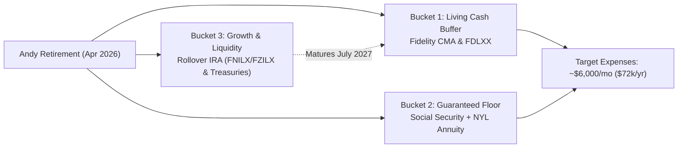

# 💰 Personal Finance & Wealth Dashboard

> [!NOTE] Strategic Second Brain vs. Cold Storage
> This dashboard is your central, live financial planning and asset management hub in Obsidian. Raw bank records, paystubs, Quicken register files, and full IRS tax forms live in local archival storage on `D:\_Personal\_Financial Statements and Tax Documents` to keep your vault fast, secure, and uncluttered. One-click links to your local file archives are provided at the bottom of this page.

---

## 🧭 Strategic Retirement Architecture (2026–2033 Bridge)

### Key Pillars
1. **Target Baseline Spending:** Modeled at **\$72,000/year after tax** (~\$6,000/month).
2. **Social Security Income:** Andy applied in 2026 (~**\$3,200 – \$3,300/month**). Andrea’s spousal benefit estimated ~\$900/month pending her full retirement at age 67 (~2033).
3. **2026 Tax Target:** Stay cleanly inside the **12% Federal Tax Bracket** (estimated MFJ AGI threshold up to ~\$136,800).
4. **2027 Cash Buffer Refill (Option A - Recommended):**
   * Execute in **January 2027**: Draw **~\$13,500 gross** from Rollover IRA (using **\$15,120 FDLXX** balance, 10% tax withholding = ~\$12,150 net to CMA).
   * Runway: Covers expenses through **July 2027**, perfectly aligning with the **\$14,800 U.S. Treasury Note maturity** in July 2027 for second-half funding without touching equities.

---

## 🤝 Financial Advisory & Professional Contacts

| Organization / Firm | Role / Advisor | Contact Information | Focus Areas |
| :--- | :--- | :--- | :--- |
| **The Mather Group** | **Luis Robles** Wealth Advisor | Client Portal Access Zoom Consultations | Comprehensive retirement modeling, portfolio allocation, Monte Carlo simulations |
| **Fidelity Investments** | **Will Martens** VP, Financial Consultant | Fidelity Client Service Rollover Specialist Team | Rollover IRA management, CMA liquidity, FDLXX/SPAXX money market, ETF strategy |
| **New York Life** | Policy Administration | Policy: `77154494` Beneficiary Confirmation On File | Fixed Annuity guaranteed income floor & survivor beneficiary allocations |

---

## 📊 Account Directory & Structural Overview

| Account / Asset | Institution | Primary Role & Strategy | Notes / Related Documents |
| :--- | :--- | :--- | :--- |
| **Rollover IRA** | Fidelity | Equities (FNILX, FZILX), Treasuries, Money Market (FDLXX, SPAXX) | [[2027 Cash Buffer Strategy 261021\|2027 Cash Buffer Strategy]] [[Fidelity Ronald McGuire IRA Rollover meeting_notes 260504\|Rollover Meeting Notes]] |
| **Cash Management (CMA)** | Fidelity | Operational checking, bill pay, debit buffer | [[The FDLXX Strategy_ Liquidity and State Tax Efficiency\|FDLXX Tax Efficiency]] |
| **Fixed Annuity** | New York Life | Policy #`77154494` — Guaranteed income floor | [[NYL Annuity Policy 77154494 Contract .pdf\|Annuity Contract]] [[NYL Annuity Policy Beneficiary Confirmation.pdf\|Beneficiary Confirmation]] |
| **Tax & Estate Plan** | CPA / Legal | 12% Tax Bracket management, RMD planning, IRMAA thresholds | [[401K conversion Plan and 2026 Tax Year Estimates\|401k Tax Estimates]] [[Navigating the 2026 Tax Brackets and IRMAA Thresholds\|IRMAA & Bracket Guide]] |

---

## 📑 Core Vault Planning & Research Links

- **Advisory Transcripts:** [[Zoom meeting with Luis @ Mather Group Notes\|Luis @ Mather Group Meeting Notes]]
- **Liquidity & Drawdowns:** [[2027 Cash Buffer Strategy 261021\|Cash Buffer Refill Plan]] • [[The Seven-Year Retirement Bridge Strategy\|7-Year Bridge Strategy]]
- **Market & ETF Knowledge:** [[Understanding ETFs Webinars - NotebookLM Report\|Understanding ETFs]] • [[5 stock market risks 261030\|5 Stock Market Risks]] • [[Where to find high yield bonds now\|High Yield Bonds]]
- **Tax Optimization:** [[401K conversion Plan and 2026 Tax Year Estimates\|401K Conversion & Tax Estimates]] • [[The FDLXX Strategy_ Liquidity and State Tax Efficiency\|State Tax-Exempt Cash Management]]

---

## 🗄️ One-Click Access to Local Financial Archives (`D:\_Personal`)

Click any link below to open the corresponding folder directly on your computer:

### 🏛️ Bank of America (Organized by Year)
- 📂 [BofA Checking Statements (2026 Active)](file:///D:/_Personal/_Financial%20Statements%20and%20Tax%20Documents/Bank%20of%20America/Bank%20of%20America%20Checking%20Statements/2026)
- 📂 [BofA Credit Card Statements (2026 Active)](file:///D:/_Personal/_Financial%20Statements%20and%20Tax%20Documents/Bank%20of%20America/Bank%20of%20America%20Credit%20Card%20Statements/2026)
- 📂 [All BofA Checking Years (2009–2026)](file:///D:/_Personal/_Financial%20Statements%20and%20Tax%20Documents/Bank%20of%20America/Bank%20of%20America%20Checking%20Statements)
- 📂 [All BofA Credit Card Years (2008–2026)](file:///D:/_Personal/_Financial%20Statements%20and%20Tax%20Documents/Bank%20of%20America/Bank%20of%20America%20Credit%20Card%20Statements)

### 📈 Fidelity Investments
- 📂 [Fidelity Monthly Statements (Official PDFs)](file:///D:/_Personal/_Financial%20Statements%20and%20Tax%20Documents/_Fidelity/Statements)
- 📂 [Fidelity Account Activity Snapshots](file:///D:/_Personal/_Financial%20Statements%20and%20Tax%20Documents/_Fidelity/Account%20Snapshots)
- 📂 [Fidelity Root Directory](file:///D:/_Personal/_Financial%20Statements%20and%20Tax%20Documents/_Fidelity)

### 📋 Taxes, Payroll, Legal & Planning
- 📂 [Official Tax Returns & IRS Documents](file:///D:/_Personal/_Financial%20Statements%20and%20Tax%20Documents/_Tax%20Returns%20and%20Documents)
- 📂 [New York Life Annuity Folders](file:///D:/_Personal/_Financial%20Statements%20and%20Tax%20Documents/_New%20York%20Life%20Annuity)
- 📂 [ADP Payroll & AVDG Paystubs](file:///D:/_Personal/_Financial%20Statements%20and%20Tax%20Documents/ADP%20(AVDG%20Payroll))
- 📂 [Social Security Administration Documents](file:///D:/_Personal/_Financial%20Statements%20and%20Tax%20Documents/_Social%20Security)
- 📂 [Mather Group Planning Portal Files](file:///D:/_Personal/_Financial%20Statements%20and%20Tax%20Documents/Mather%20Group)
- 📂 [Quicken Active Financial Database](file:///D:/_Personal/_Financial%20Statements%20and%20Tax%20Documents/Quicken)
- 📂 [Obsidian Ingestion Full Backup Archive](file:///D:/_Personal/_Financial%20Statements%20and%20Tax%20Documents/_Obsidian_Finance_Imports_Backup)
