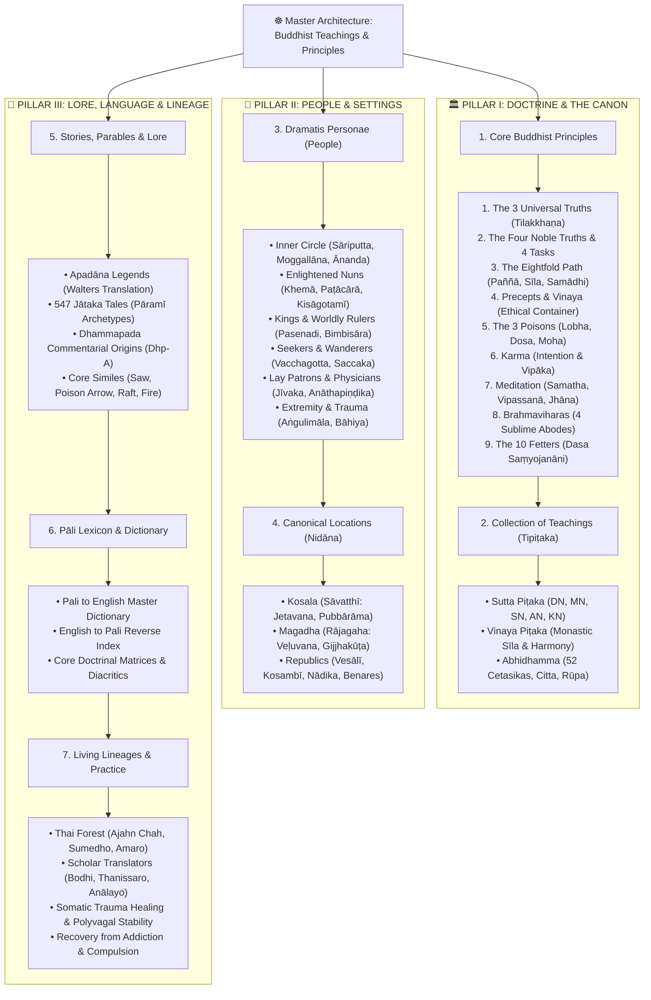
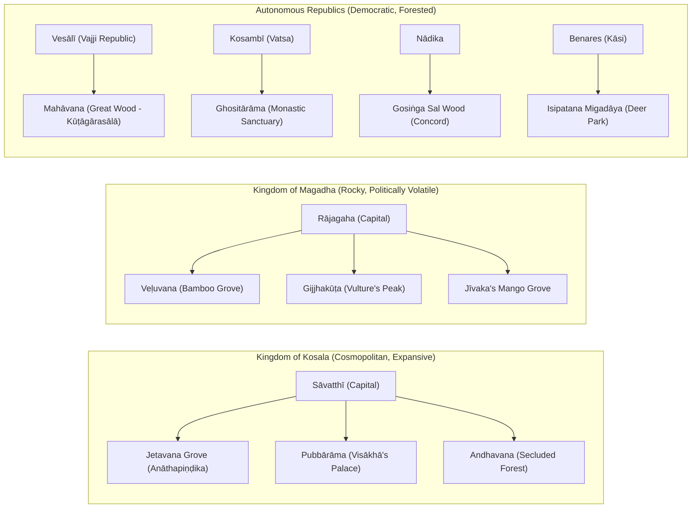

# ☸️ Master Mind Map: Buddhist Teachings, Principles & Canonical Architecture

> *"Just as the great ocean has but one taste, the taste of salt, even so this Dhamma and Vinaya has but one taste, the taste of liberation."*  
> — ***Udāna 5.5*** (*Uposatha Sutta*)

> *"When struck by an arrow, the untrained person sorrows, grieves, and laments... Thus they feel two feelings—a bodily one and a mental one. It is as if a man were pierced by an arrow, and following that, immediately pierced by a second arrow."*  
> — ***Sallatha Sutta*** (SN 36.6)

---

## 🧭 Visual System Architecture Mind Map & Interactive Canvas

> [!TIP] **Interactive Obsidian Canvas Available**
> For an infinitely zoomable, pannable, and interactive visual exploration across all 7 branches, open the native canvas:
> ➡️ **[[Buddhist Teachings & Canonical Architecture.canvas|Open Master Canvas: Buddhist Teachings & Canonical Architecture]]**

![[Master_Mind_Map_Buddhist_Teachings_and_Principles.png]]

---

### 🗂️ Click to Open Child Sub-Master Mind Maps

Select any branch below to open its dedicated architectural mind map and visual chart:

| Branch # | Child Mind Map Title | Focus & Scope | Direct Note Link |
| :-: | :--- | :--- | :--- |
| **1** | **Core Buddhist Principles** | The 9 Essential Pillars (*3 Universal Truths, 4 Noble Truths, 8-Fold Path, Precepts, 3 Poisons, Karma, Meditation, Brahmavihāras, 10 Fetters*). | ➡️ **[[_Master Mind Map - Core Buddhist Principles]]** |
| **2** | **The Tipiṭaka (The Three Baskets)** | Sutta Piṭaka (*5 Nikāyas: DN, MN, SN, AN, KN*), Vinaya Piṭaka (*Monastic discipline*), and Abhidhamma Piṭaka (*Micro-phenomenology*). | ➡️ **[[_Master Mind Map - The Tipitaka]]** |
| **3** | **Dramatis Personae (People)** | Inner Monastics, Enlightened Nuns (*Therīs*), Worldly Rulers, Seekers, Brahmins, Lay Supporters, and Outcasts/Trauma cases. | ➡️ **[[_Master Mind Map - Dramatis Personae]]** |
| **4** | **Canonical Locations (Nidāna)** | Sāvatthī (*Jetavana, Pubbārāma*), Rājagaha (*Veḷuvana, Gijjhakūṭa*), Vesālī, Kosambī, Nādika Gosiṅga Grove, Benares, Kapilavatthu. | ➡️ **[[_Master Mind Map - Canonical Locations]]** |
| **5** | **Stories, Parables & Lore** | Walters' Apadāna (*550 Theras, 40 Therīs*), 547 Jātaka tales, Dhammapada Commentarial crises, and master teaching similes. | ➡️ **[[_Master Mind Map - Stories and Parables]]** |
| **6** | **Pāli Lexicon & Master Dictionary** | Root etymologies, master alphabetical dictionary, English-Pāli reverse index, numerical formulas, and phonetic guide. | ➡️ **[[_Master Mind Map - Pali Lexicon]]** |
| **7** | **Living Lineages & Practice** | Thai Forest Tradition (*Ajahn Chah, Sumedho, Amaro*), master translators, applied somatic neuroscience, and mindful recovery. | ➡️ **[[_Master Mind Map - Living Lineages and Practice]]** |

---

### 🗺️ Interactive Structural Diagram

<b>Toggle Text Diagram Architecture</b>

 

---

## 🗂️ Detailed Navigation Portal by Major Branch

| Major Branch | Primary Scope & Doctrinal Territory | Dedicated Sub-Master Mind Map Note |
| :--- | :--- | :--- |
| **Branch 1: Core Principles & Doctrines** | The 9 foundational pillars: 3 Universal Truths, 4 Truths, 8-Fold Path, Precepts, 3 Poisons, Karma, Meditation, Brahmavihāras, 10 Fetters. | ➡️ **[[_Master Mind Map - Core Buddhist Principles]]** |
| **Branch 2: The Tipiṭaka (3 Baskets)** | Canonical structure: Sutta Piṭaka (5 Nikāyas), Vinaya Piṭaka (Ethical container), Abhidhamma (Psychology). | ➡️ **[[_Master Mind Map - The Tipitaka]]** |
| **Branch 3: Dramatis Personae (People)** | Profiles, temperaments (*carita*), backstories, and relationships to the Buddha. | ➡️ **[[_Master Mind Map - Dramatis Personae]]** |
| **Branch 4: Canonical Locations (*Nidāna*)** | The physical geography, monasteries, kingdoms, and sociopolitical atmospheres of ancient northern India. | ➡️ **[[_Master Mind Map - Canonical Locations]]** |
| **Branch 5: Stories & Parables** | The narrative lore: Apadāna past-life vows, Jātaka archetypes, Dhammapada origin tales, and core similes. | ➡️ **[[_Master Mind Map - Stories and Parables]]** |
| **Branch 6: Pāli Dictionary & Lexicon** | Dynamic master vocabulary, root etymologies, textual citations, and pronunciation standards. | ➡️ **[[_Master Mind Map - Pali Lexicon]]** |
| **Branch 7: Lineages & Modern Application** | Living Thai Forest lineage teachings, modern somatic integration, Right Speech, and mindful recovery. | ➡️ **[[_Master Mind Map - Living Lineages and Practice]]** |

---

## Branch 1: Core Buddhist Principles & Foundational Architecture

The Buddhist path is built upon nine interrelated, operational principles. These are not academic dogmas to memorize, but contemplative diagnostics and practices to cultivate in the body and heart. We will develop dedicated research reports for each:

---

### 1. The 3 Universal Truths (*Tilakkhaṇa* / Three Marks of Existence)
* **Hub Note**: `[[Core Principle - The 3 Universal Truths]]`
* **Canonical Foundation**: SN 22.59 (*Anattalakkhaṇa Sutta*), Dhp 277–279.
* **The Three Marks**:
  1. **Impermanence (*Anicca*)**: All conditioned physical and mental phenomena arise, change while standing, and vanish. Resistance to change is the seed of suffering.
  2. **Unsatisfactoriness / Stress (*Dukkha*)**: Because all conditioned things change, nothing impermanent can provide lasting, unshakeable security or final fulfillment.
  3. **Not-Self / Insubstantiality (*Anattā*)**: What is impermanent and subject to stress cannot rightfully be claimed as *"This is mine, this I am, this is my self."*
* **Somatic Dimension**: Directly experiencing the transient pulses of breath, heartbeat, and sensations in the belly—seeing that they breathe and beat on their own without an "owner."

---

### 2. The Four Noble Truths (*Cattāri Ariyasaccāni*)
* **Hub Note**: `[[Core Principle - The Four Noble Truths]]`
* **Canonical Foundation**: SN 56.11 (*Dhammacakkappavattana Sutta*), MN 141 (*Saccavibhaṅga Sutta*).
* **The Four Truths & Four Active Duties**:
  * **1. Dukkha (Suffering / Friction)** $\rightarrow$ **To be fully understood** (*Pariññeyya*). Met with open somatic inquiry rather than denial or self-gaslighting.
  * **2. Samudaya (The Origin: Craving / Taṇhā)** $\rightarrow$ **To be abandoned** (*Pahātabba*). Releasing the compulsive thirst for sensuality (*kāma-taṇhā*), becoming (*bhava-taṇhā*), and non-becoming (*vibhava-taṇhā*).
  * **3. Nirodha (The Cessation: Nibbāna)** $\rightarrow$ **To be realized** (*Sacchikātabba*). Experiencing the unconditioned stillness when craving is extinguished.
  * **4. Magga (The Noble Eightfold Path)** $\rightarrow$ **To be cultivated** (*Bhāvetabba*). Living the integrated middle way.

---

### 3. The Eightfold Path (*Ariya Aṭṭhaṅgika Magga*)
* **Hub Note**: `[[Core Principle - The Eightfold Path]]`
* **Canonical Foundation**: MN 117 (*Mahācattārīsaka Sutta*), DN 22 (*Mahāsatipaṭṭhāna Sutta*).
* **The Threefold Training (*Tisikkhā*) Matrix**:
  | Training Division | Path Factor (Pāli) | Meaning in Action |
  | :--- | :--- | :--- |
  | **Wisdom (*Paññā*)** | `Sammā-diṭṭhi` (Right View) `Sammā-saṅkappa` (Right Intention) | Seeing through the lens of the 4 Truths & karma. Resolves of renunciation (*nekkhamma*), non-ill-will, and harmlessness (*ahiṃsā*). |
  | **Ethics (*Sīla*)** | `Sammā-vācā` (Right Speech) `Sammā-kammanta` (Right Action) `Sammā-ājīva` (Right Livelihood) | Truthful, timely, gentle, and beneficial communication. Refraining from harming living beings, stealing, and sexual misconduct. Engaging in work that supports life without exploitation. |
  | **Stillness (*Samādhi*)** | `Sammā-vāyāma` (Right Effort) `Sammā-sati` (Right Mindfulness) `Sammā-samādhi` (Right Concentration) | Guarding the mind: preventing and abandoning unwholesome states; cultivating wholesome ones. Anchoring in the 4 Foundations of Mindfulness (*body, feelings, mind, dhammas*). Unified absorption (*Jhāna*) free from hindrances. |

---

### 4. Precepts & Vinaya (*Sīla & Saṃvara*)
* **Hub Note**: `[[Core Principle - Precepts and Vinaya]]`
* **Canonical Foundation**: AN 8.39 (*Abhisanda Sutta*), Vinaya Suttavibhaṅga.
* **The Ethical Container**:
  * **The Five Precepts (*Pañcasīla*)**: The bedrock of psychological safety: non-harming (*pāṇātipātā*), non-stealing (*adinnādānā*), sexual integrity (*kāmesumicchācārā*), truthful speech (*musāvādā*), and sobriety (*surāmerayamajjapamādaṭṭhānā*).
  * **The Eight Precepts (*Aṭṭhaṅgasīla*)**: Uposatha practice refining simplicity, fasting after noon, and sense-moderation.
  * **The Monastic Vinaya (*Pātimokkha*)**: Communal covenants safeguarding harmony, resolving disputes, and shielding the meditative container.
* **Contemplative Resonance**: Sīla produces **non-remorse (*avippaṭisāra*)**. When our behavior is harmless, the nervous system ceases running defensive loops, creating the settled ease needed for meditation.

---

### 5. The 3 Poisons (*Tīṇi Akusalamūlāni* / Root Kilesas)
* **Hub Note**: `[[Core Principle - The 3 Poisons]]`
* **Canonical Foundation**: AN 3.68 (*Mūla Sutta*), MN 7 (*Vatthūpama Sutta*).
* **The Root Toxins & Their Antidotes**:
  1. **Greed / Craving (*Lobha / Rāga*)**: The pull to possess, consume, and hoard. *Antidote*: Generosity (*dāna*), contentment (*santuṭṭhi*), and contemplation of impermanence.
  2. **Hatred / Aversion (*Dosa*)**: The push away, irritation, resentment, and hostility. *Antidote*: Loving-kindness (*mettā*), compassion (*karuṇā*), and patience (*khanti*).
  3. **Delusion / Ignorance (*Moha / Avijjā*)**: Lack of clear awareness, dullness, and confusing the conditioned for permanent happiness. *Antidote*: Wise reflection (*yoniso manasikāra*) and penetrative wisdom (*paññā*).
* **Somatic Imprint**: Greed creates forward-leaning grasping; aversion knots the stomach and throat; delusion creates brain fog and heavy collapse.

---

### 6. Karma (*Kamma & Vipāka*)
* **Hub Note**: `[[Core Principle - Karma and Volition]]`
* **Canonical Foundation**: AN 6.63 (*Nibbedhika Sutta* - *"Intention, monks, is what I call karma"*), MN 135 (*Cūḷakammavibhaṅga Sutta*).
* **Key Principles**:
  * **Volition as Action (*Cetanā*)**: Karma is not fate or external judgment; it is the imprint left on the heart-mind by intentional choices through body, speech, and thought.
  * **Cause (*Hetu*) and Fruit (*Vipāka*)**: Wholesome actions (*kusala*) produce ease and mental brightness; unwholesome actions (*akusala*) produce affliction and internal distress.
  * **Non-Fatalism**: Past karma conditions the cards we are dealt in the present moment, but present mindfulness (*sati*) determines how we play the hand.

---

### 7. Meditation (*Bhāvanā & Samādhi*)
* **Hub Note**: `[[Core Principle - Meditation and Jhana]]`
* **Canonical Foundation**: MN 10 (*Satipaṭṭhāna Sutta*), MN 118 (*Ānāpānasati Sutta*), MN 128 (*Upakkilesa Sutta*).
* **The Meditative Spectrum**:
  * **Calm (*Samatha*) & Insight (*Vipassanā*)**: Two sides of a single practice—stillness unifies the mind, insight dissolves grasping.
  * **The 4 Foundations of Mindfulness (*Satipaṭṭhāna*)**: Mindfulness of Body (*Kāya*), Feelings (*Vedanā*), Mind-States (*Citta*), and Reality Principles (*Dhammā*).
  * **Overcoming the 5 Hindrances (*Nīvaraṇāni*)**: Sensual desire, ill-will, sloth/torpor, restlessness/remorse, and skeptical doubt.
  * **The 4 Jhānas**: Progressive stages of collected meditative stillness and rapture culminating in pure, unshakeable equanimity.

---

### 8. The Brahmaviharas (*Cattāro Brahmavihārā* / Sublime Abodes)
* **Hub Note**: `[[Core Principle - The Brahmaviharas]]`
* **Canonical Foundation**: MN 55 (*Jīvaka Sutta*), DN 13 (*Tevijja Sutta*), SN 46.54.
* **The Four Boundless Hearts**:
  1. **Loving-Kindness (*Mettā*)**: The wish for genuine welfare and happiness for all beings without exclusion. *Near enemy*: Clinging affection. *Far enemy*: Ill-will / Hatred.
  2. **Compassion (*Karuṇā*)**: The trembling of the open heart when meeting suffering, without turning away. *Near enemy*: Pity / Sentimental grief. *Far enemy*: Cruelty.
  3. **Appreciative Joy (*Muditā*)**: Rejoicing in the good fortune, virtue, and success of others. *Near enemy*: Vicarious exuberance. *Far enemy*: Envy / Jealousy.
  4. **Equanimity (*Upekkhā*)**: Spacious, balanced neutrality rooted in understanding conditionality and karma. *Near enemy*: Cold indifference / Apathy. *Far enemy*: Agitation / Clinging.

---

### 9. The 10 Fetters (*Dasa Saṃyojanāni*) & The Stages of Awakening
* **Hub Note**: `[[Core Principle - The 10 Fetters]]`
* **Canonical Foundation**: MN 64 (*Mahāmāluṅkya Sutta*), SN 45.179.
* **The Progressive Severing of Mental Bonds**:
  | Category | Fetter (Pāli) | English Meaning | Severed at Stage |
  | :--- | :--- | :--- | :--- |
  | **Five Lower Fetters** *(Orambhāgiya)* Binds mind to the sensual realm | 1. `Sakkāya-diṭṭhi` 2. `Vicikicchā` 3. `Sīlabbata-parāmāsa` 4. `Kāmarāga` 5. `Byāpāda` | Personality view / illusion of separate self Skeptical doubt in the path Attachment to rites and rituals as saving Sensual desire / craving Ill-will / aversion / resentment | **Stream-Entry (*Sotāpatti*)** severs 1–3.  **Once-Returner (*Sakadāgāmī*)** weakens 4–5.  **Non-Returner (*Anāgāmī*)** fully severs 4–5. |
  | **Five Higher Fetters** *(Uddhambhāgiya)* Binds mind to subtle existence | 6. `Rūparāga` 7. `Arūparāga` 8. `Māna` 9. `Uddhacca` 10. `Avijjā` | Craving for fine-material rebirth / jhānic form Craving for formless existence Conceit ("I am better, worse, equal") Subtle mental restlessness / vibration Fundamental ignorance of true nature | **Arahantship** fully destroys all remaining fetters (6–10), attaining complete unshakeable release (*Akuppā Cetovimutti*). |

---

---

## Branch 2: The Collection of Teachings (The Tipiṭaka)

The classical Pāli Canon is structured into three primary baskets:

### 1. Sutta Piṭaka (The Basket of Discourses)
* **Dīgha Nikāya (DN)**: 34 long discourses. Public philosophical debates, cosmological vistas, societal ethics (*Sigālovāda Sutta*, DN 31), and the final days of the Buddha (*Mahāparinibbāna Sutta*, DN 16).
* **Majjhima Nikāya (MN)**: 152 middle-length discourses. The living heart of interpersonal encounters: deep psychological analyses, dialogues with kings, wanderers, physicians, novices, and killers. Indexed in `[[Majjhima_Nikaya_Master_Interlocutors_and_Contextual_Index]]`.
* **Saṃyutta Nikāya (SN)**: 2,889 thematic discourses grouped into 56 Saṃyuttas (e.g., Kosala, Mara, Dependent Arising, Aggregates, Sense Bases, Feelings/Sallatha, Truths).
* **Aṅguttara Nikāya (AN)**: Numerical discourses arranged in 11 Nipātas (from the Ones to the Elevens). Practical everyday ethics, community life, obstacles (*Kantaka Sutta*, AN 10.72), and lineages (*Ariyavaṃsa Sutta*, AN 4.28).
* **Khuddaka Nikāya (KN)**: The Minor Collection. 15 diverse texts of verse and narrative:
  * *Dhammapada (Dhp)*: 423 aphorisms on mind, vigilance, and liberation.
  * *Udāna (Ud)*: Exclamations of awakening and origin events (e.g., Meghiya, Bāhiya).
  * *Itivuttaka (Iti)*: "Thus Was Said" concise doctrinal verses.
  * *Sutta Nipāta (Snp)*: Archaic verse masterpieces (*Aṭṭhakavagga*, *Pārāyanavagga*).
  * *Theragāthā & Therīgāthā (Thag / Thig)*: Verses of the enlightened elders and nuns.
  * *Jātaka*: 547 past-life rebirth stories illustrating the perfections.
  * *Apadāna*: Heroic hagiographies and past vows of 550 Theras and 40 Therīs.

### 2. Vinaya Piṭaka (The Basket of Monastic Discipline)
* **Suttavibhaṅga**: The monastic training rules (*Pātimokkha*) for monks and nuns with detailed origin stories (*nidāna*) showing the human errors that necessitated each precept.
* **Khandhaka (Mahāvagga & Cullavagga)**: Communal procedures, ordination rites, medicine, robe-making, schisms (*Kosambī*), and assembly protocols.
* **Parivāra**: Analytical summaries and catechisms.

### 3. Abhidhamma Piṭaka (The Basket of Ultimate Realities)
* Seven treatises (*Dhammasaṅgaṇī*, *Vibhaṅga*, *Dhātukathā*, *Puggalapaññatti*, *Kathāvatthu*, *Yamaka*, *Paṭṭhāna*).
* Breaks conventional reality down into four ultimate truths (*paramattha-sacca*): Consciousness (*Citta*), Mental Factors (*52 Cetasikas*), Material Form (*Rūpa*), and Unconditioned Peace (*Nibbāna*).

---

## Branch 3: Dramatis Personae (People & Interlocutors)

The suttas come alive through their human participants:

| Category | Canonical Figures | Relationship to Buddha | Primary Sutta Encounters |
| :--- | :--- | :--- | :--- |
| **Chief Monastics** | Sāriputta, Mahā-Moggallāna, Mahākassapa, Anuruddha, Ānanda | Disciples, assistants, spiritual brothers | MN 31 (Concord), MN 121 (Emptiness), MN 141 (Saccavibhaṅga) |
| **Enlightened Nuns** | Mahāpajāpatī Gotamī, Khemā, Uppalavaṇṇā, Paṭācārā, Kisāgotamī | Aunt, noble disciples, former mothers in grief | Thig, SN 5 (Bhikkhunī Saṃyutta), AN 1 (Etadagga) |
| **Worldly Rulers** | King Pasenadi of Kosala, King Bimbisāra, King Ajātasattu | Patrons, governance leaders, anxious seekers | MN 87, MN 89, MN 90, SN 3 (Kosalasaṃyutta), DN 2 |
| **Philosophers & Wanderers** | Vacchagotta, Dīghanakha, Saccaka, Poṭaliputta | Sincere seekers, combative debaters, skeptics | MN 36, MN 71, MN 72 (Aggivacchagotta), MN 73, MN 74 |
| **Vedic Scholars & Brahmins** | Assalāyana, Caṅkī, Jāṇussoṇi, Pokkharasāti | Traditional elite, proud scholars, skeptics | MN 93 (Assalāyana), MN 95 (Caṅkī), DN 3 (Ambaṭṭha) |
| **Householders & Lay Patrons** | Anāthapiṇḍika, Visākhā, Jīvaka Komārabhacca, Citta | Chief donors, medical carers, mature lay scholars | MN 55 (Jīvaka), MN 143 (Anāthapiṇḍikovāda), SN 41 (Citta) |
| **Trauma & Extremity Cases** | Aṅgulimāla, Raṭṭhapāla, Bāhiya Dārucīriya, Suppabuddha | Outlaws, radical renunciates, dying seekers | MN 86 (Aṅgulimāla), MN 82 (Raṭṭhapāla), Ud 1.10 (Bāhiya) |

---

## Branch 4: Canonical Locations & Monastic Sanctuaries

The geographical setting (*nidāna*) set the social tone and atmospheric container of the teachings:

* **Jetavana in Sāvatthī**: Donated by Anāthapiṇḍika; the site of hundreds of foundational teachings, where the Buddha spent 19 rainy season retreats (*vassa*).
* **Veḷuvana in Rājagaha**: Donated by King Bimbisāra; set amidst rocky peaks, home to intense meditative strivings and court challenges.
* **Mahāvana in Vesālī**: The forested monastery outside the bustling Licchavi republic; site where the Order of Nuns (*Bhikkhunī Saṅgha*) was formally established.
* **Ghositārāma in Kosambī**: The monastic settlement marked by human vulnerability—the site of the famous dispute, followed by deep reconciliation (*Kosambiya Sutta*, MN 48).
* **Gosiṅga Sal Wood in Nādika**: The quiet sal forest where Anuruddha, Nandiya, and Kimbila lived "blending like milk and water" (*Cūḷagosiṅga Sutta*, MN 31).

---

## Branch 5: Stories, Parables, Narratives & Commentarial Lore

The Dhamma speaks directly to the subconscious through narrative archetypes and vivid everyday similes:

### 1. Narrative Literature
* **The Apadāna Legends**: Jonathan Walters' translation ([Walters Apadāna Translation PDF](file:///G:/Google%20Drive%20(260611)/Obsidian%20Master%20Vault/Flashrebob%20Obsidian/_A_My%20Research/_Buddhism/Apadana_%20Legends%20of%20the%20Buddhist%20Saints%20(v2022)%20-%20Jonathan%20Walters.pdf)). Captures the long trajectories of the 550 Theras and 40 Therīs, showing how spiritual maturity ripens over long spans of intentional ethical momentum (*abhinīhāra*).
* **The Jātaka Tales**: 547 narrative episodes illustrating how the Bodhisatta cultivated the ten perfections (*dāna, sīla, nekkhamma, paññā, viriya, khanti, sacca, adhiṭṭhāna, mettā, upekkhā*) amidst worldly adversity.
* **The Dhammapada Origin Stories (*Dhammapada-aṭṭhakathā*)**: Real-life human dramas (bereavement, jealousy, monastic squabbles, royal intrigue) that prompted specific verse utterances.

### 2. Master Pedagogical Similes (*Upāya-kosalla*)
* **The Simile of the Saw (*Kakacūpama*, MN 21)**: Even if bandits saw through one's limbs with a two-handled saw, the heart must remain anchored in goodwill (*mettā*), free from ill-will.
* **The Poison Arrow (*Cūḷamāluṅkya*, MN 63)**: A man struck by a poisoned arrow does not demand to know the caste, name, or feather-type of the archer before pulling out the arrow. Practice addresses the immediate arrow of suffering, not speculative ontology.
* **The Raft Simile (*Alagaddūpama*, MN 22)**: The Dhamma is like a raft built to cross a treacherous river; once safely across to the far shore, the raft is laid down, not carried on one's head.
* **The Extinguished Fire (*Aggivacchagotta*, MN 72)**: When a fire exhausts its fuel and goes out, it cannot be said to have gone east, west, north, or south. Terms of existence do not apply to the unconditioned release of Nibbāna.
* **The Two Acrobats (*Sedaka*, SN 47.19)**: The master acrobat tells the assistant: *"You watch yourself, and I will watch myself; thus guarded by our own balance, we will perform safely."* Tending one's own awareness protects the community; cultivating patience protects oneself.

---

## Branch 6: Pāli Language & Master Dictionary Portal

Our master lexicon serves as the semantic bedrock across all research files:

* **Primary Lexicon Note**: [`Pali to English Dictionary.md`](file:///G:/Google%20Drive%20(260611)/Obsidian%20Master%20Vault/Flashrebob%20Obsidian/_A_My%20Research/My%20Pali%20Dictionary/Pali%20to%20English%20Dictionary.md). Alphabetical glossary from A to Z with:
  * Primary Translation
  * Literal Root Etymology
  * Category / Domain
  * Doctrinal Definition
  * Contemporary Living Teacher Context
  * Cross-linked Pāli synonyms and related terms
* **Reverse Concept Index**: `[[English to Pali-Sanskrit Index]]`.
* **Structured Numerical Matrices**: `[[_Pali Core Doctrinal Lists & Formulas]]`.
* **Pronunciation & Diacritical Precision Guide**: Detailed in `[[_Master Mind Map - Pali Dictionary]]`.

---

## Branch 7: Living Lineages & Contemplative Applications

The ancient Canon meets modern human life through living monastic lineages and applied somatic wisdom:

### 1. The Thai Forest Tradition (*Kammatthana*)
* **Ajahn Chah**: Direct, naturalistic, earthy Dhamma. Non-clinging (*"If you let go a little, you will have a little peace; if you let go a lot, you will have a lot of peace; if you let go completely, you will have complete peace"*).
* **Ajahn Sumedho**: The Sound of Silence (*nāda-sound*), Intuitive Awareness, resting as the Unconditioned Knowing (*buddho*), dissolving the "I am" construct (*sakkāya-diṭṭhi*).
* **Ajahn Amaro, Ajahn Sucitto, Ajahn Pasanno**: Bridging classical Pāli scholarship, somatic breath awareness, monastic vinaya, and contemporary Western psychological needs.

### 2. Scholarly Translators
* **Bhikkhu Bodhi**: Comprehensive English translations of the four major Nikāyas; rigorous doctrinal analysis.
* **Thanissaro Bhikkhu**: Action-oriented Dhamma (*kamma*), breath energy mechanics, and forest tradition translations.
* **Ven. Anālayo**: Comparative early Buddhist research (Pāli suttas, Chinese Āgamas, Tibetan fragments) and Satipaṭṭhāna clinical integration.

### 3. Applied Somatic & Relational Domains in the Vault
* **The Polyvagal & Somatic Ground**: The belly, chest, and throat reflect the mind's threat response. Conditionality (*idappaccayatā*) teaches that tightness is a biological reflex, not a personal failing.
* **Recovery from Addiction & Compulsion**: Mapped in `[[Report - The Architecture of Recovery - Sakkaya-Diṭṭhi, Trauma, Sangha, and the Path from Compulsion to Liberation]]`. Interrupting craving at the feeling-tone (*vedanā*) threshold; finding safe relational refuge in the Sangha.
* **The Architecture of Right Speech**: Timely, truthful, gentle, beneficial, and spoken with a mind of goodwill (*AN 5.198*).
* **Communal Concord**: Surrendering rigid self-will (*citta-parivattana*) to blend with companions like milk and water (`[[Culagosinga_Sutta_MN_31_Living_in_Concord_Blending_Like_Milk_and_Water]]`).

---

## 🎯 How to Use This Master Mind Map Note

1. **Top-Level Orienting Portal**: Whenever opening a new sutta research project, blog post, or Dhamma talk, start here to locate the intersection of **Principle**, **Person**, **Location**, and **Somatic Application**.
2. **Dataview & Graph View Anchor**: Because this document links the primary thematic hubs, it serves as the central super-node in Obsidian’s interactive Graph View.
3. **Cross-Referencing**: Follow the companion note links to drill down into specific suttas, dossiers, and dictionary entries.
