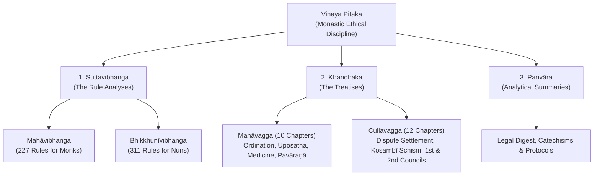
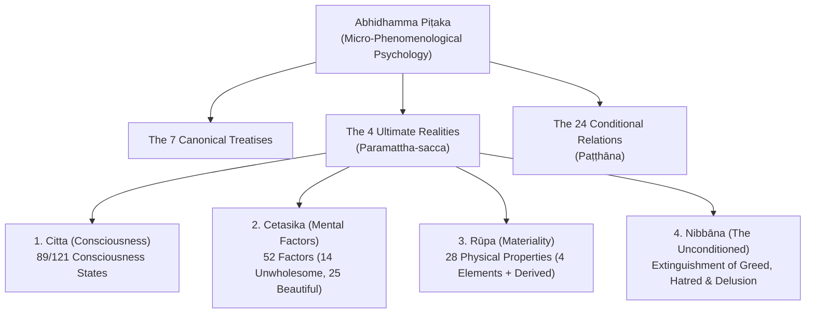

# 📚 Master Mind Map: The Tipiṭaka (The Three Baskets)

> *"The Dhamma and the Vinaya that I have set forth and made known to you, that shall be your Teacher after I am gone."*  
> — ***Mahāparinibbāna Sutta*** (Dīgha Nikāya 16)

---

## 🧭 Visual Canonical Mind Map

![[Master_Mind_Map_The_Tipitaka.png]]

---

## 🗂️ The Three Baskets Navigation Portal

| The Basket | Pāli Title | Teaching Category | Core Function in the Holy Life | Direct Note Link |
| :--- | :--- | :--- | :--- | :--- |
| **I. Sutta Piṭaka** | *Suttapiṭaka* | Conventional Teaching (*Vohāra-desanā*) | Cultivates **Gathered Stillness (*Samādhi*) & Penetrative Insight** through contextual discourses and pedagogical dialogues. | [[#1 Sutta Piṭaka — The Basket of Discourses]] |
| **II. Vinaya Piṭaka** | *Vinayapiṭaka* | Prescriptive Authority (*Āṇā-desanā*) | Cultivates **Ethical Purity (*Sīla*) & Non-Remorse (*Avippaṭisāra*)**, shielding the meditative mind and harmonizing the Sangha. | [[#2 Vinaya Piṭaka — The Basket of Monastic Discipline]] |
| **III. Abhidhamma Piṭaka** | *Abhidhammapiṭaka* | Ultimate Reality (*Paramattha-desanā*) | Cultivates **Sharp Wisdom (*Paññā*)** through microscopic analysis of consciousness, mental factors, and causality. | [[#3 Abhidhamma Piṭaka — The Basket of Higher Doctrine]] |

---

## 1. Sutta Piṭaka — The Basket of Discourses

The Sutta Piṭaka contains the living conversations of the Buddha and his foremost disciples. It is divided into five great collections (*Nikāyas*):

### 1.1 Dīgha Nikāya (DN) — The Long Discourses
* **Structure**: 34 extensive discourses organized into 3 divisions (*Vaggas*): *Sīlakkhandhavagga*, *Mahāvagga*, *Pāthikavagga*.
* **Character**: Grand philosophical debates with royal courts and Vedic scholars; societal blueprints; cosmology; and the definitive account of the Buddha’s final year.
* **Essential Discourses**:
  * **DN 2: Sāmaññaphala Sutta**: The visible fruits of the contemplative life, from preliminary ethical restraint to the four jhānas and liberating knowledge.
  * **DN 16: Mahāparinibbāna Sutta**: The final walking tour, the last instructions, the passing into parinibbāna, and the distribution of relics.
  * **DN 22: Mahāsatipaṭṭhāna Sutta**: The comprehensive exposition of the Four Foundations of Mindfulness.
  * **DN 31: Sigālovāda Sutta**: The householder’s code of reciprocal social relationships (parents, teachers, spouses, friends, workers, ascetics).

### 1.2 Majjhima Nikāya (MN) — The Middle-Length Discourses
* **Structure**: 152 dialogues arranged in 15 chapters (*Vaggas*).
* **Character**: The premier narrative heart of early Buddhism. Human encounters, psychological analyses, debate psychology, tailored similes, and deep meditation instructions.
* **Master Interlocutor Index**: See [`Majjhima_Nikaya_Master_Interlocutors_and_Contextual_Index`](file:///G:/Google%20Drive%20(260611)/Obsidian%20Master%20Vault/Flashrebob%20Obsidian/_A_My%20Research/_Antigravity%20Spiritual%20Reports/Majjhima_Nikaya_Master_Interlocutors_and_Contextual_Index.md).
* **Key Encounters**:
  * *MN 10 (Satipaṭṭhāna)*: Operational mindfulness.
  * *MN 21 (Kakacūpama)*: The Simile of the Saw on non-retaliation.
  * *MN 31 (Cūḷagosiṅga)*: Blending like milk and water; communal harmony (`[[Culagosinga_Sutta_MN_31_Living_in_Concord_Blending_Like_Milk_and_Water]]`).
  * *MN 61 & 62 (Rāhulovāda)*: The mirror of moral reflection and element contemplation.
  * *MN 72 (Aggivacchagotta)*: The extinguished fire and speculative views.
  * *MN 86 (Aṅgulimāla)*: Radical redemption and stopping.
  * *MN 118 (Ānāpānasati)*: The 16 steps of breath mindfulness.
  * *MN 128 (Upakkilesa)*: The 11 mental corruptions obstructing samādhi (`[[Upakkilesa_Sutta_MN_128_Imperfections_and_Mental_Thorns_to_Samadhi]]`).

### 1.3 Saṃyutta Nikāya (SN) — The Connected Discourses
* **Structure**: 2,889 short discourses categorized into 56 themed chapters (*Saṃyuttas*) across 5 great books (*Vaggas*).
* **Character**: Precise doctrinal inquiries arranged systematically by subject matter.
* **Essential Saṃyuttas**:
  * **SN 12: Nidānasaṃyutta**: The definitive analysis of the 12 links of Dependent Origination (*Paṭiccasamuppāda*).
  * **SN 22: Khandhasaṃyutta**: Deconstruction of the five aggregates (*khandhā*) as impermanent, unsatisfactory, and not-self.
  * **SN 35: Saḷāyatanasaṃyutta**: The six internal and external sense bases; burning fire of the senses (*Adittapariyāya*).
  * **SN 36: Vedanāsaṃyutta**: The feeling tones; contains the famous **Sallatha Sutta** (SN 36.6) on the **Two Arrows**.
  * **SN 47: Satipaṭṭhānasaṃyutta**: Establishing mindfulness; the acrobat simile (*Sedaka Sutta*, SN 47.19).
  * **SN 56: Saccasaṃyutta**: The Four Noble Truths; contains the First Sermon (*Dhammacakkappavattana Sutta*, SN 56.11).

### 1.4 Aṅguttara Nikāya (AN) — The Numbered Discourses
* **Structure**: Over 9,500 discourses arranged progressively in 11 sections (*Nipātas*), from the Book of the Ones (*Ekakanipāta*) to the Book of the Elevens (*Ekādasakanipāta*).
* **Character**: Highly practical, catalog-style teachings covering everyday social ethics, community dynamics, governance, psychological obstacles, and progressive spiritual qualities.
* **Key Discourses**:
  * *AN 3.65 (Kesamutti / Kālāma Sutta)*: Charter of free inquiry beyond dogma and tradition.
  * *AN 4.28 (Ariyavaṃsa Sutta)*: The four noble lineages of monastic contentment (`[[Ariyavamsa_Sutta_AN_4.28_The_Four_Noble_Lineages]]`).
  * *AN 4.95 (Chavālāta Sutta)*: Practicing for one's own welfare and the welfare of others.
  * *AN 10.72 (Kantaka Sutta)*: The ten thorns to meditation (`[[Kantaka_Sutta_AN_10.72_Thorns_to_Meditation]]`).

### 1.5 Khuddaka Nikāya (KN) — The Minor Collection
The treasury of early Buddhist verse, parables, and saint biographies. It comprises 15 canonical texts:
1. **Dhammapada (Dhp)**: 423 immortal aphorisms on vigilance, mind, and the path to freedom.
2. **Udāna (Ud)**: 80 exclamations of joy and awakening, each prefaced by its historical origin story (*Meghiya*, *Bāhiya*).
3. **Itivuttaka (Iti)**: 112 concise discourses beginning with *"Thus was said by the Blessed One"*.
4. **Sutta Nipāta (Snp)**: Some of the most archaic verse in the Canon (*Aṭṭhakavagga* and *Pārāyanavagga*), emphasizing direct non-clinging.
5. **Theragāthā (Thag)**: "Verses of the Elders" — 264 poems spoken by enlightened monks recounting their breakthroughs.
6. **Therīgāthā (Thig)**: "Verses of the Senior Nuns" — 73 moving poems of women transforming trauma, grief, and societal oppression into awakening.
7. **Jātaka**: 547 narrative tales illustrating the Bodhisatta’s perfection of the ten pāramīs across past lives. See [[Report - The Jataka Rebirth Tales - Pāramī Archetypes and Canonical Narratives|Detailed Study: Jātaka Rebirth Tales & Pāramī Archetypes ↗]].
8. **Apadāna**: Jonathan Walters' translation ([Walters Apadāna Translation PDF](file:///G:/Google%20Drive%20(260611)/Obsidian%20Master%20Vault/Flashrebob%20Obsidian/_A_My%20Research/_Buddhism/Apadana_%20Legends%20of%20the%20Buddhist%20Saints%20(v2022)%20-%20Jonathan%20Walters.pdf)). 550 legends of Theras and 40 legends of Therīs detailing their original vows and long spiritual preparation.
9. *Other KN Texts*: Khuddakapāṭha, Vimānavatthu, Petavatthu, Niddesa, Paṭisambhidāmagga, Buddhavaṃsa, Cariyāpiṭaka.

---

## 2. Vinaya Piṭaka — The Basket of Monastic Discipline

The Vinaya provides the institutional, relational, and somatic container for the spiritual community. Rather than arbitrary legalism, each rule was established in real-time response to human friction:

* **1. Suttavibhaṅga**: Contains the *Pātimokkha* code. Every single precept is accompanied by its **origin story (*nidāna*)**, naming the monk or nun involved, the mistake made, the community’s reaction, and the Buddha’s formulation of the rule.
* **2. Khandhaka**:
  * **Mahāvagga**: Establishes community rituals: *Upasampadā* (higher ordination), the bi-weekly *Uposatha* recitation, the *Pavāraṇā* invitation for feedback, robe-making protocols (*Kaṭhina*), and medical care for the sick.
  * **Cullavagga**: Details the seven formal methods for settling legal disputes (*Adhikaraṇa-samatha*), the reconciliation of the Kosambī dispute (`[[Kosambiya_Sutta_MN_48_Discourse_at_Kosambi]]`), the founding of the Nuns' Order, and the proceedings of the First Council at Rājagaha.
* **3. Parivāra**: A systematic manual analyzing rules by origin, intention, fault, and legal gravity.

---

## 3. Abhidhamma Piṭaka — The Basket of Higher Doctrine

The Abhidhamma strips away conventional narrative (*interlocutors, personalities, locations*) and maps reality from the perspective of moment-to-moment phenomenological micro-events:

### 3.1 The Seven Canonical Treatises
1. **Dhammasaṅgaṇī**: Enumeration and classification of all physical and mental phenomena.
2. **Vibhaṅga**: The Book of Analysis (18 treatises examining the aggregates, sense bases, truths, dependent origination, jhānas).
3. **Dhātukathā**: Discussion of elements and mental factors.
4. **Puggalapaññatti**: Description of human personality types according to spiritual development.
5. **Kathāvatthu**: "Points of Controversy" — 216 debates refuting sectarian distortions, compiled by Moggaliputta Tissa at the Third Council under Emperor Asoka.
6. **Yamaka**: "The Book of Pairs" — logical analysis using dialectical questioning.
7. **Paṭṭhāna**: "The Book of Causal Relations" — the crowning masterpiece analyzing the 24 universal conditions (*paccayas*) governing all reality.

---

## 🔗 Parent & Child Mind Map Navigation

* **Return to Master Mind Map**: [[_Master Mind Map - Buddhist Teachings and Principles]]
* **Explore Sutta Interlocutors (Majjhima)**: [[Majjhima_Nikaya_Master_Interlocutors_and_Contextual_Index]]
* **Explore Vocabulary & Etymology**: [[Pali to English Dictionary]]
