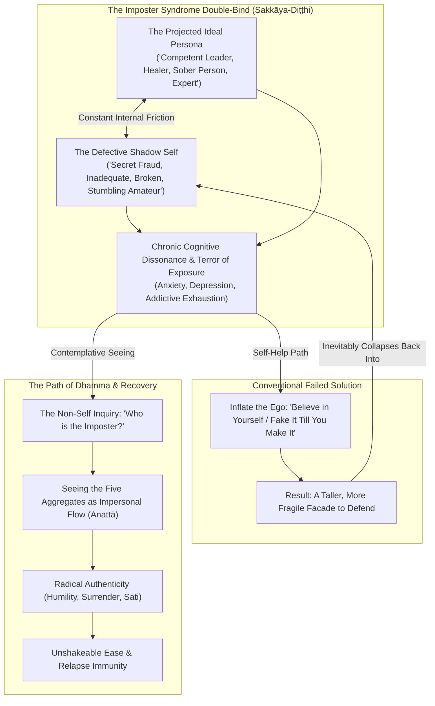
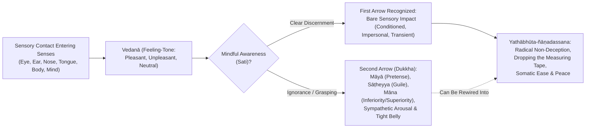
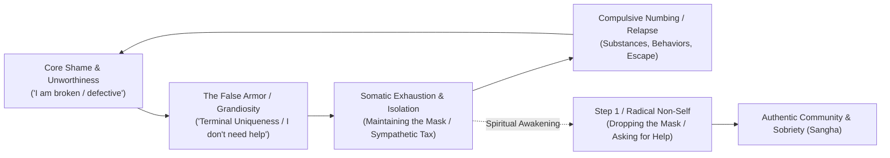

# 🌿 Authenticity, Imposter Syndrome, Recovery, and Mental Health: The Dissolution of *Sakkāya-Diṭṭhi*
### *Bridging the Divided Self: From the Measuring Mind to Inherent Completeness*

> *"And I kind of give them a look like, 'Oh boy, look at this guy' kind of thing, you know? And it's funny—I'm a drunk. Why would I do that? It's really questioning my egotism and how I can add a lot of labels that aren't really accurate..."*  
> — **Andy McGuire**, *Personal Reflection on Selfish Ego* (October 13, 2024)

> *"He regards form as self, or self as possessing form, or form as in self, or self as in form. He regards feeling as self... perception as self... volitional formations as self... consciousness as self... This is called personality view (sakkāya-diṭṭhi). For an uninstructed run-of-the-mill person, touched by the feeling born of contact with ignorance, there arises 'I am.'"*  
> — ***Mahāpuṇṇama Sutta*** (MN 109)

> *"By oneself is oneself evaluated; by oneself is oneself understood. Therefore, watch over yourself, as a trader watches over a fine steed... A mind that does not measure itself as superior, equal, or inferior to anyone is a mind at rest."*  
> — ***Soṇa Sutta*** (AN 6.55) & ***Dhammapada*** 379

> *"When touched by a painful bodily feeling, the uninstructed worldling sorrows, grieves, and laments... They feel two feelings: a bodily one and a mental one. It is as if they were pierced by an arrow, and right after were pierced by a second arrow."*  
> — ***Sallatha Sutta*** (SN 36.6)

---

## Opening & Contextual Metadata

### 1. Location
The reflections and practical inquiries in this work emerge from the grounded spaces of everyday living: recovery meeting halls, meditation cushions, quiet conversations in home living rooms, the aisles of local markets, and contemplative retreats. Canonically, these teachings are anchored in the historical sites where the Buddha systematically dismantled the mechanics of identity: the **Gabled Hall in the Great Wood at Vesālī**, **Mount Vulture Peak in Rājagaha** (*Soṇa Sutta*, AN 6.55, on tuning effort and releasing conceit), and **Eastern Park at Sāvatthī** in the Palace of Migāra’s Mother (*Mahāpuṇṇama Sutta*, MN 109, on the twenty forms of personality view).

### 2. Circumstances
The teaching addresses the universal, exhausting modern affliction of **imposter syndrome**, chronic self-doubt, perfectionism, and the split between the mask presented to the public and the private vulnerability felt within. It investigates the biological and psychological crises experienced by leaders, professionals, spiritual practitioners, and people in addiction recovery who carry the secret dread of being "found out" or exposed as fraudulent. 

The immediate catalyst arises from deep personal reflections: catching oneself generating subtle feelings of superiority at the market to conceal past shame, grappling with reluctance and expectations around spiritual leadership, and recognizing that conventional self-help advice—"puff yourself up, fake it till you make it, build self-esteem"—actually worsens the neurosis by forging an even heavier, more fragile mask to defend.

### 3. People Involved
- **Andy McGuire**: Speaker, writer, Buddhist practitioner, and person in long-term recovery exploring the somatic and contemplative mechanics of non-self.
- **Fellow Practitioners & Interlocutors**: Andrea (reflecting on reluctance toward spiritual leadership and the friction of obligations), peers in Twelve-Step recovery circles, and meditators in sangha inquiry.
- **Canonical Figures**: The Buddha; Venerable Soṇa Koḷivisa (struggling with strained effort, guilt, and comparative evaluation); the assembly of sixty senior monks who attained liberation upon hearing the exposition on the Five Aggregates in MN 109.

### 4. Theme of the Dharma Talk
Authenticity understood not as an idealized, curated "True Self," but as **radical non-deception (*yathābhūta-ñāṇadassana*)** and the cessation of pretense (*māyā*) and deceit (*sāṭheyya*). The deconstruction of imposter syndrome through the dissolution of personality view (*sakkāya-diṭṭhi*), the three modes of conceit (*vidha-māna*), and craving to become (*bhava-taṇhā*). Bridging early Buddhist psychology, Twelve-Step recovery principles, and somatic neurobiology to realize the inherently luminous, unbroken ground of awareness (*pabhassara citta*).

### 5. Condensed Version of the Teachings
Imposter syndrome is not a personal character defect or a mere lack of self-esteem; it is the direct experiential friction of **personality view (*sakkāya-diṭṭhi*)** operating alongside **conceit (*māna*)**. When we construct an idealized persona ("the competent professional, the serene meditator, the perfect sober person") and hold it against our raw, conditioned human feelings, we trap ourselves in a painful split. 

Maintaining this pretense carries an exhausting nervous system tax, keeping our body in threat-mode. In nature, when a deer flees a predator, it shakes off the biological shock once safe and returns to peaceful grazing. We humans, however, keep the threat alive in conceptual thought: *"We think about the tiger when there is no tiger."* When things enter our senses—at the checkout counter, in traffic, when paying bills, or facing bodily aches—that raw sensory contact is merely the First Arrow. The added mental spinning, self-condemnation, and fear of exposure is the Second Arrow (*dukkha*). 

Freedom does not come from puffing up the ego. It comes from discovering that inside the suit of armor, there is no permanent, fixed entity to defend, prove, or hide. Authenticity is dropping the measuring tape entirely and resting in the natural wholeness that has been present all along.

### 6. Expanded Version of the Teachings
The detailed exploration unfolds across eight interconnected dimensions:
1. **The Core Dilemma & Somatic Split**: The physiological, cognitive, and autonomic cost of maintaining an external persona against an internal fear of inadequacy.
2. **Authenticity in Early Buddhism**: Refuting curated pop-authenticity; establishing authenticity as *yathābhūta-ñāṇadassana* (seeing things as they are) through the impersonal flow of the Five Aggregates (*khandhas*).
3. **The Trap of Māna & Pretense**: Unpacking the three forms of conceit (*vidha-māna*), identifying inferiority conceit (*hīna-māna*) as inverted arrogance, and investigating the unwholesome factors of pretense (*māyā*) and guile (*sāṭheyya*).
4. **The Committee of the Mind & Inherent Wholeness**: Ṭhānissaro Bhikkhu’s model of conflicting sub-personalities; shifting from identifying with voices to resting in "The One Who Knows" (*phu roo*); recognizing the radiant, unstained mind (*pabhassara citta*).
5. **Classic Parables of Unmasking**: The Zen demon mask, the golden Buddha of Wat Traimit, and the gold-lacquered cracks of Kintsugi.
6. **The Recovery Dimension**: Addiction, terminal uniqueness, and ego fatigue as the root of relapse; humility and non-self as the ultimate relapse prevention.
7. **Clinical Integrations**: Cognitive defusion in depression, the panopticon of social anxiety, and ACT’s Self-as-Context vs. Self-as-Content.
8. **Practical Inquiries & Somatic Grounding**: Clear questions to dissolve pretense, and somatic practices for meeting contraction with gentle awareness.

---

## 🧭 1. The Core Dilemma: The Divided Life and the Human Pretense

We live in a culture deeply preoccupied with identity. From early childhood, we are coached to fashion a coherent "somebody"—an armor of preferences, credentials, defensive postures, and public masks. We are told to "find our authentic self," to project confidence, and to curate our image for the world.

Yet beneath that polished surface, millions walk through daily life with a quiet, sickening terror: **Imposter Syndrome**. 

We sit in boardrooms, recovery circles, classrooms, meditation halls, and family gatherings feeling like secret frauds. The mind churns: *"If they really knew who I was—if they saw my messy mind, my lingering cravings, my pettiness, my shameful past, my stumbling doubts—they would cast me out."*

### The Anatomy of the Split

| Domain | The External Mask (The Performer) | The Internal Fear (The Imposter) | Neurological & Somatic Toll |
| :--- | :--- | :--- | :--- |
| **Cognitive Stance** | Appears competent, knowledgeable, and fully composed. | Harbors thoughts: *"I don't belong here; they're going to find me out."* | High cognitive load from monitoring contradictions and rationalizations. |
| **Relational Stance** | Meets all external expectations; performs out of obligation. | Secrets and shame: *"If they really saw my flaws, they would leave."* | Inability to absorb genuine affection, praise, or warmth from others. |
| **Physiological State** | Braced, polite, wearing an armored posture or forced smile. | Hidden anxiety, dread, and stomach tightness. | Chronic sympathetic nervous system arousal; adrenal and prefrontal exhaustion. |

### The Somatic Cost of Inauthenticity

Maintaining a persona requires continuous vigilance and defensiveness. The nervous system registers the gap between our internal felt reality and our external presentation as an existential threat: the terror of social exile.

* **The High-Alert State**: When we feel obligated to perform or pretend, our sympathetic nervous system remains chronically activated. Our stomach gets tight or knotted up, our breathing becomes shallow, and our baseline physiology stays braced against being caught off guard.
* **Animals vs. Humans in Threat Response**: In nature, when an animal such as a deer senses danger, its physiology mobilizes for immediate flight. Once the predator is gone and safety returns, the deer trembles, shakes off the biological shock, and returns quietly to grazing. We humans, however, possess a conceptual mind that keeps the threat alive in thought: ***"We think about the tiger when there is no tiger."*** We anticipate tomorrow's meeting, rehash yesterday's awkward comment at the grocery checkout, and spend decades braced against an imagined exposure.
* **The Two Arrows (*Sallatha Sutta*, SN 36.6)**: Life constantly enters our senses—difficult news, an unexpected utility bill, physical aches, or a sharp tone of voice from a coworker. That raw sensory impact is the **First Arrow**. It is an unavoidable fact of being an embodied organism. But the moment we generate pretense, shame, and stories about our adequacy, we shoot ourselves with the **Second Arrow**—which is directly **dukkha**.
* **Conditionality (*Idappaccayatā*)**: When our stomach is tight or knotted up, we can remind ourselves that this contraction is a natural biological survival reaction to perceived threat, not a moral failure or personal defect. It is conditioned (*idappaccayā*), arising because of specific causes.
* **The Gift of Alignment**: Radical honesty operates as a profound somatic unburdening. When our internal felt experience matches our external expression, the nervous system drops the exhausting cognitive tax of monitoring falsehoods, allowing our body to settle back into safety and grounded ease.

> [!QUOTE] Michael Ventura on What Owns Us
> *"The people you have to lie to, own you. The things you have to lie about, own you. If your need for pretense owns you, then you are not free; you are the child of what owns you."*

---

## 🌊 2. What Is "Authenticity" When the Self Is Conditioned?

### 2.1 The Capitalist & Pop-Spiritual Fallacy of "The True Self"

Modern pop-psychology often treats "authenticity" as a museum piece—a pristine, static "True Self" buried beneath social conditioning that must be excavated and broadcast to the world. In the digital age, this easily degenerates into **curated authenticity**: performing vulnerability for social capital, personal branding, or audience approval.

This creates a secondary layer of suffering: people become intensely anxious trying to determine whether their wardrobe, career choices, emotional expressions, or relationships are "truly authentic." We turn authenticity into another standard to fail.

### 2.2 Authenticity as *Yathābhūta-Ñāṇadassana* (Seeing Things As They Are)

In the Buddha's teachings, there is no permanent, unchanging self (*Anattā*) hidden behind experience. What we call human life is an ongoing, conditioned flow of the **Five Aggregates (*Pañcakkhandha*)**:

1. **Rūpa**: The physical body, nervous system, and raw sensory data entering the eyes, ears, nose, tongue, and body.
2. **Vedanā**: The bare feeling-tone of every sensory contact—pleasant, unpleasant, or neutral.
3. **Saññā**: The recognition, labeling, and memory applied to sensory events.
4. **Saṅkhāra**: Mental fabrications, volitions, habit patterns, and emotional reactions.
5. **Viññāṇa**: Bare sense consciousness cognizing each experience.

True spiritual authenticity is not cementing a stylized ego-monument. **Authenticity is the cessation of pretense (*māyā*) and deceit (*sāṭheyya*).** It is alignment with reality (*yathābhūta-ñāṇadassana*)—having the courage and spaciousness to acknowledge what is actually occurring in the present moment without defensiveness:
* *"Right now, there is fear in this body; my stomach is tight."*
* *"Right now, an arrogant, judgmental thought arose while looking at someone in the market."*
* *"Right now, I feel confused and I do not know the answer."*

### 2.3 Wanting, Not Wanting, and the Habit of Becoming

As recorded in Andy's personal reflections on authenticity and the human condition (December 23, 2023):
> *"When I feel authentic and genuine, then I'm pleased with myself, I'm happy, contented... But when we're doing things that we don't want to do, or that we're forced or obligated to do... and it's not coming from a genuine heart that is open and present with what you're experiencing, we're not happy.*
>
> *Craving for sensual desire means looking for something to grab onto because we're not contented with just who we are... We reach out for something to attach to for a sense of identity. And then there is this idea of becoming something that we want to become—like when creative energy comes out and we want to teach, to become something that we feel we aren't, so that we can feel proud and authentic.*
>
> *And the flip side is not wanting to be what we are: 'I don't like what I am, I want to push away, annihilate, condemn, get space from the things that I don't like.' Wanting and not wanting is the basis for our actions... When we are not authentic, we look to fill that hole externally instead of coming in and finding that ground of well-being within ourselves that is present right here."*

Authenticity is not a static identity we possess; **it is an ethical and contemplative posture of radical non-deception**. When we no longer have a reputation or a rigid self-image to defend, we are entirely authentic because there is nothing left to stage-manage.

---

## 🔍 3. Imposter Syndrome in Buddhist Psychology: The Trap of *Māna*

Modern psychology describes imposter syndrome as an intellectual self-doubt accompanied by the persistent fear of being exposed as a fraud. Early Buddhist psychology (*Abhidhamma*) diagnoses this exact condition under three interlinked mental factors:

### A. *Māna* (Conceit / The Measuring Mind)
In the Pāli Canon, **Māna** is not merely boastful arrogance; it is the fundamental compulsion of the ego to **measure, grade, and compare itself against others**. The Buddha identified **Three Modes of Conceit (*Vidha-Māna*)**:

1. *"I am better than others"* (Superiority conceit — *Seyyo 'ham asmīti*)
2. *"I am equal to others"* (Parity conceit — *Sadiso 'ham asmīti*)
3. **"I am worse than others / I don't belong / I am a fraud"** (Inferiority conceit — *Hīno 'ham asmīti* / ***Hīna-māna***)

> [!IMPORTANT] The Imposter Trap
> Buddhist psychology reveals that **feeling like a fraud is not genuine humility—it is an inverted form of conceit (*hīna-māna*)**. It is still the self-obsessed "I" standing in front of a mirror, agonizing over its own rank, score, and perceived deficits. Liberation does not mean moving from "I am worse" to "I am better"; it means **dropping the measuring tape altogether**.

### B. *Sakkāya-Diṭṭhi* (Identity View) & *Bhava-Taṇhā* (Craving to Become)
When we strive to "become" a respected meditator, a great teacher, a flawless professional, or an untouchable sober person, we construct an idealized marble statue of ourselves. Imposter syndrome is the acute terror that the living, breathing, imperfect human being will fall short of that marble statue. 

The moment we attach to an idealized identity, we create its shadow: the defective fraud waiting to be exposed.

### C. *Māyā* (Pretense) & *Sāṭheyya* (Treacherous Guile)
In the **[[14 Unwholesome Mental Factors]]** and the secondary defilements (*upakkilesa*, MN 7):
* **Māyā** is the mental habit of actively concealing one's real shortcomings, mistakes, and doubts out of fear of losing face.
* **Sāṭheyya** is the habit of putting on airs, boasting, or exaggerating one's virtues and knowledge to gain status.

Both arise directly from threat-reactivity. The instant we indulge in pretense, we sow the seed of imposter syndrome, because we now possess a counterfeit secret that must be defended at all costs.

### D. The Buddhist Koan: *Who Is the Imposter?*
The breakthrough occurs when we apply the radical diagnostic of **Anattā** (Non-Self):

> **If we look directly into the five aggregates right now—strip away the narrative memories, strip away the social evaluations, and feel the bare physical sensations and thoughts arising and passing—where is the "fraud"? Where is the "expert"?**

In objective, lived reality:
* *Skills* are learned neural adaptations.
* *Speech* is vocal cords vibrating air.
* *Mistakes* are informational feedback loops.
* *Emotions* are transient neurochemical tides.

There is no solid, unchanging "imposter" lurking inside our chest. **The imposter is a mental phantom fabricated by *sakkāya-diṭṭhi*.** When we recognize that nobody in the room possesses an unchanging, perfected ego—that everyone from corporate executives to senior spiritual teachers is a conditioned human organism learning and stumbling in real time—the bottom falls out of the fraud narrative. We stop needing to be either an "imposter" or an "expert"; we simply show up to serve the task at hand.

---

## 🎭 4. The "Committee of the Mind" and Inherent Wholeness

### 4.1 The Committee of the Mind (Ṭhānissaro Bhikkhu)

In teachings on the mind's inner architecture, Ṭhānissaro Bhikkhu points out that the mind is not a single unified entity; it is a **committee of conflicting sub-personalities and habits**:

| Committee Member | Primary Agenda & Voice | Typical Narrative Script | Contemplative Antidote |
| :--- | :--- | :--- | :--- |
| **The Inner Watcher (*Sati / Phu Roo*)** | The Wise Observer; "The One Who Knows." Grounded in the breath and present awareness. | Observes without bias: *"A thought of comparison has arisen; it is impermanent and empty of self."* | Resting as spacious awareness; no need to take sides or litigate. |
| **The Driver of Convenience** | Avoids awkward social friction, conflict, and vulnerability. | Fabricates small half-truths; agrees to obligations out of fear of disappointing others. | Notice the somatic contraction of lying; choose simple, quiet honesty. |
| **The Defender of Status** | Armors up against failure; seeks validation and superiority (*seyyo-māna*). | Exaggerates accomplishments; criticizes others to protect its own standing. | Acknowledge vulnerability; remember that status is an impermanent worldly wind. |
| **The Imposter Critic (*Hīna-māna*)** | Anticipates exposure; fixates on flaws and unworthiness. | *"You're a fake; you have no right to speak; they're going to see right through you."* | Recognize the voice as an ancient biological threat strategy; drop the measuring tape. |

* **The Problem of Identification**: We suffer when we believe that whichever voice currently has the microphone is "who I am."
* **Developing "The One Who Knows" (*Phu Roo*)**: By establishing mindful awareness with the breath, we step back from the podium. When the imposter voice announces: *"You don't know what you're doing, you're a fraud,"* the Watcher simply notices: *"A conditioned thought of comparison has arisen in consciousness. It is inconstant, impersonal, and empty of self."*

---

### 4.2 What It Means to Be Whole (*Pūrṇa* / Inherent Completeness)

#### A. Wholeness vs. Perfection
* **The Etymology of Healing**: The English words *heal*, *whole*, and *holy* all trace back to the Proto-Germanic root *\*hailaz*, meaning **undivided, complete, sound**.
* **Wholeness is not perfection**: Perfection is an ego ideal based on exclusion—amputating weaknesses, suppressing messy emotions, and showing only polished trophies.
* **Wholeness is radical inclusion**: It is the capacity of awareness to hold the entire field of human experience—grief and joy, competence and clumsy mistakes, fear and quiet courage—without disowning a single part.

| Dimension | Perfection (Exclusion / The Ego Ideal) | Wholeness (Inclusion / The Ground of Dhamma) |
| :--- | :--- | :--- |
| **Strategy** | Rejects the shadow; amputates perceived deficits. | Welcomes all parts of experience into spacious awareness. |
| **Psychological Texture** | Rigid, brittle, and perpetually braced against failure. | Resilient, flexible, and grounded in somatic reality. |
| **Relational Expression** | Lives behind a mask; performs for external validation. | Transparent, authentic, and capable of real connection. |
| **Spiritual Fruit** | Seeds chronic imposter panic and defensive arrogance. | Rests in inherent completeness (*pabhassara citta*). |

#### B. The Innately Radiant Mind (*Pabhassara Citta*)
In early Buddhism, the Buddha declared (*AN 1.49-50*):
> *"Luminous, monastics, is this mind. And it is freed from visiting defilements."*

Our essential awareness is not broken, deficient, or fraudulent. The feelings of unworthiness, pretense, and fear are merely **visiting guests (*āgantukā kilesā*)**. They pass through the sky of awareness like storm clouds. We are the sky, not the weather. When we understand this, we no longer need to pretend: we rest in the natural wholeness that has been present all along.

---

## 🏛️ 5. Classic Parables & Contemplative Stories

### A. The Demon Mask (*Zen Tradition*)
> A theatrical actor played the role of an ancient, terrifying demon with such fierce passion that audiences wept and trembled. Night after night, he tied the carved wooden mask to his face with silk ribbons.
> 
> One night, after an exhausting performance, he stood before the mirror and untied the ribbons. But when he tried to take off the mask, it would not budge. He pulled harder, but the wood clung tight. Panic seized him: he believed the wood had grafted into his flesh and consumed his real face.
> 
> He fell to his knees in terror, weeping and praying. In total exhaustion, he finally surrendered the struggle and sat completely still on the floor, breathing in the quiet darkness.
> 
> As his frantic breathing slowed, his facial muscles—which had been locked in an intense grimace to hold the mask's fierce expression—completely relaxed. With a soft click, the mask fell away into his hands. His true face had never been lost; it had only been held prisoner by the muscular tension of pretending.

### B. The Golden Buddha of Wat Traimit (Bangkok)
> For over two hundred years, a massive, plain plaster-and-clay Buddha statue sat neglected in a simple open-sided temple in Thailand. In 1955, as monks attempted to move it with a crane, a cable snapped, and the heavy statue crashed into the mud. That night, torrential rain washed over it.
> 
> When the abbot went out with a flashlight to inspect the damage, he noticed a brilliant glimmer reflecting through a crack in the clay. Bringing a chisel, he began carefully chipping away the dried mud. Beneath the thick plaster shell lay **five and a half tons of solid, brilliant gold**—the largest solid-gold statue in the world.
> 
> Centuries earlier, when invaders had marched on the city, the monks covered the gold with mud and plaster to hide it. Over generations, the true nature was forgotten, and everyone assumed it was just an ordinary clay figure.
> 
> **Contemplative Insight**: Our imposter syndrome and armored pretenses are the dried mud we plastered over ourselves in childhood to survive criticism, judgment, and trauma. Spiritual practice does not construct gold; it simply chips away the plaster of pretense.

### C. The Kintsugi Vessel (*Japanese Aesthetics & Zen*)
> In Japanese Zen aesthetics, when a beloved ceramic bowl breaks, it is not discarded or hidden away in shame. A master artisan mends the fractures using natural lacquer dusted with powdered gold (*Kintsugi*).
> 
> The repaired vessel is considered far more beautiful, authentic, and valuable than an unbroken factory piece. The fractures are not disguised; they are illuminated.
> 
> Wholeness is not about pretending we have never been hurt, never failed, or never felt like a beginner. Wholeness is wearing our life's genuine cracks illuminated by awareness and presence.

---

## 🔄 6. The Recovery Dimension: Addiction, The Mask, and Terminal Uniqueness

For anyone with a history of addiction or compulsion, *sakkāya-diṭṭhi* is not an abstract philosophical riddle; **it is a matter of life and death**.

### 6.1 The Mask That Kills
Addiction is fueled by the unbearable friction between inner shame and outer pretense. We construct grand, charming, defiant, or self-righteous personas to hide our terror and loneliness.

In Twelve-Step fellowships, this is called **Terminal Uniqueness**—which is nothing other than *sakkāya-diṭṭhi* and *māna* (the comparative measuring mind):
* *"My pain is unique; nobody could possibly understand how dark my mind gets."*
* *"The rules that apply to ordinary people don't apply to me."*
* *"I am too intelligent—or too damaged—to be helped by simple spiritual practices."*

Terminal uniqueness isolates the individual from the healing power of community (*Sangha*). It whispers: *"Do not let them see who you really are, or they will reject you."*

### 6.2 Imposter Syndrome in Recovery Rooms
When someone enters recovery, imposter syndrome often follows them through the door:
* *"I have been sober for years, but I had a resentful, petty thought today—I must be a total fake."*
* *"I chair meetings, but my personal life feels messy—who am I to speak?"*
* As recorded in Andy's personal reflection: *"Look at this guy in the fish market... and it's funny, I'm a drunk. Why would I judge him? It's really questioning my egotism and the labels I apply."*

That exact moment of self-honesty—catching the ego in the act of manufacturing superiority to cover its own past vulnerability—is the **holy ground of recovery**.

Recovery does not mean building an untouchable "sober superstar" identity. Recovery means having the humility to laugh gently at the ego's antics, drop the moral posturing, and stand shoulder-to-shoulder with our fellow human beings as equals in suffering and healing.

### 6.3 Relapse Prevention through Non-Self
Relapse is rarely an ambush out of nowhere; it is almost always the culmination of **ego fatigue**. 

Maintaining a high-pressure, defensive persona—trying to prove to the world that we have everything together—exhausts the prefrontal cortex, drains nervous system reserves, and floods the body with stress hormones. Eventually, the scream of the nervous system becomes unbearable, and the craving to numb that pressure with alcohol, drugs, or compulsive behaviors takes over.

**Dismantling *sakkāya-diṭṭhi* is the ultimate relapse prevention.** When we have nothing to hide, nothing to prove, and no rigid persona to defend, the pressure dissolves. The nervous system relaxes into safety.

---

## 🧠 7. Mental Health: Anxiety, Depression, and Cognitive Defusion

### 7.1 Depression: The Petrification of Identity
In clinical depression, *sakkāya-diṭṭhi* turns toxic and inward. Aaron Beck’s classic Cognitive Triad describes depression as automatic negative schemas about:
1. *The Self* ("I am defective, unlovable, useless.")
2. *The World* ("The world is hostile and demanding.")
3. *The Future* ("Nothing will ever improve.")

Notice the grammatical trap: **"I am defective."**  
This is the reification of personality view. A transient state of biological exhaustion, neural inflammation, grief, or neurochemical depletion (*dukkha-vedanā*) is hijacked by the conceptual mind and forged into an absolute, permanent identity.

The contemplative and clinical cure (found in Mindfulness-Based Cognitive Therapy, MBCT) is not arguing with the thought ("No, you're actually great!"), which only keeps the ego engaged in litigation. The cure is **decentering**:
* Shifting from: *"I am depressed and broken."*
* To: *"There is a depressive thought arising in awareness; there is a heavy sensation in the chest; these are transient mental and physical phenomena, not my identity."*

### 7.2 Social Anxiety: The Tyranny of the Inner Panopticon
Social anxiety is *sakkāya-diṭṭhi* operating as an internal panopticon. The socially anxious mind is trapped in perpetual self-surveillance:
* *"How did my voice sound?"*
* *"Are they judging how I look?"*
* *"Did I say something foolish?"*

The mind assumes that everyone in the room is watching, evaluating, and cataloging the "self." But as non-self reveals, **everyone else is trapped inside their own internal panopticon worrying about their own fictional self!** 

When we realize that there is no solid "me" on trial, and that other people's opinions are simply transient cognitive weather conditioned by their own histories, social anxiety loses its fuel. Attention turns outward—toward kindness, listening, curiosity, and service.

### 7.3 Acceptance & Commitment Therapy (ACT): Self-as-Content vs. Self-as-Context

Modern contextual behavioral science (ACT, developed by Steven C. Hayes) mirrors Buddhist non-self with astonishing precision:

| ACT Model | Buddhist Phenomenology | Experiential Reality & Practice |
| :--- | :--- | :--- |
| **Self-as-Content** (The Conceptualized Self) | **Sakkāya-Diṭṭhi** (Personality View) | The rigid narrative story: *"I am a failed parent, a recovering addict, an imposter, a success."* Clinging to this story creates chronic psychological inflexibility and distress. |
| **Cognitive Fusion** | **Taṇhā & Upādāna** (Craving & Clinging) | Treating thoughts and labels as literal objective realities that must be obeyed or fought. |
| **Self-as-Context** (The Observing Self) | **Sati & Citta-Anupassanā** (Mindfulness & Witnessing Awareness) | The spacious awareness in which all thoughts, sensations, and roles appear. The context cannot be damaged by the content, just as the sky cannot be stained by the clouds. |

---

## 🛠️ 8. Practical Inquiries & Somatic Antidotes

### A. Three Diagnostic Inquiries
When we notice subtle pretense, anxiety, or performance tension creeping into our speech and actions, we can pause and gently bring forward these three questions:

1. **"What are we pretending not to know?"**  
   *(Cuts straight through habitual rationalization and false speech, bringing awareness back to what is real.)*
2. **"If there were no one to impress right now, how would we act?"**  
   *(Instantly dissolves the performance energy and drops the heavy tax of curating an image.)*
3. **"Can we allow ourselves to be a learner here?"**  
   *(Transforms the burden of the 'expert' back into the open, innocent mind of the beginner.)*

### B. Somatic Grounding When Imposter Panic Strikes
1. **Drop the Story into the Body**: When the thought *"They're going to realize I'm a fraud"* flares up, we can shift attention from the mental narrative down into direct physical sensations: noticing where our stomach is tight or knotted up, feeling the pulse, noticing the throat or chest.
2. **Soften and Breathe Around the Tightness**: There is no need to fight the sensation or push it away. Placing a hand on the heart or belly, we can breathe gently into the constriction, reminding ourselves: *"This is the ancient biological feeling of wanting to belong. It is okay to feel this; this is conditioned nature."*
3. **Drop the Measuring Tape (*Māna*)**: We can silently reflect: *"Not better, not worse, not equal. Just this human heart learning as it goes."*
4. **Freeing Up Vital Energy**: Stress easily becomes a chronic habit of the mind. Practice offers immediate real-time relief, but the deeper long-term fruit is rewiring the habit into peace—freeing up our vital energy so we can deal with life in a skillful, grounded manner.

---

## ✍️ 9. The Spiritual Writer's Vow: Notes for the Book

For the book project on ***Sakkāya-Diṭṭhi***, four core commitments serve as enduring guideposts:

1. **Write from the Dirt, Not from the Pedestal**:
   - The moment a spiritual author attempts to sound like an enlightened master who has transcended all human frailty, *sakkāya-diṭṭhi* has hijacked the keyboard.
   - Readers do not heal through reading about perfected gurus; they heal when an author shares real, unvarnished human moments—like catching oneself judging someone at the market, or feeling the sudden grip of imposter syndrome before teaching a class.
2. **Normalize the Fragility of Identity**:
   - Show how identity is a constructed convenience, like a driver's license. We need a name and a number to navigate civil society, but we do not mistake the plastic card for our living heart.
3. **Bridge Buddhism, 12-Step Recovery, and Neurobiology**:
   - The convergence between ancient Dhamma (Pāli Canon), somatic awareness, and practical 12-Step principles is the book's superpower. It translates high-level metaphysics into down-to-earth tools for people struggling with real pain, addiction, and self-doubt.
4. **The Ultimate Message of Grace**:
   - We do not have to fix the self to be free. We do not have to perfect the imposter.
   - **We just have to see through the illusion of the owner.** 
   - When the owner is seen as empty, what remains is life itself—breathing, feeling, loving, stumbling, laughing, and showing up with open hands in the sacred ordinary world.

---

## 🔗 Related Notes & Vault Resources

* **[[_Book - Sakkaya Ditthi]]** — Master book draft and chapter outline
* **[[Report - Personality View, Identity, Worldly Winds, and Protection]]** — Companion chapter on the eight worldly winds and identity view
* **[[The Architecture of Stress and Suffering]]** — Detailed breakdown of the Two Arrows (*Sallatha Sutta*) and somatic contraction
* **[[The Architecture of Trauma - Somatic Imprints, Karma, and Healing]]** — Somatic conditioning, trauma loops, and nervous system unburdening
* **[[Pali to English Dictionary]]** — Master doctrinal lexicon containing definitions for *Sakkāyadiṭṭhi*, *Māna*, *Hīna-māna*, *Māyā*, *Sāṭheyya*, and *Pabhassara Citta*
* **[[Conviction]]** — Saddhā as the empirical working hypothesis and engine of practice
* **[[The Five Spiritual Faculties]]** — Balancing energy, trust, and clear discernment
* **[[Vicikiccha - Doubt]]** — Investigating skeptical doubt and inner paralysis
* **[[Khanti - The Art of Patient Endurance]]** — Patience with our own messy growth
* **[[25 Beautiful Mental Factors]]** — Wholesome mental factors (*Hiri*, *Ottappa*, *Sacca*) vs. pretense
* **[[14 Unwholesome Mental Factors]]** — Detailed analysis of *Māna* (conceit), *Diṭṭhi* (view), and *Issā* (envy)
* **Audio & Meeting Transcripts in Vault**:
  * [*Living Mindfully: The Architecture of Self-Honesty*](file:///G:/Google%20Drive%20%28260611%29/Obsidian%20Master%20Vault/Flashrebob%20Obsidian/Fireflies/Andy%20-%20Being%20Authentic%20and%20the%20Human%20Condition%20-%20S%20and%20T%20.md)
  * [*Living Mindfully 5: Talking to Yourself*](file:///G:/Google%20Drive%20%28260611%29/Obsidian%20Master%20Vault/Flashrebob%20Obsidian/_A_Head%20&%20Heart%20Together/_0_Living%20Mindfully/Meetings/LM%2005%20-%20Talking%20to%20Ourself/LM5%20Dharma%20Talk%20-%20Working%20Draft.md)
  * [*Emotional Sobriety Pretense (Google Keep)*](file:///G:/Google%20Drive%20%28260611%29/Obsidian%20Master%20Vault/Flashrebob%20Obsidian/Google%20Keep/Emotional%20Sobriety%20Pretense.md)
