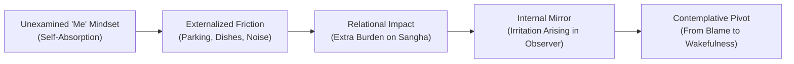
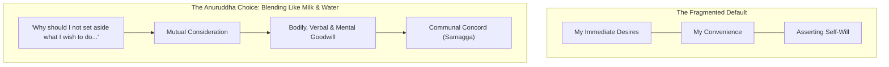
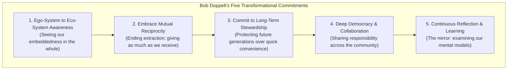
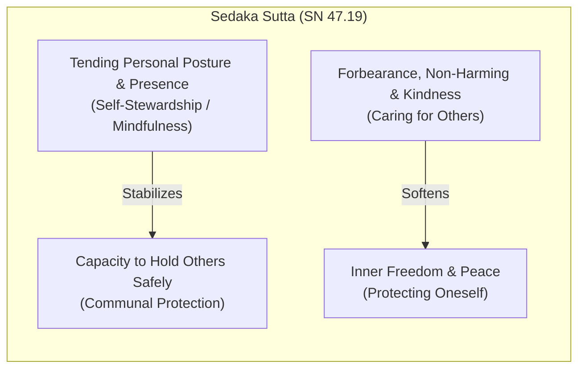
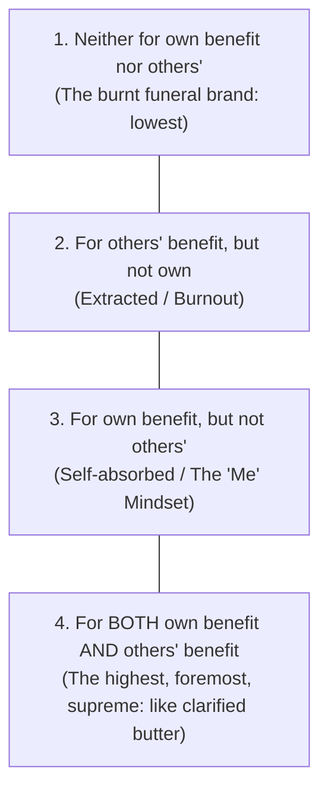
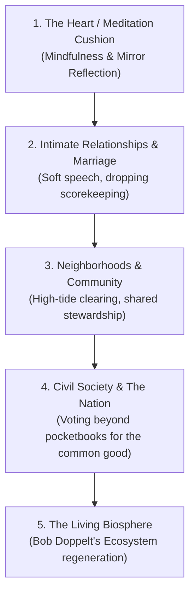

---
tags:
  - retreat-notes
  - imc-retreat
  - hidden-villa
  - from-me-to-we
  - fabian-pfortmuller
  - bob-doppelt
  - communal-harmony
  - culagosinga-sutta
  - mn-31
  - ambalatthikarahulovada-sutta
  - mn-61
  - sedaka-sutta
  - sn-47-19
  - attahita
  - parahita
  - ubhayahita
  - saraniyadhamma
  - kalyana-mittata
  - khirodakibhuta
  - non-contention
  - ethical-reflection
  - two-arrows
  - sallatha-sutta
  - conditionality
  - idappaccayata
  - somatic-awareness
Created: 2026-10-30
Companion Notes:
  - "[[2026-10 IMC Hidden Villa Retreat - Dharma Talks & Morning Instructions]]"
  - "[[Culagosinga_Sutta_MN_31_Living_in_Concord_Blending_Like_Milk_and_Water]]"
  - "[[Kantaka_Sutta_AN_10.72_Thorns_to_Meditation]]"
  - "[[Kosambiya_Sutta_MN_48_Discourse_at_Kosambi]]"
  - "[[From Me to We - Fabian Pfortmüller]]"
  - "[[Pali to English Dictionary]]"
---

# From Me to We: Living in Concord and the Mirror of Consideration
### *Reflections from Hidden Villa, the Perceptions of "Amy," and Why We Get Along*

---

### 🏛️ Contextual Metadata

- **Location**: Hidden Villa Retreat Center (Blodgett House & Dhamma Hall), Los Altos Hills, California; followed by post-retreat integration on US-101 and the tidal wetlands of Marin County.
- **Circumstances**: Observing micro-actions, relational friction, and communal etiquette during the October 2026 Insight Meditation Center (IMC) silent residential retreat. Investigating how unconscious self-absorption impacts the collective container, how internal irritation acts as a personal mirror, and how humanity can shift from extractive individualism to cooperative stewardship.
- **People Involved**: Andy McGuire (yogi, dishwasher, narrator), "Amy" (fellow retreatant, held as an archetypal mirror rather than a target of personal condemnation), IMC retreat teachers (Diana Clark, David Lorey, Ying Chen, Kim Allen), and Andrea McGuire.
- **Theme of the Dharma Talk / Contemplation**: Shifting from "Me" to "We"; examining the phrase *"Why do we get along? Because we want to!"*; balancing legitimate somatic self-care (*attahita*) with active communal consideration (*parahita*); integrating Buddhist canonical psychology (MN 31, MN 61, SN 47.19, AN 4.95) with Fabian Pfortmüller's community model and Bob Doppelt's systemic ecological frameworks.
- **Condensed Version of the Teachings**:
  1. **The Shared Container as a Magnifier**: In the quiet of a silent retreat, everyday micro-behaviors (parking, dishwashing, door-closing) become vivid mirrors of our internal state. Unexamined self-absorption creates subtle friction for everyone around us.
  2. **Holding the Mirror without Contempt**: When another person's self-centeredness triggers irritation in us, the Buddha's advice to Rāhula (MN 61) reminds us to look inward. Irritation is a second arrow (*dukkha*) that contracts our own belly and heart. We can see behavior clearly without abandoning kindness.
  3. **Concord Is an Active Choice**: Harmony does not arise automatically. As Venerable Anuruddha revealed in the *Cūḷagosiṅga Sutta* (MN 31), individuals blend "like milk and water" when they intentionally decide to set aside personal self-will for the welfare of the whole: *"Why do we get along? Because we want to!"*
  4. **The Distinction Between Self-Care and Selfishness**: In the *Sedaka Sutta* (SN 47.19), acrobats maintain balance by taking care of their own posture first so they can support each other. True self-stewardship (tending bodily pain, pacing energy) sustains community; self-centeredness extracts from it.
  5. **Scaling Outward**: The shift from *Ego-system* to *Ecosystem* (Bob Doppelt) and from *Consumer* to *Co-creator* (Fabian Pfortmüller) provides the blueprint for healing intimate relationships, neighborhoods, civil society, national politics, and our relationship with the living planet.
- **Expanded Version of the Teachings**: Detailed below in full contemplative exposition.

---

## 1. The Sacred Container: Micro-Actions in the Quiet of Hidden Villa

When thirty or forty human beings gather at Hidden Villa in Los Altos Hills to practice residential Vipassana meditation, an extraordinary collective agreement takes shape. We set aside our smartphones, our professional roles, and our conversational habits. We enter Noble Silence (*ariya-tuṇhībhāva*). 

In Blodgett House and the sunlit Dhamma Hall, external speech ceases so the narrative-generating machinery of the mind can settle down. Yet, as the silence deepens, another reality becomes palpable: *everything we do speaks*. 

Without conversational pleasantries to smooth over rough edges, our micro-actions are placed under a contemplative microscope. 
- How softly do we catch a screen door as it swings shut?
- How gently do we set our drinking cup on the wooden shelf?
- Do we leave a clear pathway when we take off our walking shoes at the entrance?
- How mindfully do we rinse our food bowls at the outdoor dish station?

In a shared silent container, consideration ceases to be a polite social abstraction. It becomes the literal bedrock of communal safety. When practitioners move with quiet mindfulness, the hall feels spacious, steady, and protective—like a warm shelter where weary nervous systems can finally rest. But when even one or two individuals move through the space with unexamined carelessness, the collective quiet is pierced. 

It was within this delicate container that the perceptions surrounding a fellow retreatant—whom we can refer to as "Amy"—became a living teaching.

---

## 2. The Perceptions of "Amy": Behavior as an Archetype, Not a Condemnation

It is essential to state at the very outset: **there is no intention here to condemn, villainize, or sit in superior judgment over Amy.** We do not know her personal history, the private griefs or traumas she may carry, her medical circumstances, or the unspoken weight she brought with her to the retreat. She was, and is, a fellow human being seeking peace, worthy of goodwill and compassion.

Instead, we look at our perceptions of what her behavior *represented*—an archetype of how the unexamined "Me" mindset unconsciously extracts from the communal "We."

Throughout the days at Hidden Villa, a consistent pattern of behavior entered the field of sensory awareness:
- **The Dedicated Handicap Space**: Her vehicle was parked throughout the entire retreat in the prominent handicap stall directly adjacent to the main lodge, despite no handicap placard or license plate displayed, occupying a critical space that others with genuine mobility limitations might urgently need.
- **The Kitchen & Dishwashing Protocol**: As part of our yogi jobs, several of us served as dishwashers and pot scrubbers. Clear, gentle instructions were posted for washing: scrape your plate, rinse with water outside, and place your bowl neatly into the wash racks so the dish crew can sanitize them without unnecessary backlog. Amy repeatedly bypassed the system—leaning through the kitchen doorway with one hand to balance half-rinsed dishes precariously on crowded ledges, leaving extra mess for others to untangle.
- **The Individual Schedule**: While the Sangha gathered for silent sits, walking periods, and teacher discourses, she appeared to operate entirely on a private timetable—frequently late, skipping group sits, and utilizing the retreat grounds as a personal walking and hiking resort in pristine outdoor gear.
- **Hyper-Guardedness vs. Communal Trust**: While showing little awareness of how her dish-clearing or lateness affected others, there was an intense, repetitive vigilance directed inward—walking around her car to test every door handle multiple times to ensure it was locked.
- **Taking from the Commons**: Loading multiple heaped bowls of food at the buffet before everyone had moved through the line.

When we observe these patterns without romanticizing or demonizing them, we see the classic architecture of hyper-individualism: *I am here for my experience. The rules and courtesies of this place are background scenery. My comfort, my convenience, and my timetable take precedence over the community that makes this space possible.*

---

## 3. The Inward Turn: The Mirror of Rāhula and the Sting of Irritation

The most dangerous spiritual trap in observing another person's self-centeredness is falling into self-righteous indignation. It is so easy for the mind to puff up: *"Look at how considerate I am being, and look at how oblivious she is!"*

On Day 3 of the retreat, teacher Ying Chen offered a Dharma discourse on the *Ambalaṭṭhikārāhulovāda Sutta* (Majjhima Nikāya 61). In this sutta, the Buddha instructs his seven-year-old son, the novice monk Rāhula, using the everyday simile of a bronze mirror (*ādāsa*):

> *"What is a mirror for, Rāhula?"*  
> *"For the purpose of reflection, Bhante."*  
> *"Just so, Rāhula, bodily actions, verbal actions, and mental actions should be performed only after repeated reflection."*

The Buddha taught that we must look into the mirror:
1. **Before an action (*pubbe va*)**: Will this action lead to affliction for myself, for others, or for both?
2. **During an action (*karonto*)**: Is this action presently causing affliction?
3. **After an action (*katvā*)**: Did this action cause affliction? If so, we acknowledge it honestly, make amends, and resolve restraint in the future.

When Amy leaned through the door with her unwashed dishes, a moment of sharp frustration arose: *"I'll just wash your dishes for you!"*

In that very instant, the mirror of the *Rāhula Sutta* flipped inward. We have to ask: *What is happening in my own heart right now?*
- The stomach is tight or knotted up.
- The jaw is set.
- The mental commentary is churning with blame, building a case against a fellow human being.

That irritation is what the Buddha described in the *Salla Sutta* (SN 36.6) as the **Second Arrow**. Amy's behavior was simply sensory contact (the First Arrow—a plate placed clumsily on a counter). But the burning annoyance, the internal moralizing, and the resentment were entirely self-generated (*dukkha*). 

Irritation is an unwholesome state. It hurts the one who carries it far more than anyone else. Recognizing this does not mean pretending that thoughtless behavior is skillful. It means we refuse to drink the poison of contempt while trying to protect the container. We can notice: *Amy is showing me what unconscious "Me" behavior looks like on the outside, and my own mind is showing me how easily aversion takes root on the inside.*

---

## 4. "Why Do We Get Along? Because We Want To!"

On the drive home along US-101, as the speed jumped from the quiet 20 mph gravel roads of Hidden Villa to 65 mph freeway traffic, a clear realization surfaced: 

> **"Why do we get along? Because we want to!"**

Communal peace, harmonious marriage, functional neighborhoods, and healthy societies do not occur by default. Left to sheer biological impulse, human beings default to territorial self-interest, resource hoarding, and defensiveness. 

We get along because we make an intentional, conscious commitment to live in concord.

This exact insight is celebrated in one of the most beloved discourses in the Pāli Canon: the *Cūḷagosiṅga Sutta* (MN 31). The Buddha travels to the Gosiṅga sal-forest to visit three senior disciples—Venerable Anuruddha, Venerable Nandiya, and Venerable Kimbila. Seeing their extraordinary peace, the Buddha asks:

> *"I hope, Anuruddha, that you are living in concord, with mutual appreciation, without disputing, **blending like milk and water**, viewing each other with eyes of affection?"* (*khīrodakībhūtā aññamaññaṁ piyacakkhūhi sampassantā viharatha*)

Anuruddha answers with profound simplicity:

> *"In truth, venerable sir, we are living in concord... As to this, venerable sir, I think: 'It is truly a gain for me, a great blessing, that I live with such companions in the holy life.' I maintain bodily acts of loving-kindness toward these venerables, both openly and in private; I maintain verbal acts of loving-kindness... mental acts of loving-kindness...  
> **Why should I not set aside what I wish to do and do only what these venerables wish to do?**  
> So, venerable sir, I set aside what I wish to do and do only what these venerables wish to do. We are different in body, venerable sir, but only one in mind."*

When Anuruddha asks, *"Why should I not set aside what I wish to do and do only what these venerables wish to do?"*, he is not describing groveling self-erasure or codependency. He is describing the liberating power of **relinquishment**. He understands that holding on to his petty, moment-to-moment preferences (*"I want to sit now, I want to eat now, I want the window closed"*) creates friction, whereas yielding to the communal rhythm produces an atmosphere so buoyant that all three monastics attained deep meditative release.

We get along because we value the peace of the whole more than the triumph of our personal ego.

---

## 5. The Sociological Lens: Fabian Pfortmüller's "From Me to We"

This ancient monastic wisdom aligns directly with modern community design. In his foundational article, *“From Me to We — The Shift in Behavior I See in Powerful Communities,”* community strategist Fabian Pfortmüller observes that human beings enter any new group with a natural, self-focused "Me" orientation. 

In dysfunctional groups, people remain stuck in that consumerist identity. But in healthy, transformative communities, a fundamental behavioral shift occurs: individuals evolve from consumers into co-creators.

| Dimension | "Me" Behavior (Consumer Mindset) | "We" Behavior (Co-Creator Mindset) | Manifestation at Hidden Villa |
| :--- | :--- | :--- | :--- |
| **Primary Identity** | **Consumer**: *"What is in it for me?"* Expecting to be served and accommodated. | **Co-Creator**: *"This is our space; unless I contribute, nothing happens."* | Washing retreat pots with care vs. dumping dirty bowls on the edge of the counter. |
| **Entitlement vs. Initiative** | Feels entitled to comfort; complains when things are imperfect. | Empowered to notice needs and quietly take action to support others. | Checking doors so they latch softly; clearing walkways of cluttered footwear. |
| **Reciprocity** | Transactional: *"I will only help if I get something immediate in return."* | Unconditional generosity: helping because of love for the community and its members. | Volunteering for heavy chores (trash, dishwashing) without keeping score. |
| **Conflict & Friction** | Ignores friction, blames others, or walks away the moment discomfort arises. | Views friction as natural; meets difficulty with patience, reflection, and open dialogue. | Using moments of annoyance as a mirror for practice rather than festering in contempt. |
| **Vulnerability & Presence** | Guarded, defensive; shows only a polished facade or retreats into isolation. | Shows up with whole self; willing to be authentic, open, and supportive of others' vulnerability. | Sitting through knee and back pain alongside fellow yogis in shared, honest stillness. |
| **Trust & Social Norms** | Deeply suspicious; assumes society's dog-eat-dog, transactional rules apply everywhere. | Deep trust in the shared values of the container; treats strangers with immediate respect. | Honoring the handicap space for whoever needs it most; respecting the silence of the hall. |

When Amy parked in the handicap stall, bypassed dishwashing stations, and lived on her own private schedule, she was acting out the unevolved "Me" behavior: treating a volunteer-sustained sacred sanctuary as an extractive service provider. 

When fellow yogis woke at 5:00 AM to sweep the halls, washed pots in hot suds, moved quietly down corridors, and sat shoulder-to-shoulder holding silence, they were embodying "We" behavior.

---

## 6. The Systems & Planetary Lens: Bob Doppelt's Five Commitments

What happens inside a retreat dining hall is not an isolated curiosity; it is a miniature holographic model of the entire world.

In his groundbreaking work *From Me to We: The Five Transformational Commitments Required to Rescue the Planet, Your Organization, and Your Life*, systems-change expert Bob Doppelt argues that the root cause of our overlapping global crises—climate breakdown, social polarization, economic inequality, and chronic anxiety—is the hyper-individualistic "Me" mental model that dominates modern industrial civilization.

Doppelt outlines the urgent necessity of moving from an **Ego-system** mindset to an **Ecosystem** mindset through five commitments:

1. **Shift from Ego-System to Eco-System Awareness**: Recognizing that we do not exist as autonomous, disconnected entities. Our well-being is inextricably bound to the health of the social and biological systems that support us.
2. **Embrace Mutual Reciprocity**: Moving away from extractive relationships (taking more than we give) toward reciprocal relationships that regenerate our communities and natural systems.
3. **Commit to Long-Term Stewardship**: Making choices that prioritize the flourishing of future generations rather than immediate gratification or short-term convenience.
4. **Foster Deep Collaboration**: Replacing top-down competition and self-centered silos with cooperative problem-solving.
5. **Practice Continuous Reflection and Learning**: Routinely examining the mental models and assumptions that drive our behaviors—an exact modern restatement of the Buddha's advice in the *Rāhula Sutta*.

When we look through Doppelt’s lens, the link between Amy taking a handicap spot and global environmental collapse becomes crystal clear: **both stem from the unexamined belief that individual privilege can be extracted from the commons without cost.**

---

## 7. The Paradox of Needs: When to Think of Ourselves vs. When to Put Others First

This inquiry brings us to the central question raised by every honest practitioner:

> *"Why should I place my needs above others, and when do we need to think of ourselves over others?"*

There is a vital distinction between **healthy somatic self-stewardship** and **egoic self-centeredness**.

In the *Sedaka Sutta* (Saṃyutta Nikāya 47.19), the Buddha tells the unforgettable story of two bamboo acrobats—an acrobat master named Jūgandhabba and his young apprentice, Medakathālikā. 

The master balances a tall bamboo pole on his shoulders, and the apprentice climbs to the top. The master says: *"Look here, Medakathālikā: you protect me, and I will protect you. Watching over each other, guarded by each other, we will perform our tricks safely."*

The apprentice corrects him with remarkable wisdom:

> *"That will not do, master! You protect yourself, and I will protect myself. Each self-protected and guarded, we will perform our feats, come down safely from the bamboo pole, and get our reward."*

The Buddha affirms the apprentice's insight:

> *"Just as the apprentice said to the master, so it is.  
> **'Protecting oneself, one protects others; protecting others, one protects oneself.'**  
> And how does one, protecting oneself, protect others? By the development of mindfulness, by cultivating it, by making much of it.  
> And how does one, protecting others, protect oneself? By forbearance (*khanti*), by non-harming (*ahiṃsā*), by loving-kindness (*mettā*), and by tenderness."*

### The Canonical Blueprint: Four Types of Persons (AN 4.95)

In the *Chavālāta Sutta* (Aṅguttara Nikāya 4.95), the Buddha addresses this exact balance, classifying human behavior into four distinct orientations:

The Buddha explicitly teaches that the fourth person—one who practices **both for one's own welfare (*attahitāya*) and for the welfare of others (*parahitāya*)**—is supreme, topmost, and sublime (*uttamo pavaro pāmokkho uttamatthena*).

### The Clear Line of Discernment

How do we know the difference in everyday life?

| Dimension | Wise Self-Stewardship (*Attahita*) | Egoic Self-Centeredness ("Me" Behavior) |
| :--- | :--- | :--- |
| **Core Motivation** | Sustainability, non-harming, bodily integrity, honoring true limits. | Immediate personal convenience, entitlement, avoidance of effort. |
| **Impact on Others** | Prevents breakdown; allows one to remain a steady, reliable contributor. | Places an invisible extra burden on the people around us. |
| **Retreat Example** | Shifting posture from floor cushion to bench to relieve bow-legged knee agony; resting when a migraine flares up. | Parking in a handicap stall without need; leaving half-rinsed dishes for fellow yogis to wash. |
| **Relational Feeling** | Open, honest, humble, communicative, appreciative. | Guarded, indifferent, defensive, oblivious to the surroundings. |

We need to think of ourselves when tending our physical health, our mental stability, and our ethical boundaries. If an acrobat does not stabilize his own spine, both acrobats fall. If a meditator stubbornly destroys his knees out of spiritual pride, he becomes an invalid who must be cared for by others. 

Taking care of our legitimate needs is an act of communal service. But prioritizing our whims, comforts, and shortcuts at the expense of others is the definition of unwholesome grasping.

---

## 8. The Concentric Rings of "We": Scaling from the Meditation Hall to the Planet

The realization that took root on the US-101 highway ripples far beyond retreat centers. Consideration is a living technology that transforms every sphere of human existence.

### Ring 1: Intimate Relationships & Marriage
In a partnership, "Me" behavior looks like keeping a silent ledger of chores, demanding that our partner match our emotional tempo, or insisting on being right during an argument. 
When we remember Kim Allen's retreat guidance on the *Karaṇīya Mettā Sutta* (Sn 1.8)—cultivating mild, gentle speech (*mudu suvaco*)—we drop the hard edges. We ask: *"Why should I not set aside what I wish to do to make Andrea's evening easier?"* When both partners lean into "We," domestic life ceases to be a negotiation and becomes a sanctuary.

### Ring 2: Neighborhoods and Local Communities
Returning home to Marin County, we encountered peak seasonal King Tides flooding the intersections around Corte Madera Creek. Navigating flooded roads requires communal awareness: checking where the salt water is cresting, finding parking spots that do not block neighbors' driveways, and stepping in to help unblock storm drains. 
Neighborhoods flourish when residents act as co-creators rather than detached property consumers. Shoveling a shared pathway, keeping noise levels down late at night, or checking on an elderly neighbor during a storm are simple, direct expressions of "We."

### Ring 3: Civil Society and the Nation
On the drive home, the reflection expanded naturally to national political life:
> *"Why should I put my needs above everybody else? That's a teaching for the world, you know, because we vote our pocketbook and not what would be for the betterment of everybody. If you don't have money, that makes sense. But if you have resources, why wouldn't you want the betterment of the world?"*

When citizens vote solely from the "Me" mindset—asking only *"Which candidate will lower my personal taxes or protect my private wealth?"*—democracy degrades into competitive tribalism. 
A mature society is built when citizens vote from the "We" mindset—asking *"What policies ensure that children are fed, hospitals are funded, roads are maintained, the vulnerable are protected, and public education is strong?"* True civilization begins where the narrow pocketbook gives way to the common good.

### Ring 4: Humanity and the Living Planet
At the macroscopic level, Bob Doppelt’s thesis is undeniable. Humanity is treating planet Earth exactly as Amy treated the Hidden Villa kitchen: consuming resources at our own speed, leaving toxic runoff in the common sink, parking our industrial footprint across irreplaceable ecosystems, and obsessively guarding our borders while ignoring the climate crisis we have unleashed.

Climate change, ocean acidification, and biodiversity loss are the inevitable consequences of eight billion people living inside a collective "Me" trance. 
The ecological shift from *Ego-system* to *Ecosystem* is not a luxury or a philosophical ideal; it is the absolute precondition for our survival. The Earth is our shared Blodgett House. If we do not wash the bowls and tend the container, there is no other home to go to.

---

## 9. Conclusion: Tipping Back and Floating in Shared Concord

In the closing circle at Hidden Villa, yogis shared the profound sense of vulnerability and rawness that comes from days of silent practice. As one teacher humorously noted, returning to the world can feel overwhelming: standing in a grocery store aisle staring at twenty-seven varieties of strawberry jam can suddenly induce sensory overload.

Yet, alongside that raw sensitivity comes a deep, quiet strength. During the retreat, a vivid somatic sensation emerged during meditation: 

> *"Life was thrashing on me and I was just trying to swim as well as I can... coming here I have felt this feeling of just like tipping back and floating and having this realization that that's available anytime."*

We spend so much of our lives thrashing in the water, frantically trying to stay afloat through self-assertion, hyper-vigilance, and control. We lock every door, grab the best parking spot, heap our plates high, and guard our boundaries, convinced that if we do not fight for "Me," no one else will.

The Dhamma offers a different path. 

When we step into the container of ethical restraint (*sīla*), spiritual friendship (*kalyāṇa-mittatā*), and honest self-reflection (*ādāsa*), we discover that we do not have to thrash. We can tip our heads back into the water and float. The container of community holds us.

And when we look back at "Amy," the irritation dissolves entirely. In its place remains a warm, clear understanding. She is a mirror of our shared human confusion—a reminder of how easily we can get lost in the small cage of "Me." 

Whenever we notice that contraction arising in our belly or our mind, we can pause, take a breath, look into the mirror of Rāhula, and remember the words of Anuruddha:

> *Why do we get along? Because we want to.*  
> *Different in body, but one in heart—blending, quietly and gracefully, like milk and water.*

---

## 📚 Key Scriptural & Conceptual References

| Text / Author | Source / Canonical Citation | Core Doctrinal Contribution |
| :--- | :--- | :--- |
| **Living in Concord: Milk & Water** | *Cūḷagosiṅga Sutta* (MN 31) | Setting aside personal self-will for communal peace (*samagga*); bodily, verbal, and mental acts of loving-kindness in public and private. |
| **The Mirror of Moral Reflection** | *Ambalaṭṭhikārāhulovāda Sutta* (MN 61) | Checking intentions *before*, *during*, and *after* action to prevent affliction to self, others, or both. |
| **The Two Acrobats** | *Sedaka Sutta* (SN 47.19) | Protecting oneself through mindfulness to protect others; protecting others through kindness to protect oneself. |
| **Four Orientations to Benefit** | *Chavālāta Sutta* (AN 4.95) | Establishing that living for *both* one's own welfare (*attahita*) and others' welfare (*parahita*) is the supreme spiritual path. |
| **Sound as a Thorn** | *Kaṇṭaka Sutta* (AN 10.72) | Neutral sensory contact vs. mental resistance; sound is an outer contact, noise is mental reactivity. |
| **Gentle & Unarrogant Speech** | *Karaṇīya Mettā Sutta* (Sn 1.8) | Developing mild, easily spoken to qualities (*suvaco c'assa mudu anatimānī*) as heart medicine. |
| **Community Transformation Model** | Fabian Pfortmüller (2018) | The sociological shift from consumer "Me" identity to co-creator "We" identity in purposeful communities. |
| **The Five Commitments** | Bob Doppelt (2012) | Transitioning from an extractive Ego-system mindset to a regenerative Ecosystem mindset across organizations and planetary systems. |
