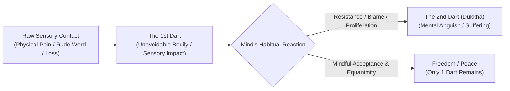

# Dharma Talk & Daylong Retreat Report: Fully Understanding *Dukkha* — Exploring the First Noble Truth
### *A Day of Teachings, Guided Contemplations, and Dialogue with Ajahn Karunadhammo*
#### *Spirit Rock Meditation Center — August 12, 2018*

---

## 🎧 Media & Discourse Metadata

| Metadata Field | Record Details |
| :--- | :--- |
| **Speaker / Teacher** | **Ajahn Karunadhammo** (Co-Abbot / Senior Monastic, Abhayagiri Buddhist Monastery) |
| **Date Recorded** | **August 12, 2018** (09:30 AM – 05:15 PM PDT) |
| **Recording Location** | **Spirit Rock Meditation Center (SRMC)**, Community Meditation Hall, Woodacre, California |
| **Host / Publisher** | **Dharma Seed** (`dharmaseed.org` \| Audio ID: `51608`) |
| **Audio Source File** | `20180812-Ajahn_Karunadhammo-SR-fully_understanding_dukkha_exploring_the_first_noble_truth-51608.mp3` |
| **Media Duration** | **7 hours 41 minutes 58 seconds** (27,718.28 seconds) |
| **File Size / Bitrate** | 317.53 MB (332,957,390 bytes) \| 96 kbps CBR, 44.1 kHz, Mono MP3 |
| **Retreat / Event** | Spirit Rock Meditation Center Daylong Non-Residential Retreat |
| **Canonical Subjects** | **First Noble Truth (*Dukkha Ariyasacca*)**, The Duty of Full Understanding (*Pariññeyya*), The Five Clinging-Aggregates (*Pañcupādānakkhandhā*), The Two Darts (*Sallatha Sutta*), and Non-Self as a Contemplative Strategy (*Anattā*) |
| **Associated Monastics** | Tan Kaccāna (Abhayagiri Monastic community member present in hall) |
| **Host / Facilitator** | Romi (Spirit Rock Volunteer / Program Coordinator) |
| **Embedded Tag Comment** | *"Fully Understanding Dukkha: Exploring the First Noble Truth (Recorded at Spirit Rock Meditation Center)"* |

---

## 🏛️ Structured Contextual Metadata

* **Location:**
  * *Canonical Sutta Geography:* The Deer Park at Isipatana near Vārāṇasī (*Dhammacakkappavattana Sutta*), where the Buddha first turned the Wheel of Dhamma and declared the Four Noble Truths.
  * *Modern Venue:* Spirit Rock Meditation Center, Woodacre, California. Set in the quiet hills of West Marin County, bringing together lay practitioners, long-term yogis, and visiting monastics from Abhayagiri Buddhist Monastery.
* **Circumstances:**
  * Ajahn Karunadhammo was invited to lead a full Sunday daylong retreat dedicated to dismantling the persistent Western misunderstanding that Buddhism is a pessimistic doctrine declaring "life is suffering." Beginning with reflections shared the previous night at Abhayagiri Monastery during the lunar observance (*uposatha*), Ajahn Karunadhammo established a contemplative container alternating between conceptual exposition, somatic grounding, silent meditation, and two expansive Q&A sessions.
* **People Involved:**
  * *Teacher:* Ajahn Karunadhammo (senior disciple in the lineage of Venerable Ajahn Chah and Luang Por Sumedho).
  * *Monastic Companion:* Tan Kaccāna (junior monk accompanying Ajahn from Abhayagiri).
  * *Spirit Rock Host:* Romi and volunteer support staff.
  * *Assembly:* Full hall of retreatants, meditators, psychotherapists, somatic practitioners, healthcare professionals/caregivers, householders, and long-term students of the Thai Forest and Vipassanā traditions.
* **Theme of the Dharma Talk & Daylong:**
  * Moving beyond the superficial English translation of *dukkha* as mere physical pain or sorrow, and understanding it as the inherent friction, unsatisfactoriness, and stress of grasping (*upādāna*). Clarifying the precise noble duty regarding the First Truth: not to fix it, bypass it, or lament it, but to **fully understand** it (*pariññeyya*). Applying *anattā* (not-self) not as an abstract metaphysical dogma, but as an active, somatic contemplative strategy of deconstruction.
* **Condensed Version of the Teachings:**
  * When the Buddha set forth his awakening, he summarized his entire dispensation in the Four Noble Truths. Crucially, each Truth carries a specific, non-negotiable duty (*kicca*): the First Noble Truth of *dukkha* is to be **fully understood** (*pariññeyya*); the Second Noble Truth of craving (*taṇhā*) is to be **abandoned** (*pahātabba*); the Third Noble Truth of cessation (*nirodha*) is to be **realized** (*sacchikātabba*); and the Fourth Noble Truth of the Noble Eightfold Path is to be **developed** (*bhāvetabba*). Meditators frequently confuse these duties—attempting to abandon suffering directly or trying to force cessation before understanding the mechanics of grasping.
  * In nature, pain is inevitable (the First Arrow / Dart), but suffering is our mental addition (the Second Arrow / Dart)—the aversion, panic, resentment, and narrative fabrication (*papañca*) built on top of physical or sensory contact. The primary locus of suffering is the five aggregates subject to clinging (*pañcupādānakkhandhā*): form, feeling, perception, mental formations, and consciousness. When we treat *anattā* (not-self) as a living contemplative strategy rather than a philosophical theory, we methodically inspect each aggregate: *"Can I regard this changing, uncontrollable phenomenon as me, mine, or who I am?"* Recognizing that none of the aggregates can provide permanent shelter, we stop building stories of selfhood and experience the unburdening of deconstruction.
* **Expanded Version of the Teachings:**
  * The full daylong systematically unpacks the contemplative mechanics of *dukkha* across somatic, cognitive, and interpersonal dimensions. Drawing upon Luang Por Sumedho's teaching on "The Way It Is" (*sabhāva-dhamma*), Ajahn Karunadhammo leads practitioners to examine the body directly. In meditation, the natural biological processes—breathing, heartbeats, nerve sensations—operate autonomously. We cannot command the body to stop breathing or the heart to cease beating; recognizing this lack of absolute executive control dissolves the illusion of an autonomous owner (*attā*).
  * Across two extensive Q&A sessions, Ajahn Karunadhammo bridges classical Abhidhamma formulations with contemporary psychological challenges: navigating caregiver burnout, distinguishing between somatic pain and mental proliferation, holding world suffering and daily news without despair, and addressing Western narratives of self-actualization, personal branding, and narrative therapy. Rather than countering self-stories with an alternative "spiritual story," the Dhamma points to the liberation of not constructing stories at all. Practice is fundamentally an unconditioned deconstruction of clinging, leaving awareness rested in spacious, unattached peace.

---

## 🌅 Holistic Daylong Overview & Chronological Session Breakdown

### Holistic Overview of the Day
The daylong retreat is structured as an integrated contemplative arc moving from external orientation into profound doctrinal investigation, experiential contemplation, and culminating in deep interactive dialogue:
1. **Morning Arc:** Grounding the assembly in somatic mindfulness, establishing the Noble Silence container, delivering an exhaustive morning discourse on the First Noble Truth (*Dukkha Ariyasacca*), and conducting a wide-ranging **Morning Q&A Session (Questions 1–8)** on detachment, the Middle Way, passivity vs. right effort, parenting, and caregiver burnout.
2. **Midday Arc:** Investigating the boundary of control through guided body contemplation, followed by monastic food offering (*dāna*), silent mindful eating, and outdoor walking meditation.
3. **Afternoon Arc:** Systematic deconstruction of the Five Clinging-Aggregates (*Pañcupādānakkhandhā*), understanding how craving (*taṇhā*) turns neutral sensory input into *dukkha*, an interim discussion on effort, extended silent integration, and a **54-minute Capstone Q&A Session (Questions 9–20)** exploring relational clinging, unconscious mental habits, ethical communication, global atrocities without burnout, somatic trauma vs. conceptual proliferation (*papañca*), and culminating in Andy's dialogue on not-self as a contemplative strategy of deconstruction.

---

### Chronological Session-by-Session Breakdown

```
00:00:00 ─── Session 1: Opening Welcome & Orientation (Romi & Ajahn Karunadhammo)
00:12:45 ─── Session 2: Morning Guided Meditation (Somatic Whole-Body Awareness)
00:20:52 ─── Session 3: Silent Sitting & Walking Meditation Interval
00:43:41 ─── Session 4: Morning Dhamma Talk — Fully Understanding Dukkha (48 mins)
01:31:38 ─── Session 5: Morning Interactive Q&A Session (Questions 1–8, 48 mins)
02:25:18 ─── Session 6: Guided Contemplation on Control, Involuntary Body & Anattā
02:50:42 ─── Session 7: Meal Blessing, Monastic Dāna & Lunch Routine
02:57:38 ─── Lunch Break & Outdoor Walking Meditation Interval
04:01:20 ─── Session 8: Afternoon Reconvene & Settling Meditation
04:16:59 ─── Session 9: Afternoon Dhamma Talk — The 5 Aggregates & Craving (1h 08m)
05:00:25 ─── Session 10: Interim Q&A on Effort vs. Passivity (Farmer Simile)
05:25:44 ─── Session 11: Silent Walking & Sitting Integration Period
06:48:04 ─── Session 12: Capstone Q&A Session & Closing Dedication (54 mins)
07:41:58 ─── End of Recording
```

#### Session 1: Opening Welcome, Orientation & Noble Silence
* **Timestamp:** `00:00:00 – 00:11:52` (Duration: 11m 52s)
* **Speakers:** Romi (Spirit Rock Host) and Ajahn Karunadhammo.
* **Session Description:** Romi introduces Spirit Rock volunteer coordinators, outlines facilities guidelines, and introduces Ajahn Karunadhammo of Abhayagiri Buddhist Monastery. Ajahn Karunadhammo establishes the retreat intention, introduces Tan Kaccāna, and establishes Noble Silence (*ariya-tuṇhībhāva*), inviting retreatants to relinquish social posturing and technology to allow inward sensitivity to emerge.

#### Session 2: Morning Guided Meditation — Somatic Whole-Body Awareness
* **Timestamp:** `00:12:45 – 00:20:52` (Duration: 8m 07s)
* **Speaker:** Ajahn Karunadhammo.
* **Session Description:** Descending attention below the neck into the shoulders, chest, torso, and seat. Feeling the solid, earthen qualities (*paṭhavi-dhātu*)—bones, muscle tissue, contact sensations—and anchoring awareness in the effortless rhythm of the natural breath.

#### Session 3: Silent Sitting & Walking Practice Interval
* **Timestamp:** `00:20:52 – 00:43:41` (Duration: 22m 49s)
* **Session Description:** Silent practice interval allowing practitioners to stabilize attention on physical touchpoints and transition into walking meditation along the hall paths.

#### Session 4: Morning Dhamma Talk — The First Noble Truth & The Duty of Full Understanding
* **Timestamp:** `00:43:41 – 01:31:38` (Duration: 47m 57s)
* **Speaker:** Ajahn Karunadhammo.
* **Session Description:** Unpacking *dukkha* as unsatisfactoriness, friction, and precariousness. Introducing the four duties (*kicca*) across the Three Turnings (*tiparivaṭṭa*): *dukkha* is to be **fully understood** (*pariññeyya*). Exploring the Two Darts (*Sallatha Sutta*, SN 36.6) and Luang Por Sumedho's teaching on "The Way It Is" (*sabhāva-dhamma*).

#### Session 5: Morning Interactive Q&A Session (Questions 1–8)
* **Timestamp:** `01:31:38 – 02:19:26` (Duration: 47m 48s)
* **Speaker:** Ajahn Karunadhammo and Meditators.
* **Session Description:** Broad dialogue addressing strategies for detachment (including the Dalai Lama's "Lion's Roar"), the Middle Way vs. neutral feeling tones, right effort vs. passive surrender, teaching Dhamma to children through embodiment, the conditioned realm (*saṅkhata*) vs. unconditioned (*asaṅkhata*), avoiding caregiver burnout, loving-kindness and the Simile of the Salt Crystal (*AN 3.99*), and untangling karma from victim-blaming.

#### Session 6: Guided Contemplation — Investigating Control & Bodily Autonomy
* **Timestamp:** `02:25:18 – 02:31:18` (Duration: 6m 00s)
* **Speaker:** Ajahn Karunadhammo.
* **Session Description:** Direct experiential inquiry into bodily control: observing the breath, heartbeat, and involuntary processes, demonstrating that biological intelligence overrides conscious ego control.

#### Session 7: Meal Blessing, Monastic Dāna & Lunch Routine
* **Timestamp:** `02:50:42 – 02:57:38` (Duration: 6m 56s)
* **Speakers:** Ajahn Karunadhammo and Romi.
* **Session Description:** Monastic meal offering (*dāna*), silent eating instructions, and meal chanting blessings.

#### Session 8: Afternoon Reconvene & Settling Meditation
* **Timestamp:** `04:01:20 – 04:16:59` (Duration: 15m 39s)
* **Speaker:** Ajahn Karunadhammo.
* **Session Description:** 15-minute silent sit to settle digestion and re-establish collectedness (*samādhi*).

#### Session 9: Afternoon Dhamma Talk — The Five Clinging-Aggregates & The Trap of Craving
* **Timestamp:** `04:16:59 – 05:00:25` (Duration: 43m 26s)
* **Speaker:** Ajahn Karunadhammo.
* **Session Description:** Investigating the Five Clinging-Aggregates (*Pañcupādānakkhandhā*) and how the three forms of craving (*kāma-taṇhā*, *bhava-taṇhā*, *vibhava-taṇhā*) fuel the engine of preventable suffering.

#### Session 10: Interim Discussion — Effort vs. Passivity (The Farmer Simile)
* **Timestamp:** `05:00:25 – 05:25:44` (Duration: 25m 19s)
* **Speaker:** Ajahn Karunadhammo.
* **Session Description:** Addressing a meditator's concern regarding passivity using Ajahn Chah's famous simile of the farmer: the farmer prepares the soil and plants the seeds (Right Effort), but cannot force the crop to grow by pulling on the shoots (non-clinging to outcomes).

#### Session 11: Silent Walking & Sitting Integration Period
* **Timestamp:** `05:25:44 – 06:48:04` (Duration: 1h 22m 20s)
* **Session Description:** Extended silent meditation period allowing meditators to somatically assimilate the teachings on the five aggregates.

#### Session 12: Capstone Interactive Q&A Session & Closing Deconstruction (Questions 9–20)
* **Timestamp:** `06:48:04 – 07:41:58` (Duration: 53m 54s)
* **Speakers:** Ajahn Karunadhammo and Retreat Attendees (including Lizzie, Woman 1, Woman 2, and Andy).
* **Session Description:** A 54-minute capstone dialogue exploring relational clinging, unconscious mental habits, ethical communication during conflict, discerning karma vs. biology, overcoming doubt (*vicikicchā*), deconstructing "spiritual failure," holding global atrocities without burnout, somatic trauma vs. conceptual proliferation (*papañca*), and culminating in Andy's highlighted dialogue on "What is your story for no self?" and not-self as a contemplative strategy of deconstruction. Concludes with a 2-minute silent meditation and transfer of merit (*pattidāna*).

---

## 📋 Comprehensive Topic Breakdown & Canonical Analysis

### 1. The Four Noble Truths and Their Specific Duties (*Kicca*)
In classical Theravada hermeneutics (*SN 56.11*), the Buddha did not present the Four Noble Truths merely as theoretical propositions to believe, but as four distinct duties to be enacted:

| Noble Truth | Pāli Designation | Inherent Reality | Prescribed Noble Duty (*Kicca*) | Common Practitioner Distortion |
| :--- | :--- | :--- | :--- | :--- |
| **First Truth** | *Dukkha Ariyasacca* | Unsatisfactoriness, stress, friction | **To be Fully Understood** (*Pariññeyya*) | Trying to suppress, avoid, eliminate, or judge it |
| **Second Truth** | *Samudaya Ariyasacca* | Craving (*Taṇhā*), Grasping (*Upādāna*) | **To be Abandoned** (*Pahātabba*) | Clinging to spiritual attainments, indulging desires |
| **Third Truth** | *Nirodha Ariyasacca* | Cessation, Nibbāna, Release | **To be Realized / Experienced** (*Sacchikātabba*) | Conceptualizing cessation as an intellectual idea |
| **Fourth Truth** | *Magga Ariyasacca* | Noble Eightfold Path | **To be Developed / Cultivated** (*Bhāvetabba*) | Treating practice as a chore rather than cultivation |

> [!IMPORTANT] Essential Insight: Not Attempting to Abandon Dukkha
> Ajahn Karunadhammo emphasizes that we do **not** abandon *dukkha*. We **abandon craving (*taṇhā*)**. *Dukkha* must be held, witnessed, and fully understood (*pariññeyya*). When we attempt to abandon *dukkha* directly, we are actually operating from aversion (*vibhava-taṇhā*—the craving to get rid of), which ironically fuels the second arrow of suffering.

---

### 2. The Two Darts: Deconstructing Primary vs. Secondary Experience (*Sallatha Sutta*)
Ajahn Karunadhammo revisits the vital canonical analogy of the **Two Darts** (*SN 36.6*):



| Dimension | The First Dart (*Sallatha*) | The Second Dart (*Dukkha*) |
| :--- | :--- | :--- |
| **Origin** | Inevitable biological & sensory reality (*vipāka*) | Conditioned mental aversion & proliferation (*kamma*) |
| **Examples** | Knee ache, toothache, rude words entering the ear, sickness, aging | *"Why me?", "This shouldn't happen", "I am a failure"* |
| **Nature** | Neutral bodily sensation / feeling tone (*vedanā*) | Mental suffering, contraction, anxiety, self-story |
| **Practice Response** | Acknowledge, make space for, feel directly | Cease fabricating, let go of grasping, observe impermanence |

---

### 3. The Five Clinging-Aggregates (*Pañcupādānakkhandhā*)
Ajahn Karunadhammo analyzes the Buddha's summary statement: *"In brief, the five aggregates of clinging are dukkha."*

| Aggregate (*Khandha*) | Description & Function | Mode of Clinging (*Upādāna*) | Contemplative Deconstruction (*Anattā*) |
| :--- | :--- | :--- | :--- |
| **1. Form (*Rūpa*)** | Physical body, sensory organs, 4 elements | Identifying as "my body", vanity, fear of aging | *"Can I command the heart to stop or the body not to age? Not me, not mine."* |
| **2. Feeling (*Vedanā*)** | Pleasant, unpleasant, or neutral tones | Craving pleasure, resisting pain, ignoring neutral | *"Feelings arise conditioned by contact; they arise, peak, and vanish on their own."* |
| **3. Perception (*Saññā*)** | Recognition, labeling, memory, interpretation | Attaching to labels: "friend", "enemy", "failure" | *"Perceptions are conditioned labels, prone to distortion and misinterpretation."* |
| **4. Formations (*Saṅkhāra*)** | Thoughts, emotions, intentions, volitional patterns | Believing our internal critic, identifying with stories | *"Thoughts are natural events in awareness; they possess no independent selfhood."* |
| **5. Consciousness (*Viññāṇa*)** | Pure knowing through the six sensory doors | Conceiving awareness as a permanent 'soul' or 'I' | *"Sensory consciousness flickers in dependence upon conditions; it is not self."* |

---

## 💬 Comprehensive Interactive Q&A Documentation

### Section I: Morning Q&A Session (`01:31:38 – 02:19:26`)

#### Question 1 [01:31:41]: Strategies for Detachment & The Dalai Lama's "Lion's Roar"
* **Questioner:** Female Meditator.
* **Question:** *"Can you speak to different strategies for learning detachment?"*
* **Ajahn Karunadhammo:** Begins playfully with *"The Noble Eightfold Path!"* He notes how human beings seek a fast shortcut. He recounts driving Ajahn Amaro and Ajahn Pasanno to UCLA to hear His Holiness the Dalai Lama. When an attendee asked if there was a faster, easier way to end suffering, the Dalai Lama paused for two minutes with tears welling in his eyes, before roaring: *"There is no fast! There is no easy! If there were, don't you think I would be teaching you that?!"* Detachment begins with *khanti* (patience)—the willingness to coexist with the unpleasant without immediately reacting.

#### Question 2 [01:42:02]: Duality, the Middle Way & Neutral Feeling Tones
* **Questioner:** Female Meditator.
* **Question:** *"I need some clarification between the duality of life [good and bad], the neutral state of mind, and the Middle Way. How do we apply that?"*
* **Ajahn Karunadhammo:** Clarifies that the **Middle Way (*Majjhimā Paṭipadā*)** is an operational path of practice avoiding sensual indulgence on one side and ascetic self-mortification on the other. **Neutral feeling (*upekkhā-vedanā*)** is simply an experiential feeling-tone devoid of intense pain or pleasure. Transcending duality means neither clinging to pleasant conditions nor rejecting unpleasant ones.

#### Question 3 [01:45:34]: Surrender vs. Right Effort (Overcoming Passivity)
* **Questioner:** Male Meditator.
* **Question:** *"I've been working with detachment and surrendering... But it seems so passive to just surrender. Don't you have to at some stage take action? You can't just let life take you wherever."*
* **Ajahn Karunadhammo:** Fully agrees: *"Absolutely!"* Spiritual surrender does not mean surrendering to defilements (*kilesas*) or indolence. **Right Effort (*Sammā Vāyāma*)** is active and energetic: preventing and abandoning unwholesome states while cultivating and maintaining wholesome ones. We surrender what cannot be controlled (past karma, aging, other people's actions), while actively directing present-moment intention (*cetanā*).

#### Question 4 [01:52:16]: Teaching Dhamma to Children Through Embodiment
* **Questioner:** Male Meditator (father of two young boys).
* **Question:** *"How do we impart this wisdom to our children? Are there techniques or advice on how to do that?"*
* **Ajahn Karunadhammo:** *"Walk the walk rather than talk the talk."* Children are acute detectors of parental hypocrisy. If a parent lectures on peace but explodes in anger during traffic, the words are meaningless. When parents embody patience, emotional regulation, and kindness during crises, children absorb that stability somatically.

#### Question 5 [01:55:30]: Defining the "Conditioned Realm" (*Saṅkhata Dhamma*)
* **Questioner:** Female Meditator.
* **Question:** *"You used a couple of times 'conditioned realm.' Can you explain what that means?"*
* **Ajahn Karunadhammo:** Explains that the **Conditioned Realm (*Saṅkhata Dhamma* / *Saṃsāra*)** encompasses all physical and mental phenomena created and sustained by causes. It is inherently marked by *anicca*, *dukkha*, and *anattā*. The **Unconditioned (*Asaṅkhata Dhamma* / *Nibbāna*)** is the peace realized when the fuel of craving ceases.

#### Question 6 [01:58:28]: Caregiver Burnout & Holding Space Without Fixing
* **Questioner:** Female Meditator (professional caregiver).
* **Question:** *"For those of us in the room who are caregivers dealing with suffering in others: what are ways to practice with ourselves while offering compassionate action to someone who cannot lift themselves out of delusion?"*
* **Ajahn Karunadhammo:** Drawing upon his years as an oncology and hospice nurse, Ajahn emphasizes:
  1. Caregivers burn out when they secretly demand that their care must cure or change the patient.
  2. We must offer a grounded "safe zone" of presence rather than unsolicited fixing.
  3. Caregivers must know their own limits. Stepping back to rest, meditate, and replenish emotional reserves is an act of wisdom and necessity, not selfishness.

#### Question 7 [02:04:54]: Loving-Kindness & The Simile of the Salt Crystal (*AN 3.99*)
* **Questioner:** Male Meditator.
* **Question:** *"Could you address loving-kindness (*mettā*) and compassion (*karuṇā*) and where they fit into the framework of understanding dukkha?"*
* **Ajahn Karunadhammo:** Compassion and loving-kindness are vital; without self-compassion, contemplating *dukkha* breeds self-aversion. He shares the **Simile of the Salt Crystal (*Loṇaphala Sutta*, AN 3.99)**: a lump of salt dropped into a small cup makes the water undrinkable, but that same lump dropped into the Ganges River is diluted by the vast volume of water. When awareness is vast, patient, and full of *mettā*, painful conditions do not overwhelm the heart.

#### Question 8 [02:13:53]: Interpersonal Boundaries & Deconstructing Karmic Victim-Blaming
* **Questioner:** Male Meditator.
* **Question:** *"How do we provide compassion while setting boundaries against people who spread suffering? And if someone is victimized by a crime, are they experiencing karma for past actions?"*
* **Ajahn Karunadhammo:**
  * Setting clear boundaries is essential; compassion does not mean being a passive doormat for abuse.
  * Strongly warns against simplistic, victim-blaming interpretations of karma. The precise ripening of karma is one of the **Four Unthinkables (*acinteyya*)**. Karma is only one of five natural orders of causation (*pañca-niyāma*). Speculating whether a crime victim "deserved" it is unskillful; the only noble response is unconditional compassion and immediate assistance.

---

### Section II: Afternoon Interim Q&A (`05:00:25 – 05:24:20`)

#### Question 9 [05:00:53]: Right Effort vs. Passivity — The Simile of the Farmer
* **Questioner:** Female Meditator.
* **Question:** *"If we don't have a goal or determination, isn't that being too passive? Can dedication and effort to meditate without expectations be reasonable?"*
* **Ajahn Karunadhammo:** Cites Ajahn Chah's famous **Simile of the Farmer**: A farmer plows the field, enriches the soil, sows the seed, and waters it diligently (Right Effort). But the farmer cannot pull on the sprouts to make them grow faster. Pulling on the shoots kills the plant (craving for results). We put forth meticulous effort in practice while completely letting go of attachment to the timeline of results.

---

### Section III: Capstone Afternoon Q&A Session (`06:48:04 – 07:41:58`)

#### Question 10 [06:48:50]: Role of Meditation in Understanding Dukkha
* **Questioner:** Male Meditator.
* **Question Summary:** *"I understand how looking at suffering is the way to understand it. But where does meditation fit into that equation?"*
* **Ajahn Karunadhammo:** Meditation is the real-time laboratory. It is not forcing the mind to stop, but noticing whatever arises, applying wise reflection, and letting it go without building secondary resistance.

#### Interlude [06:52:43]: Request for the Two Darts Story
* Female retreatant asks Ajahn to recount the two darts before closing.

#### Question 11 [06:52:57]: Clinging in Relationships & Fear of Uncertainty
* **Questioner:** Male Meditator.
* **Question Summary:** *"Say I'm clinging onto a loved one, but I don't know where they stand... letting go feels like cutting something off..."*
* **Ajahn Karunadhammo:** The root of relational clinging is aversion to **uncertainty and unpredictability**. Investigate the somatic feeling of not knowing in the chest and belly. Holding uncertainty allows genuine love rather than anxious grasping.

#### Question 12 [06:57:00]: Unconscious Clinging & Deep Mental Layers
* **Questioner:** Female Meditator.
* **Question Summary:** *"If there is clinging deep down below our conscious level, how do we bring it up or get rid of it?"*
* **Ajahn Karunadhammo:** Calming meditation (*samatha*) settles surface mental chatter, allowing deep latent tendencies (*anusaya*) to rise into awareness. The practice is: **do not react**. Simply acknowledge the sensation and let the breath soothe the nervous system.

#### Question 13 [07:01:19]: Injustice & Communicating Without Fueling Fire
* **Questioner:** Female Meditator.
* **Question Summary:** *"What do you suggest during conflict when you feel a strong injustice—wanting to be heard without fueling the fire?"*
* **Ajahn Karunadhammo:** Take an intentional pause. Do not speak from intense reactive heat. Say: *"I need to think about this and get back to you."* Return only when the nervous system has settled into clarity.

#### Question 14 [07:04:16]: Discerning Natural Conditions vs. Past Karma
* **Questioner:** Female Meditator.
* **Question Summary:** *"What is the nature of things versus the karma of the thing? How does one discern that?"*
* **Ajahn Karunadhammo:** Speculating on past-life causes is unhelpful. The practice question is always: *"Right here, right now, am I adding dukkha to this sensation?"*

#### Question 15 [07:07:52]: Addressing Monastics & Overcoming Meditative Doubt
* **Questioner:** Male Meditator.
* **Question Summary:** Asks if it is appropriate to call Ajahn "Luang Por" (*"No! We have one at the monastery that we use that term for"*), and asks how to know for sure if an experience is thought or reality.
* **Ajahn Karunadhammo:** The compulsive demand for 100% certainty is the very texture of doubt (*vicikicchā*). Observe doubt itself as a passing mental formation.

#### Question 16 [07:13:38]: Practicing with "Failure" vs. Non-Self (Lizzie)
* **Questioner:** Lizzie (Female Meditator).
* **Question Summary:** Inquires about teachers speaking of "practicing with failure" while Ajahn Pasanno rejects the term "spiritual failure."
* **Ajahn Karunadhammo:** Agrees with Ajahn Pasanno. "Spiritual failure" is a toxic Western report-card concept. Phenomena arise according to causes and conditions (*idappaccayatā*), not personal inadequacy. Welcome to the human club; notice the lapse with kindness and begin again.

---

### 🌟 Question 17 [07:21:16]: Global Suffering, News & Burnout (Woman 1)
* **Questioner:** Woman 1 (Female Meditator).

#### Verbatim Transcript:
> **Woman 1 [07:21:29]:**  
> *"So, thank you so much. My question is regarding to the suffering that is in the world that we see every day, that human flow, wars, you know, families, they're separated from the parents that is happening every day. You know, every time you listen to the news—that I like to do it, I like to know what's going on. But also it's a fact because it's suffering of other people, or you just go to San Francisco and then you see people on the street, living on the street.*  
>  
> *So my question is to still knowing what's going on in the world, on the suffering every day, how we can be in a balance? Because I don't want to be numb about what's going on because I don't want to look in the other way. You know, if I go to see suffering, I see it, I look at them and it's affect me, but I don't want to look in the other way because otherwise I'm going to be not a human anymore. That's under my perspective. So that is my question: how we can deal with that on everyday suffering in the world?"*

> **Ajahn Karunadhammo [07:22:53]:**  
> *"Yeah. That's a big one. And you have to find your own balance with that. You have to be open to that and to realize that if it's driving you into a despair that causes confusion and causes unremitting kind of angst, then you're picking it up and holding on to it in a way that you don't need to.*  
>  
> *You can still be present for the suffering of other people as long as you can feel comfortable with the suffering and the pain that it causes inside. So the point of work, the point of practice is—whether it's the experience of the suffering of other people or whether it's your own particular form of suffering from your own life, what you're experiencing with loss or difficulty, or whether it's in contact with their suffering—you have to know how to handle it clearly inside of yourself without clinging to it so that you can be in the presence of immense pain, whether it's your own or the pain of somebody else because of injustice or cruelty.*  
>  
> *But it takes a lot of training of the heart, training of the mind to do that. It's a gradual process. You can't expect yourself to be all wise and compassionate just because you want to. You have the aspiration, you have the desire, but you have to develop the wisdom and the skill to be able to hold that at very different levels.*  
>  
> *So part of the process of developing real compassion (*karuṇā*) is also developing a sense of equanimity (*upekkhā*) around these kinds of things. Understanding, really, very clearly, the potential for human suffering in the world is vast and that there is a lot of that out there. It's been worse in different times. It's been a lot better in different times. It will probably be worse in the future; it will probably be better in the future. Taking a very broad perspective of: this is humanity.*  
>  
> *It's painful to see and we can't close our eyes to it. And we choose to act in ways that we have the capacity for, but you need to have the wisdom to know what your capacity is. And if you keep stretching yourself beyond your learned capacity, then you're going to burn out and you won't be any good to anybody. So you have to know for yourself what your limits are and what the measure of your limits are in terms of how you can respond and how you can help.*  
>  
> *Because if you get lost in the suffering, if you get lost in somebody else's pain and you lose your clarity, then you're not going to be a benefit to them. So you have to know how much you can immerse yourself in that and when it's time to step back and take a break, refresh, contemplate, understand with wisdom, reflect on the vastness of the human suffering condition, take refuge in the skills that you've learned to release and to let go, to simplify, to act in wholesome ways. Let that refresh your mind before you jump back in. But just with that reflection of: you don't have to feel guilty about not having the capacity to deal with it full on. We all have our individual limits. You have to know that so that you can be most effective for other people."*

---

### 🌟 Question 18 [07:28:18]: Embodied Suffering, Chronic Pain & Trauma (Woman 2)
* **Questioner:** Woman 2 (Female Meditator).

#### Verbatim Transcript:
> **Woman 2 [07:28:18]:**  
> *"So you've talked a couple times about returning to the body to escape from the suffering in the mind. I'm wondering if you can talk a little bit about embodied suffering, like responses to trauma and the way that chronic pain will kind of embed in the body so that you're reacting to pain from the past. But physically, not mentally. I'm wondering if you could talk about the embodied level of suffering."*

> **Ajahn Karunadhammo [07:28:40]:**  
> *"I don't know a lot about the whole trauma experience, and I know there's a lot written about embodiment of mental trauma and release from it and people that work in that field specifically around that. But just on a very simple level, recognizing the fact that the mind and the body are very closely connected. Significant events have a significant challenge in very deep ways. I don't know for a fact that it actually results in something that is embedded in the body. Certainly we can know what an embedded experience in the heart feels like.*  
>  
> *I guess I kind of understand the body and mind more in terms of citta, heart, and the impact that traumatic events might have in the mind stream, which is where these kinds of things are held. But that is reflected in the body itself; the body is sensitive to what the mind is holding onto. And sometimes that's the easiest and most clear place to really understand and know that, if you go to the body experience first, because the body is very concrete and full of all sorts of nerves and feelings and tensions. So I'm not sure myself that something moves from the heart or the mind as an experience and then embeds itself in the body, but the two are intimately connected and one can access that tangle of events as it feels in the body."*

> **Woman 2 [07:30:57]:**  
> *"I'm talking about the experience when you're sitting and meditating and you can feel your spine straightened or whatever, right? And then thoughts kind of crop up. I live in chronic pain and for me there's a lot of physical thought forms that crop up. I don't know if that's a thing—physical thought forms."*

> **Ajahn Karunadhammo [07:31:17]:**  
> *"Physical thought forms?"*

> **Woman 2 [07:31:18]:**  
> *"Yeah, my knee hurt last week, now it hurts again. But I think my knee is holding onto the memory of being in pain, but there's no mental thought process. But I think it's the same thing. Does that make sense at all?"*

> **Ajahn Karunadhammo [07:31:31]:**  
> *"To me it sounds like what you're saying is you have a pain in the knee, and it comes up for whatever reason—who knows—and then you form a thought around it: 'Oh, there's the pain in my knee.' But I don't know if that's what you're saying."*

> **Woman 2 [07:31:45]:**  
> *"No, I feel like the pain in my knee comes up the way that the pain in my head would. It's just like it comes. You know, when you're meditating and you empty that space and then things come. It's not like I'm remembering my knee was in pain in my mind; it's like my knee is remembering in my knee."*

> **Ajahn Karunadhammo [07:32:04]:**  
> *"Yeah, I'm not sure what to say other than it kind of just has a flavor of proliferation (*papañca*) to it—trying to figure it out or trying to make some conceptual sense out of an experience.  
>  
> And my tendency would be to say, well, **just experience it**. Don't try and figure it out on a conceptual level. Just: if there's a pain in the knee, there's a pain in the knee. If there's a thought, there's a thought. If there's a thought of the pain in the knee, there's a thought of the pain in the knee.  
>  
> It's not to try and figure out what is related to what or how it's related, but just to know it as an experience and watch it. See if it causes dukkha. Don't hold onto it. See what happens when you let it go. To me, there's a flavor of trying to figure it out that maybe it's just adding another layer of proliferation that you don't need to do."*

---

### 🌟 Question 19 [07:33:13]: Sense of Self, Narrative Therapy & Not-Self as Deconstruction (Andy)
* **Questioner:** Andy (Male Meditator in the back).

#### Verbatim Transcript:
> **Ajahn Karunadhammo [07:33:13]:**  
> *"One last question in the back."*

> **Andy [07:33:21]:**  
> *"I'm hoping you'll enjoy going back to your last teaching today about sense of self. Really interested to hear you talk more. So there's actually like—there's narrative therapy, which is a style where you're using story to help people make meaning of themselves in their life. There's also, I think of like personal branding with career development.  
>  
> And yet you had this tantalizing comment, which is—I agree with—which is how much your sense of self is a source of suffering.  
>  
> So I was wondering: **what is the alternative to these narratives that are trying to build up a sense of self? What is your story for no self?**"*

> **Ajahn Karunadhammo [07:34:03]:**  
> *"Oh boy. **It's a story of not making stories.**"*  
> *(Audience chuckles)*

> **Andy [07:34:20]:**  
> *"Can you talk about maybe the benefits that people experience before and after having no self?"*

> **Ajahn Karunadhammo [07:34:36]:**  
> *"No self—not-self (*anattā*)—isn't something you have or you don't have. And it's not a statement of metaphysics. It's not a philosophy or something we have to achieve or attain or become or let go of.  
>  
> **It's a contemplative strategy.** Not-self, it's a contemplative strategy.  
>  
> So that in whatever we're looking at in terms of our experience of the five khandhas—back to the five khandhas—we apply a contemplation, a contemplative strategy of looking clearly at this body and asking ourselves:  
> * Does it have the qualities of what I would consider to be self?  
> * If it were self, would it cause me affliction and pain?  
> * Wouldn't I be able to say, 'let it not be like this,' or 'make it like this'?  
>  
> That would be the quality of self or control that I would say should be present if this body were myself."*

> **Andy [07:36:03]:**  
> *"You're talking about basically disidentifying from the perceived source of our suffering, whether that's outside of us or just the fact that we have an identity."*

> **Ajahn Karunadhammo [07:36:14]:**  
> *"**Correct.** So we examine whatever it is that we think we might be, or that we hold on to as a self or a conception of self.  
>  
> So we look at our body; we examine it thoroughly. We ask ourselves: *'Can I regard this as myself? Can I regard something that's always changing, really not under my control, unpredictable—can I regard that as self?'* And if I'm looking clearly, the answer probably would be no.  
>  
> I take that same contemplation to my feelings, and my perceptions, and my thinking, and even my consciousness. And I apply that same process: *'Can I regard something that's always changing, really not ultimately under my control—can I regard that as this is me, this is who I am, this is myself?'*  
>  
> And if I'm doing that clearly, the likely answer is going to be no. I can't regard that as self. Although I come to the conclusion: form is not self, feeling is not self, perceptions are not self, mental formations are not self, consciousness is not self.  
>  
> And then I leave it there. I don't create any more narrative. I don't create a story. I just experience what that is like."*

> **Andy [07:37:44]:**  
> *"**So it's like a process of subtraction?**"*

> **Ajahn Karunadhammo [07:37:47]:**  
> *"**Deconstruction.**"*

> **Andy [07:37:48]:**  
> *"Okay. Thanks."*

> **Ajahn Karunadhammo [07:37:53]:**  
> *"So on that note, let's deconstruct this day. We've come together, we've constructed a nice environment for six, eight, seven, eight hours—however long it's been—and had a chance to contemplate, think, listen, ask questions. And for just one or two minutes, even though it's past five, let's just sit down quietly, close our eyes, deconstruct the day."*

---

### Question 20 [07:37:53 – 07:41:58]: Closing Deconstruction & Silent Reflection
* **Speaker:** Ajahn Karunadhammo.
* **Closing Action:** The entire hall sits in silence for two minutes deconstructing the constructed forms of the daylong retreat, followed by traditional Pāli blessings and dedication of merit (*pattidāna*).

---

## 📖 Stories & Anecdotes Offered

1. **The Dalai Lama’s "Lion’s Roar" at UCLA [01:32:45]:**  
   Ajahn Karunadhammo recounts driving Ajahn Amaro and Ajahn Pasanno to UCLA to attend a multi-day teaching by the Dalai Lama. In a packed auditorium, an attendee asked if there was an easier or faster path to end suffering. After two minutes of profound silence and tears rolling down his cheeks, the Dalai Lama delivered a thunderous "lion's roar": *"There is no fast! There is no easy! If there were, don't you think I would be teaching you that?!"*
2. **Abhayagiri Lunar Observance Night & Tan Kaccāna's Reflection [00:44:10]:**  
   Ajahn shares the scene at Abhayagiri Buddhist Monastery the night prior to the retreat. On the lunar observance day (*uposatha*), the monastics sat in meditation until midnight. Tan Kaccāna offered reflections on the First Noble Truth, reminding the community that forest training is organized around leaning into discomfort and understanding *dukkha* directly.
3. **The Oncology Nurse Perspective on Caregiver Burnout [01:58:30]:**  
   Reflecting on his years as an oncology and hospice nurse prior to monastic ordination, Ajahn shares the agony of caregivers who demand that their care must heal the patient. True compassionate action means holding a grounded, peaceful presence without getting lost in the other person's suffering.
4. **Luang Por Sumedho's "The Way It Is" (*Sabhāva-dhamma*) [01:30:15]:**  
   Ajahn recounts Luang Por Sumedho's perennial teaching on recognizing conditions as "the way it is." Rather than arguing with reality when physical aches, cold weather, or difficult emotions arise, the forest monk settles back and observes: *"Sensations are like this. Pain is like this. Resistance is like this."*
5. **Holding the Breath in Meditation [02:26:40]:**  
   To illustrate the biological limits of the ego, Ajahn challenges meditators to sit and hold their breath: in less than a minute, biological intelligence asserts itself and forces the lungs to inhale, completely overriding conscious will.
6. **The Simile of the Farmer (Ajahn Chah) [05:01:30]:**  
   A farmer plows the soil, plants seeds, and waters them (Right Effort), but cannot pull on the shoots to force growth. Demanding immediate awakening destroys practice.
7. **The "Club of Ordinary Imperfection" [07:19:30]:**  
   In response to Lizzie's inquiry regarding spiritual failure, Ajahn humorously remarks: *"Welcome to the club!"* Monastics with decades in robes still deal with knee aches and wandering thoughts. Awakening is recognizing that conditioned phenomena are not-self.

---

## 🎙️ Notable Verbatim Quotes with Audio Timestamps

* > *"The Buddha's instruction regarding the First Noble Truth is not to eliminate it, avoid it, or lament it. The duty regarding dukkha is to **fully understand** it (*pariññeyya*)."* — `[00:52:14]`
* > *"There is no fast! There is no easy! If there were, don't you think I would be teaching you that?!"* — His Holiness the Dalai Lama (recounted by Ajahn Karunadhammo) `[01:33:15]`
* > *"The first dart is the raw physical impact of living in a sensitive body. The second dart is the mind's aversion, blame, and storytelling. Pain is the first dart; suffering is the second dart."* — `[01:04:32]`
* > *"Once we can delay ourselves from this way we complicate experience and just settle back into—as Luang Por Sumedho would say—understanding the way it is, then there is an incredible amount of freedom that we can experience."* — `[01:30:28]`
* > *"In short, the five clinging-aggregates are dukkha. We cling to our bodies, our feelings, our labels, our thought patterns, and our sensory awareness. When we grasp them as 'me' or 'mine,' we create the entire mass of suffering."* — `[04:22:15]`
* > *"If you keep stretching yourself beyond your learned capacity, then you're going to burn out and you won't be any good to anybody... Part of developing real compassion is developing equanimity."* — `[07:26:25]`
* > *"Don't try and figure it out on a conceptual level. Just if there's a pain in the knee, there's a pain in the knee... Trying to figure out what is related to what has a flavor of proliferation (*papañca*) that you don't need to do."* — `[07:32:16]`
* > *"What is your story for no self? Oh boy. It's a story of not making stories."* — `[07:34:04]`
* > *"Not-self (*anattā*) isn't something you have or you don't have. It's not a statement of metaphysics. It's a **contemplative strategy**."* — `[07:34:43]`
* > *"Andy: 'So it's like a process of subtraction?' — Ajahn Karunadhammo: 'Deconstruction.'"* — `[07:37:47]`

---

## 🏛️ Doctrinal Concordance & Vault Cross-References

* **Related Suttas in the Research Vault:**
  * [[SN 56.11 - Dhammacakkappavattana Sutta|Setting in Motion the Wheel of Dhamma]] — Foundational disclosure of the Four Noble Truths and the Three Turnings (*tiparivaṭṭa*).
  * [[SN 36.6 - Sallatha Sutta|The Dart / The Arrow Sutta]] — Primary physical feeling vs. secondary mental reaction.
  * [[SN 22.59 - Anattalakkhaṇa Sutta|The Characteristic of Not-Self]] — The fivefold interrogation of the aggregates: *"Is this permanent or impermanent? Is it fit to be regarded as: This is mine, this I am, this is my self?"*
  * [[AN 3.99 - Lonaphala Sutta|The Simile of the Salt Crystal]] — Diluting karmic impact and suffering in the vast river of loving-kindness.
  * [[MN 10 - Satipaṭṭhāna Sutta|Four Establishments of Mindfulness]] — Direct observation of body (*kāya*), feelings (*vedanā*), mind (*citta*), and dhammas.
* **Teacher Hub Notes:**
  * [[_My Teachers/Ajahn Karunadhammo/SRMC - Ajahn Karunadhammo - Not Self Daylong- Part 1|Ajahn Karunadhammo – Not Self Daylong (Part 1)]]
  * [[_My Teachers/Ajahn Karunadhammo/SRMC - Ajahn Karunadhammo - Not Self Daylong- Part 2|Ajahn Karunadhammo – Not Self Daylong (Part 2)]]
  * [[_My Teachers/Ajahn Sumedho/Synthesis of Teachings/The Way It Is|Luang Por Sumedho – The Way It Is (*Sabhāva-dhamma*)]]
  * [[_My Teachers/Ajahn Pasanno/Synthesis of Teachings/Abhayagiri Heritage|Ajahn Pasanno – Dhamma Heritage & Forest Practice]]
* **Central Master Indices:**
  * [[_Abhayagiri/Abhayagiri Retreats Q&A - Master Index|Abhayagiri Retreats Q&A Master Index]]
  * [[Master Q&A Index|Master Q&A Index — Unified Buddhist & Mindfulness Research Archive]]
  * [[My Pali Dictionary/Pali to English Dictionary|Pali to English Dictionary]]
