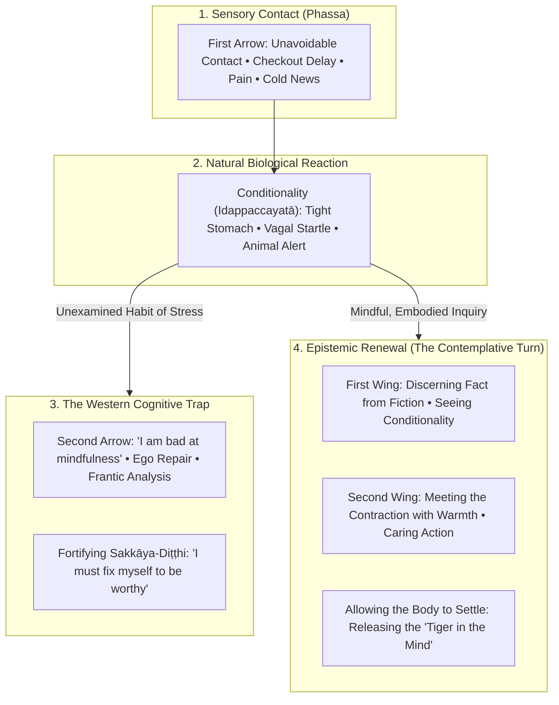

---
tags:
  - epistemic-renewal
  - indigenous-ways-of-knowing
  - relationality
  - reciprocity
  - stoicism
  - sympatheia
  - logos
  - buddhism
  - dhamma
  - sallatha-sutta
  - two-arrows
  - idappaccayata
  - conditionality
  - sakkaya-ditthi
  - avijja
  - dukkha
  - cartesian-dualism
  - hyper-individualism
  - somatic-presence
  - animacy
  - two-wings-of-practice
Created: 2026-10-30
Companion Notes:
  - "[[A_Comprehensive_Architecture_of_Stress_and_Suffering]]"
  - "[[The Architecture of Inward Turning - Blame, Reality, and the Hinge of Awakening]]"
  - "[[The_Trance_of_Becoming_Social_Conditioning_and_What_We_Miss]]"
  - "[[The Architecture of Trauma - Somatic Imprints, Karma, and Healing]]"
  - "[[Portals_of_Entry_Breath_Energy_and_Contemplations]]"
Status: Complete
comments: "Comprehensive philosophical and contemplative inquiry on epistemic renewal, exploring how Western paradigms restrict Indigenous, Stoic, and Buddhist teachings, and detailing embodied avenues for spiritual and philosophical reclamation."
---

# Report: Epistemic Renewal — Indigenous Ways of Knowing, Stoicism, and Buddhism

> *"Knowledge is not something we possess; it is something we inhabit in relationship with the living world."* — Robin Wall Kimmerer  
> *"We are made for cooperation, like feet, like hands, like the rows of the upper and lower teeth. To act against one another then is contrary to nature."* — Marcus Aurelius, *Meditations* (II.1)  
> *"When this exists, that comes to be; with the arising of this, that arises. When this does not exist, that does not come to be; with the cessation of this, that ceases."* — *Idappaccayatā* (MN 79)  
> *"When touched by bodily pain, the uninstructed person sorrows, grieves, and laments... weeping, they become distraught. They feel two pains, physical and mental—just as if they were struck by two arrows. But the wise practitioner, touched by bodily pain, feels only one arrow, not two."* — *Sallatha Sutta* (SN 36.6)

---

## Standard Opening Contextual Metadata

* **Location:** Contemplative inquiry and cross-tradition comparative dialogue; Living Mindfully research archives.
* **Circumstances:** A multi-disciplinary exploration into **epistemic renewal**—addressing how the dominant Western epistemic framework (marked by Cartesian dualism, hyper-individualism, utilitarian exploitation, and disembodied cognition) constricts and distorts ancient spiritual and philosophical traditions. The inquiry charts an intentional return to embodied, relational, and participatory modes of knowing.
* **People Involved:** Contemplative practitioners, ancestral keepers of Indigenous lifeways, classical Stoic philosophers (Epictetus, Seneca, Marcus Aurelius), and the early Buddhist monastic and lay lineage.
* **Theme of the Dharma Talk & Philosophical Inquiry:** Epistemic Renewal: Dismantling the extractive and disembodied lenses of modernity through relational knowing, conditionality (*Idappaccayatā*), cosmic kinship (*Sympatheia*), and the two wings of clear seeing and compassionate action.
* **Condensed Version of the Teachings:** Modern Western perspectives routinely reduce ancient spiritual traditions to instrumental tools for solitary self-optimization and stress mitigation. By imposing Cartesian dualism and market efficiency onto Indigenous lifeways, classical Stoicism, and early Buddhism, the dominant culture strips them of their cosmic kinship, communal duty, and relational ethics. Epistemic renewal invites us to shift our fundamental mode of knowing from extraction and control to participation and reverence. Through understanding conditionality, respecting somatic responses, releasing the frantic habits of the mind, and honoring our interdependence with all beings, we reclaim an unburdened clarity that frees our vital energy for grounded, skillful living.
* **Expanded Version of the Teachings:** Set forth below in six thematic movements.

---

## 1. What Is Epistemic Renewal?

Epistemology is commonly defined as the study of knowledge—what knowledge is, how it is acquired, and how truth is validated. In modern Western academic and cultural frameworks, knowledge is almost exclusively treated as an intellectual commodity: an accumulation of data, theories, and rational propositions possessed by an isolated, thinking mind.

**Epistemic renewal**, by contrast, is not merely acquiring new concepts or reading different books. It is a profound, paradigm-shifting transformation in **how we look, how we sense, and how we relate to reality**. It represents an awakening from the habitual trance of objectification—the habit of viewing the world, our fellow human beings, our own bodies, and the earth as inanimate resources to be analyzed, managed, and exploited.

True epistemic renewal asks us to recognize:
1. **Knowing is Relational, Not Extractive:** Knowledge is born in the space between things. We do not stand outside the world as neutral observers; we participate in an unfolding tapestry of living relationships.
2. **The Mind Is Embodied and Embedded:** Wisdom does not reside solely from the eyeballs up. It lives in our nervous system, our viscera, our somatic reflexes, and our connection to the land and atmosphere around us.
3. **Ethics and Perception Are Inseparable:** How we see determines how we treat what we see. When we view an ancient forest, an uncomfortable emotion, or a neighbor through a lens of commodification, we inevitably cause harm. When we see through a lens of kinship and conditionality, skillful action arises naturally.

---

## 2. The Western Filter: How Dominant Perspectives Limit Ancient Teachings

When ancient, relational, and contemplative traditions arrive in contemporary Western culture, they are rarely allowed to challenge our culture's core operating assumptions. Instead, they are filtered through centuries of conditioning: Cartesian mind-body dualism, radical individual autonomy, capitalism, and consumerist utility.

| Ancient / Contemplative Horizon | Dominant Western Filter | How the Teaching Becomes Limited | What Is Lost in the Translation |
| :--- | :--- | :--- | :--- |
| **Relational Interdependence (*Idappaccayatā*, *Sympatheia*)** | **Hyper-Individualism & Autonomy** | Teachings are treated as private self-help projects for individual resilience, career stamina, or personal comfort. | The ethical call to community, sangha, intergenerational solidarity, and cosmic belonging. |
| **Embodied, Participatory Wisdom** | **Cartesian Intellectualization** | Practices are reduced to head-level cognitive gymnastics, analytical frameworks, or disembodied mindfulness apps. | Somatic intimacy, interoceptive listening, visceral trauma resolution, and the aliveness of the body. |
| **Living Reciprocity with the More-Than-Human World** | **Bifurcation of Nature (Inert Matter vs. Active Mind)** | The living world is treated as an inanimate backdrop or outdoor gym; wisdom is extracted as "nature therapy." | The sacredness of place, kinship with other-than-human beings, and ecological responsibility. |
| **Radical Liberation from Ego Clinging (*Anattā*)** | **Ego-Optimization & Self-Improvement** | Practice is co-opted to build a "better, calmer, higher-performing me" who wins in competitive social hierarchies. | The dissolution of *sakkāya-diṭṭhi* (self-identity view), humility, and genuine freedom from the trance of becoming. |
| **The Inseparability of Wisdom and Compassion** | **Instrumental Utilitarianism** | Techniques are divorced from ethics (*sīla*) and care, used merely to suppress anxiety and maintain productivity. | The warm heart, active care for vulnerable beings, and moral courage. |

---

## 3. Indigenous Ways of Knowing: From Extracted Lore to Animate Kinship

Indigenous epistemologies across the globe are grounded in relational ontologies. The world is understood not as a collection of passive objects, but as a communion of living subjects. 

### The Grammar of Animacy and Kinship
In many Indigenous languages, as botanist and author Robin Wall Kimmerer observes, words for plants, animals, rivers, and mountains are verbs rather than nouns. The land is not "it"; the land is a web of living elders, teachers, and relatives. Knowledge is gained through attentive listening, long-term stewardship, and humility.

### How the Western Lens Limits Indigenous Wisdom
* **Commodification and the Tourist Gaze:** The Western mind frequently approaches Indigenous culture as an aesthetic or therapeutic commodity—extracting ceremonies, smudging, or isolated sayings while avoiding the historical realities of land theft, colonial violence, and treaty obligations.
* **Reduction to "Traditional Ecological Knowledge" (TEK) as Secondary Data:** Mainstream science often treats Indigenous knowledge as an ornamental supplement to Western empirical data, rather than recognizing it as a rigorous, millennia-tested empirical science in its own right, anchored in deep ethical protocols.
* **Separation of Knowledge from Place:** In the dominant culture, knowledge is assumed to be universal and placeless. But Indigenous knowing is inseparable from the watershed, the soil, the mountain, and the specific seasonal migrations of a home place. When taken away from place and community responsibility, its heart is silenced.

---

## 4. Classical Stoicism (*The Stoa*): Reclaiming Cosmic Kinship from "Broic" Numbing

In modern culture, Stoicism is widely branded as a philosophy of unfeeling endurance—a handbook for modern corporate athletes, tech founders, and soldiers seeking emotional armor and ruthless focus.

### The Original Vision: *Sympatheia* and Living in Accord with Nature
Ancient Stoicism—as lived by Epictetus, Seneca, and Marcus Aurelius—was an integrated philosophical ecology:
* **The Living Whole (*Logos* and *Sympatheia*):** The cosmos was seen as a single, living organism, breathing with rational order. We are not isolated combatants fighting against the world; we are limbs of one body. Marcus Aurelius constantly reminded himself that to harm another or withdraw into selfish comfort is to sever an arm or leg from the shared torso of humanity.
* **Equanimity (*Apatheia*) vs. Numbing:** Classical *apatheia* did not mean cold indifference or repressing tears. It meant freedom from *pathē*—irrational, destructive passions born of warped judgments. The ancient Stoics recognized *propatheiai*: initial, involuntary bodily reactions (the sudden flush of heat, the knot in the stomach when threat enters the senses). They did not demand that we never feel; they invited us not to feed those initial shocks with catastrophic storytelling.

### How the Western Lens Limits Stoicism
* **The "Broic" Distortion of Invulnerability:** The dominant culture turns Stoicism into an idol of toxic emotional suppression, glorifying the lone wolf who feels nothing. This directly contradicts the deep emotional tenderness, civic duty, and communal devotion found in Seneca’s letters and Marcus Aurelius's notebooks.
* **Weaponizing the Dichotomy of Control for Passivity:** The principle of discerning what is within our control (*eph' hēmin*) and what is not (*ouk eph' hēmin*) is often misread as a justification for quietism: *"If a social injustice is outside my control, I should simply detach."* In the original Stoa, understanding our limits was meant to stop us from wasting psychic energy on raging against the unchangeable, so we could channel every ounce of our courage toward virtue, justice, and the common good.

---

## 5. Early Buddhist Phenomenology: Conditionality, Somatic Reality, and the Two Arrows

When Buddhism met the West in the late 20th century, it was largely translated through cognitive psychology and secular materialism. While this made practices accessible, it created distinct blind spots.

### The Sutta of the Two Arrows (*Sallatha Sutta*, SN 36.6)
The Buddha pointed out that life inevitably brings the **First Arrow**: raw sensory friction. An unexpected bill arrives in the mail, a knee aches during meditation, a colleague makes a cutting remark, or the grocery store line stalls when we are pressed for time. This is the inescapable condition of having a human nervous system in a shared world.

The **Second Arrow** is what the frantic mind manufactures in response: anger, catastrophic projections, self-criticism, and the bitter question, *"Why is this happening to me?"* The second arrow is directly **dukkha**—the added layer of suffering.

### The Western Blame Trap
Modern self-optimization culture often takes the teaching of the Two Arrows and turns it into a weapon of self-judgment. When our stomach is tight or knotted up, we tell ourselves: *"I have been practicing meditation for ten years, yet I still feel anxious. I must be doing it wrong."* 

This is where understanding **conditionality (*Idappaccayatā*)** is essential:
> *"When this exists, that comes to be; with the arising of this, that arises."*

A somatic contraction is not a moral failure or a spiritual deficit. It is a biological survival reaction arising from biological and environmental conditions. In nature, when a predator appears, a deer runs from danger, trembles to discharge the sensory shock once safe, and quietly goes back to grazing. In human culture, trapped in our conceptual stories of self-worth and threat, **we think about the tiger when there is no tiger**. We turn a temporary biological reflex into a chronic habit of stress.

### Deconstructing *Sakkāya-Diṭṭhi* (The Illusion of the Rigid Self)
Western culture encourages us to treat mindfulness as a tool to polish our identity—to build a bulletproof ego. But the Dhamma teaches the deconstruction of *sakkāya-diṭṭhi* (personality view). Peace is not found in creating an enlightened ego; it is discovered when we step out of the exhausting audition of future becoming, resting in awareness itself.

---

## 6. Synthesis: Avenues for Connection and Everyday Living

Epistemic renewal cannot be achieved by intellectual assent alone. It must be lived in the humble, grounded circumstances of daily existence—at the kitchen sink, in traffic, in paying bills, and in our quietest moments of solitude.

### Core Convergence Across the Three Traditions

| Dimension | Indigenous Ways of Knowing | Classical Stoicism | Early Buddhism | The Renewed Way of Looking |
| :--- | :--- | :--- | :--- | :--- |
| **The Primary Problem** | Forgetfulness of kinship; treating living relations as dead resources. | Living at odds with Nature; giving in to irrational passions and egoic pride. | Ignorance (*avijjā*); clinging to an enduring self (*sakkāya-diṭṭhi*); shooting the second arrow. | Stepping out of the trance of extraction, isolation, and mental proliferation. |
| **View of the Body** | The earth made flesh; an instrument of reciprocity and living ritual. | A mortal garment of the soul; subject to universal physics; deserving of care without idolatry. | The material form (*rūpa*); conditioned, impermanent, to be inhabited with *kāyagatāsati*. | Respecting the body's autonomic signals without turning biological alerts into self-hatred. |
| **View of Community** | All beings (human, tree, bird, river) as interdependent relatives. | A single worldwide city (*Cosmopolis*); fellow citizens bound by the *Logos*. | The *Sangha*; spiritual friendship (*kalyāṇa-mittatā*) as the whole of the holy life. | Moving from radical isolation into active, caring reciprocity and mutual shelter. |
| **The Root of Peace** | Honoring the original covenants with the land and the ancestors. | Aligning our choices with virtue (*aretē*) and accepting fate (*amor fati*). | Relinquishing craving (*taṇhā*); abiding in peaceful, unconstructed awareness (*nibbāna*). | Contentment is not a future prize; it is resting in clear seeing and compassionate action right now. |

---

## 7. Practical Contemplative Protocol: Navigating Everyday Moments

When friction enters our senses in daily life, we can walk this renewed path through four gentle movements:

1. **Acknowledge the First Arrow without Resistance:**
   When an unpleasant sensation enters the eye, ear, or body—a stinging email, bad news on the phone, a physical spasm—we can notice what has arrived. There is no need to pretend it is pleasant. We can name it gently: *"Pain has landed. A difficult message has entered the senses."*

2. **Honor the Body’s Conditioned Reaction:**
   We can bring attention downward into the belly and chest. If our stomach is tight or knotted up, we can remind ourselves: *"This is the nervous system’s natural survival response. It is conditioned (*Idappaccayatā*). There is no need to blame myself for this reflex."* We give the body permission to feel the wave without trying to suppress it.

3. **Drop the Second Arrow (The Tiger in the Mind):**
   We can notice the mental story beginning to spin: *"Why do they always do this? What if everything falls apart? What does this say about my worth?"* Recognizing this narrative as the second arrow, we can consciously refrain from feeding it. We remind ourselves: *"Like the deer, the threat is an event in time. I do not need to keep the tiger alive in thought."*

4. **Open the Two Wings (Clear Seeing and Caring Action):**
   With the frantic mind quieted, our vital energy is no longer wasted on chronic stress. We bring head and heart together:
   * **Clear Seeing:** What are the actual facts here, stripped of cognitive exaggeration? What is truly within my sphere of influence today?
   * **Compassion & Kinship:** How can I meet this moment with an open heart? How can my response serve not only my own peace, but the welfare of those around me and the living world?

---

### Vault Cross-References & Related Studies
* [[A_Comprehensive_Architecture_of_Stress_and_Suffering]] — For the neurobiology of predictive coding, allostatic load, and the micro-phenomenology of everyday friction.
* [[The Architecture of Inward Turning - Blame, Reality, and the Hinge of Awakening]] — For Stoic accountability, projection, and the psychological mechanics of the inward turn.
* [[The_Trance_of_Becoming_Social_Conditioning_and_What_We_Miss]] — For the deconstruction of *bhava-taṇhā* and the comparative matrix of mindful presence versus social conditioning.
* [[The Architecture of Trauma - Somatic Imprints, Karma, and Healing]] — For polyvagal theory, somatic imprinting, and ancestral healing models.
