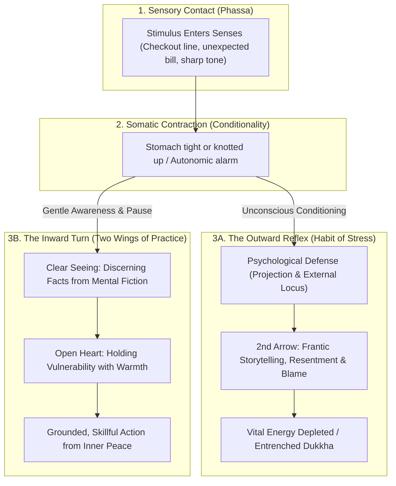
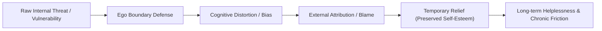
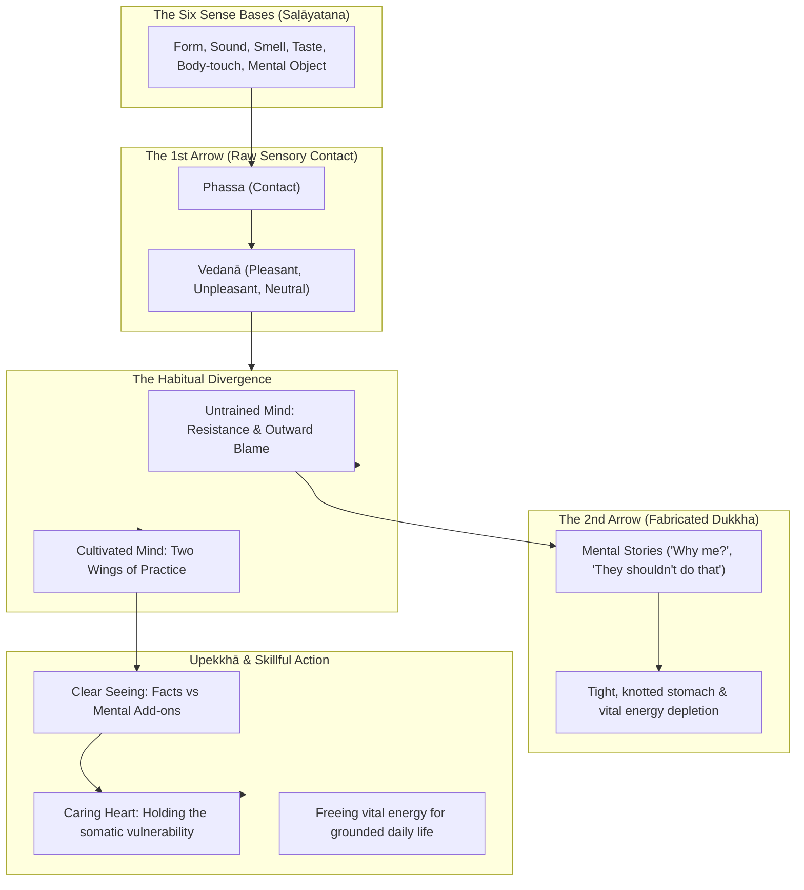
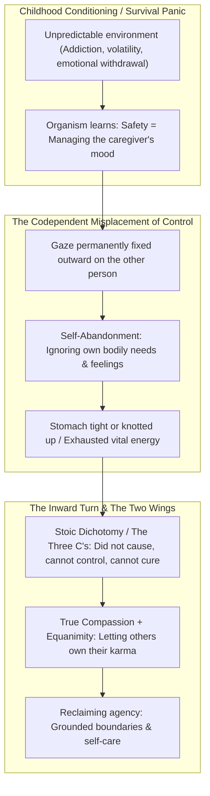
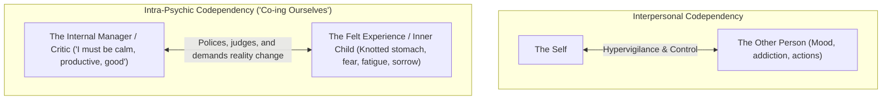
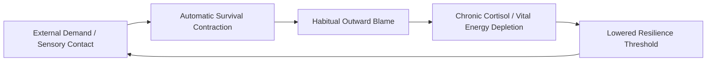
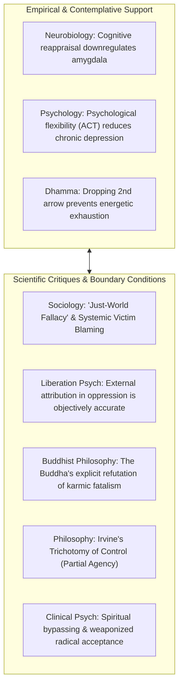
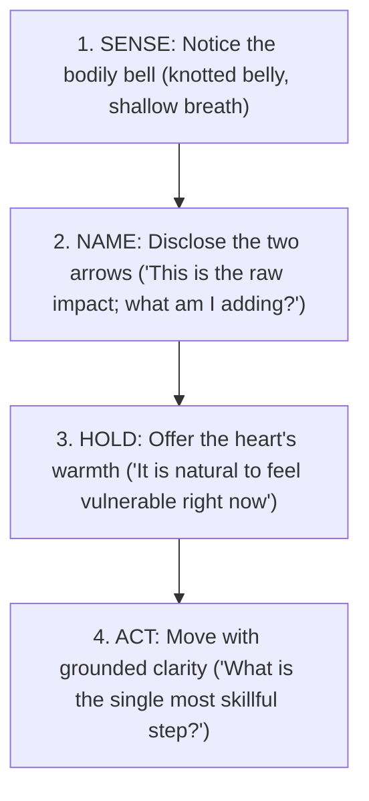

---
tags:
  - radical-acceptance
  - locus-of-control
  - projection
  - two-arrows
  - conditionality
  - idappaccayata
  - stoicism
  - epictetus
  - existentialism
  - bad-faith
  - psychology
  - shadow
  - two-wings-of-practice
  - tara-brach
  - mindfulness
  - compassion
Created: 2026-10-22
Companion Notes:
  - "[[A_Comprehensive_Architecture_of_Stress_and_Suffering]]"
  - "[[The Architecture of Trauma - Somatic Imprints, Karma, and Healing]]"
  - "[[The_Trance_of_Becoming_Social_Conditioning_and_What_We_Miss]]"
  - "[[Portals_of_Entry_Breath_Energy_and_Contemplations]]"
Status: Complete
comments: "Expanded inquiry into the outward projection of blame, psychological defense structures, Stoic and existential accountability, and the contemplative inward turn through the Two Wings of Practice."
---

# The Architecture of Inward Turning: Blame, Reality, and the Hinge of Awakening

> *"An uneducated person blames others for their failures. Those who have begun to learn blame themselves. Those who have learned blame neither others nor themselves; they simply accept reality."*  
> — **Epictetus**, *Enchiridion* (Chapter 5)

> *"When struck by an arrow, the untrained run about lamenting, striking themselves with a second arrow. When struck by an arrow, the wise simply tend to the wound."*  
> — ***Sallatha Sutta*** (SN 36.6)

> *"Your vision will become clear only when you can look into your own heart. Who looks outside, dreams; who looks inside, awakes."*  
> — **Carl G. Jung**, *Letter to Fanny Bowditch* (1916)

---

## Executive Summary & Foundational Synthesis

When friction enters our lives—whether through a sharp comment at work, a long delay at the grocery checkout counter, an unexpected utility bill, or an aching knee—the nervous system experiences an immediate biological contraction. Very often, our stomach is tight or knotted up before our conscious mind has even registered what has taken place. 

In that split second of discomfort, an instinctive movement almost universally occurs: **the gaze of consciousness reflexively darts outward**. 

We look for something or someone to hold responsible. We blame the slow clerk, the thoughtless driver, the economy, or our partner's tone. Across clinical psychology, classical philosophy, and contemplative traditions, this outward fixation is recognized not as a moral defect or personal failure, but as a deeply conditioned survival reflex. The frantic mind rushes outward to diagnose, defend, and demand that reality rearrange itself, because turning inward to meet our raw vulnerability feels intolerable to the fragile ego.

Yet, as human wisdom consistently demonstrates across millennia, attempting to resolve our suffering by policing the external world is like trying to wipe away smudge marks on our own face by scrubbing the surface of a mirror. 

The transformative hinge of human maturity and spiritual freedom arrives when we notice this outward reflex and gently invite the attention inward:
1. **Clear Seeing (Mindfulness)**: Discerning the raw, unavoidable impact of sensory contact (the First Arrow) from the frantic mental storytelling and blame we add on top (the Second Arrow).
2. **Compassionate Holding (An Open Heart)**: Meeting the somatic vulnerability beneath our blame—recognizing our knotted stomach and racing pulse as natural survival reactions born of conditionality (*[[Idappaccayatā]]*).
3. **Skillful Engagement**: Conserving the vital energy previously squandered in chronic resistance and directing it into grounded, wise, and practical action in the world.

---

---

## 1. Psychological Foundations: The Mechanics of Defense and Attribution

Modern cognitive and depth psychology provide empirical and clinical models for why human beings instinctively blame external circumstances before looking inward. Rather than viewing this pattern as malice, psychology understands it as an automated cognitive shortcut designed to preserve psychic equilibrium.

### 1.1 Locus of Control: Julian B. Rotter (1954, 1966)
In social learning theory, Julian Rotter established the dimension of **Locus of Control**—the degree to which people expect that an outcome is contingent upon their own behavior or personal characteristics versus external forces.

* **External Locus of Control**: The internalized conviction that one's circumstances, suffering, and outcomes are determined entirely by luck, chance, systemic forces, or powerful others. While structural forces do exist in everyday life, an entrenched external locus of control traps the psyche in perceived helplessness. When things go wrong, the mind looks exclusively outward for the culprit, and therefore assumes the solution must also come from the outside world changing first.
* **Internal Locus of Control**: The recognition that while we cannot dictate every circumstance entering our senses, our choices, internal orientation, and responses belong within our sphere of agency.
* **Documentation & Source**:
  * Rotter, J. B. (1966). *Generalized expectancies for internal versus external control of reinforcement*. Psychological Monographs: General and Applied, 80(1), 1–28.

### 1.2 The Fundamental Attribution Error & Self-Serving Bias
Social psychology highlights two systematic cognitive biases that govern how we distribute praise and blame:

* **The Fundamental Attribution Error (Lee Ross, 1977)**: When observing others, we disproportionately attribute their behaviors and failures to internal character flaws (e.g., *"They cut in line because they are entitled and rude"*), while ignoring situational factors.
* **The Self-Serving Attributional Bias (Miller & Ross, 1975)**: When evaluating our own lives, we invert this process. When we succeed, we credit our personal virtue or skill; when an error occurs, we reflexively point to situational constraints (e.g., *"I was late because the traffic was dreadful and the alarm malfunctioned"*).
* **Clinical Insight**: These biases operate as evolutionary shock absorbers. Admitting error immediately registers in the nervous system as a drop in social status or safety. Blaming the external environment shields self-esteem from immediate puncture, even though it arrests emotional development.
* **Documentation & Sources**:
  * Ross, L. (1977). *The intuitive psychologist and his shortcomings: Distortions in the attribution process*. Advances in Experimental Social Psychology, 10, 173–220.
  * Miller, D. T., & Ross, M. (1975). *Self-serving biases in the attribution of causality: Fact or fiction?* Psychological Bulletin, 82(2), 213–225.

### 1.3 Psychological Projection: Sigmund Freud (1894) and Anna Freud (1936)
In psychoanalytic theory, **projection** is an involuntary ego defense mechanism. When an internal impulse, vulnerability, inadequacy, or unacceptable emotion arises within the psyche, the conscious ego experiences severe anxiety. To evade this discomfort, the psyche unconsciously disowns the internal state and projects it onto external persons, objects, or systems.

* If we carry unacknowledged internal anxiety or chaos, we perceive our workplace, family members, or daily schedule as the sole creators of our agitation.
* Blaming the external target temporarily spares us from feeling the raw ache of self-doubt or inadequacy, but leaves us perpetually embattled with the world.
* **Documentation & Sources**:
  * Freud, S. (1894). *The Neuro-Psychoses of Defence*. Standard Edition, 3: 41–61.
  * Freud, A. (1936). *The Ego and the Mechanisms of Defence*. London: Hogarth Press.

### 1.4 Radical Acceptance: Marsha M. Linehan (1993)
Developed within Dialectical Behavior Therapy (DBT), **Radical Acceptance** addresses our chronic instinct to wage war against reality.

* **The DBT Suffering Equation**:
  $$\text{Suffering} = \text{Pain} \times \text{Non-Acceptance}$$
* **Pain** is the inevitable sensory contact of living in a fragile body and a changing world (delays, unexpected bills, physical pain, relationship ruptures). 
* **Suffering** is the psychic agony created when we refuse to accept that what has happened has already happened. Linehan emphasizes that acceptance is not approval, surrender, or passivity; rather, it is the refusal to expend our vital life force fighting facts. Only when we radically accept the situation as it currently presents can we formulate an effective, skillful response.
* **Documentation & Source**:
  * Linehan, M. M. (1993). *Cognitive-Behavioral Treatment of Borderline Personality Disorder*. New York: Guilford Press.

### 1.5 The Developmental Roots of Denial: Childhood, Cognitive Dissonance, and Naïve Realism

The reflex to look outward and refuse to admit fault does not begin in adulthood; its roots run straight back into childhood and adolescence. Observing why children and teenagers deny evident wrongdoing illuminates the foundational survival architecture of the ego.

* **Childhood Denial as a Survival Panic**:
  * When a young child or teenager is confronted with clear evidence of a mistake—a broken object, an unfinished task, or a crossed boundary—they will frequently deny it vehemently, even when the evidence is indisputable.
  * In developmental psychology, this is recognized not as cold malice, but as an acute nervous system panic. To a developing nervous system, **guilt** (*"I made a mistake"*) easily collapses into **toxic shame** (*"I am bad, defective, and unlovable"*). Because children depend completely on caregivers for survival, admitting wrongdoing feels like risking relational abandonment or severe condemnation. The automated falsehood (*"It wasn't me"*) is a primitive somatic shield thrown up by an overwhelmed nervous system.
* **Cognitive Dissonance and Self-Justification (Tavris & Aronson)**:
  * In *Mistakes Were Made (But Not by Me)*, social psychologists Carol Tavris and Elliot Aronson demonstrate that when our self-concept (*"I am a good, honest, competent person"*) clashes with behavioral evidence of a failure, the brain experiences excruciating cognitive dissonance.
  * Rather than revising the self-concept downward—which feels like identity death—the mind unconsciously distorts perception, generates confabulations, or attacks the accuser.
* **The Societal Escalation and the Legal Mindset**:
  * In legal frameworks, the presumption of *"innocent until proven guilty"* is an essential protection against institutional tyranny. 
  * However, when this adversarial stance is imported into daily interpersonal life, it becomes weaponized: *"Never concede, never admit fault, demand absolute proof."* Society fosters a culture where acknowledging a mistake is equated with weakness or unconditional surrender.
* **Naïve Realism and the Asymmetry of Judgment (Lee Ross)**:
  * While we claim innocence and demand contextual understanding for ourselves, we operate on **Naïve Realism** toward others: we believe we see reality objectively, and that anyone who falters is inherently flawed, malicious, or ignorant.
  * Thus, we routinely give ourselves the benefit of the doubt while sentencing others without trial based on immediate surface impressions.
* **Documentation & Sources**:
  * Tavris, C., & Aronson, E. (2007). *Mistakes Were Made (But Not by Me): Why We Justify Foolish Beliefs, Bad Decisions, and Hurtful Acts*. New York: Harcourt.
  * Ross, L., & Ward, A. (1996). *Naive realism in everyday life: Implications for social conflict and misunderstanding*. In T. Brown, E. S. Reed, & E. Turiel (Eds.), *Values and Knowledge* (pp. 103–135). Psychology Press.

---

## 2. Philosophical Rigor: From Reaction to Ethical Agency

Philosophical traditions across centuries have scrutinized the tendency to demand that the universe adapt to our personal preferences, diagnosing it as the core obstacle to human tranquility and moral autonomy.

### 2.1 Classical Stoicism and the Dichotomy of Control

In the Hellenistic tradition, **Epictetus** established the cornerstone of Stoic practice around the clear division between what is up to us (*ta eph' hemin*) and what is not up to us (*ta ouk eph' hemin*).

* **The Three Levels of Moral Education (*Enchiridion*, Chapter 5)**:
  > *"An uneducated person blames others for their failures. Those who have begun to learn blame themselves. Those who have learned blame neither others nor themselves; they simply accept reality."*
* **The Epictetian Diagnosis**:
  * **Level 1 (The Untrained Mind)**: Looks outward. Blames weather, rulers, neighbors, luck, and circumstances for its unhappiness. This state is marked by anger, helplessness, and agitation.
  * **Level 2 (The Awakening Student)**: Turns inward, but falls into the trap of self-blame, guilt, and moral recrimination. The mind recognizes that its own judgments cause its distress, but weaponizes that realization against itself.
  * **Level 3 (The Wise Practitioner / Sage)**: Transcends the game of blame altogether. Neither other people nor oneself are condemned. There is simply the clear seeing of conditionality, followed by immediate alignment with what is present and necessary.
* **The Source of Distress**:
  > *"What upsets people is not things themselves, but their judgments about the things."* (*Enchiridion*, Chapter 5)
  The event entering our senses is morally neutral (*adiaphora*). The suffering arises entirely within our interpretive faculty (*prohairesis*).
* **Documentation & Sources**:
  * Epictetus. *Discourses*, Book I, Chapter 1 ("On what is in our power and what is not").
  * Epictetus. *Enchiridion* (Handbook), Chapters 1, 5, and 10.
  * Marcus Aurelius. *Meditations*, Book IV, 3; Book VIII, 47.

### 2.2 Unfavorable Conditions, Scarcity, and Meeting Past Karma in the Moment

When conditions turn against us—when income shrinks, expenses surge, or health declines—an ancient evolutionary alarm sounds within the body. We are hardwired to survive and thrive; therefore, any perceived lack triggers acute existential dread. 

In these moments, the habit of finger-pointing flares with intense force: we blame the economic system, employers, inflation, family members, or our own perceived inadequacy. Yet contemplative inquiry and Stoic philosophy reveal that present reality is always a vast, interconnected tapestry of causes and conditions.

#### The Reality of Causes and Conditions (*Idappaccayatā*)
In the *Sivaka Sutta* (SN 36.21), the Buddha cautioned against reducing human experience to a single simplistic source. Difficult conditions arise from a confluence of factors: biological processes, environmental and climatic shifts, systemic realities, and the ripening of past intentional actions (*vipāka*). 

* **The Nature of Past Karma**: Past choices, historical circumstances, and social structures have already unfolded. They arrive at our senses as given facts. 
* **Meeting Past Karma in the Present**: We cannot alter the karma that has already ripened into this moment. We cannot rewrite the history that led to our bank balance or bodily condition today. **All we can do with past karma is to meet it in the present moment.**
* If we meet unfavorable conditions with frantic resentment and external blame, we forge painful new karma (*akusala kamma*) and fire the Second Arrow into our own chest.
* If we meet unfavorable conditions with clear seeing and compassion, we hold the biological contraction without panicking, conserving our vital energy to respond effectively.

#### Taxonomy of Control: What Is Not in Our Control vs. What Is in Our Control

The intersection of Stoic discipline (*Epictetus*) and Buddhist volition (*cetanā*) gives us an exact, operational roadmap for navigating unfavorable conditions and scarcity:

| Domain | What Is NOT in Our Control (*Ta Ouk Eph' Hemin* / Ripened Karma / 1st Arrow) | What IS in Our Control (*Ta Eph' Hemin* / Present Volition / Wise Response) | The Trap of Misplaced Effort | The Grounded Skillful Shift |
| :--- | :--- | :--- | :--- | :--- |
| **Material & Economic Reality** | Macro-economic trends, market fluctuations, inflation rates, the cost of living, unexpected emergency bills. | How we budget, our honest assessment of needs vs. desires, our practical effort to earn and adapt, seeking community assistance. | Consuming vital energy in bitter rage against the economy; paralyzed panic; financial avoidance. | Clear seeing of the financial ledger; taking practical, humble, and steady action from calm presence. |
| **Physical Body & Health** | Genetic baseline, past injuries, aging, physical illness entering through the senses, autonomic contractions. | How we nourish, rest, and care for the body; the medical advice we seek; our mental attitude toward pain. | Blaming the body for being weak; fighting physical sensations; treating illness as a personal insult. | Honoring bodily vulnerability; gently soothing the knotted belly; following grounded medical care. |
| **Other People & Society** | Other people's opinions, moods, honesty, biases, political systems, whether others admit fault or apologize. | Our own speech, boundary setting, patience, refusal to retaliate, choosing where to invest our attention. | Waging endless campaigns to reform others; stewing in resentment over someone's dishonesty. | Relinquishing the demand that others validate us; acting with unwavering personal integrity. |
| **Past Karma & History** | Past mistakes, historical childhood upbringing, decisions made years ago, previous financial deficits. | Present intentional action (*nava-kamma*); current framing; learning the lessons offered by past errors. | Reliving the past in loops of shame, regret, and "if only" catastrophizing; self-recrimination. | Radically accepting past history as unalterable fact; meeting present reality with an open heart. |
| **Mental Formations & Thoughts** | Initial reactive thoughts that flash into awareness; spontaneous survival feelings; emotional waves. | Whether we believe, fuel, and identify with reactive thoughts; our commitment to mindful inquiry and kindness. | Believing every panic thought; trying to forcefully suppress feelings; calling oneself a failure for feeling fear. | Recognizing thoughts as transient mental events; letting waves rise and fall without grabbing on. |

* **Documentation & Sources**:
  * *Sivaka Sutta*, Saṁyutta Nikāya (SN 36.21) [The eight causes of felt experience beyond mere fatalism].
  * *Nibbedhika Sutta*, Aṅguttara Nikāya (AN 6.63) [Volition (*cetanā*) as the engine of karma].
  * Epictetus, *Enchiridion*, Chapter 1 ("Things in our control are opinion, pursuit, desire, aversion, and, in a word, whatever are our own actions...").

### 2.2 Existentialism and "Bad Faith" (*Mauvaise Foi*): Jean-Paul Sartre (1943)

In existentialist philosophy, assigning blame to external forces is examined through the concept of **Bad Faith** (*mauvaise foi*).

* **The Fleeing of Radical Freedom**: Sartre posits that human beings are "condemned to be free." In every moment, we possess the terrifying burden of choosing our orientation, attitude, and actions. 
* **The Alibi of Circumstance**: Looking inward and realizing that our lives are defined by our own choices induces existential vertigo (*angoisse*). To flee this anxiety, we pretend to be helpless objects dictated by circumstances, social background, personality traits, or other people's actions. 
* When we declare, *"I had no choice but to lose my temper because of how they spoke to me,"* we adopt the stance of bad faith. We collapse our transcendent consciousness into a passive thing, blaming the mirror rather than acknowledging our sovereign freedom to choose our response.
* **Documentation & Source**:
  * Sartre, J.-P. (1943). *L'Être et le néant: Essai d'ontologie phénoménologique* (*Being and Nothingness*). Part 1, Chapter 2: "Bad Faith." Paris: Gallimard.

### 2.3 The Space Between Stimulus and Response: Viktor Frankl (1946)

Drawing from his survival in concentration camps, neurologist and psychiatrist Viktor Frankl articulated the ultimate human freedom:

> *"Between stimulus and response there is a space. In that space is our power to choose our response. In our response lies our growth and our freedom."*

When we reflexively blame what is outside, we collapse that space into zero, reacting like an automated machine. The spiritual and psychological task is to widen the space, allowing awareness to hold the stimulus before action is taken.

* **Documentation & Source**:
  * Frankl, V. E. (1946). *Trotzdem Ja zum Leben sagen: Ein Psychologe erlebt das Konzentrationslager* (*Man's Search for Meaning*). Boston: Beacon Press.

---

## 3. Contemplative & Dhamma Framework: Healing the Split

In Dhamma practice, the tendency to blame outward is illuminated not as an intellectual error, but as the friction of **grasping (*taṇhā*)** and **resistance (*dosa*)** meeting the natural flow of reality.

### 3.1 The Two Arrows: *Sallatha Sutta* (SN 36.6)
In the *Sallatha Sutta* ("The Dart" or "The Arrow"), the Buddha describes the essential distinction between how an untrained worldling (*assutavā puthujjana*) and an instructed noble disciple (*sutavā ariyasāvaka*) experience difficulty:

1. **The First Arrow (Raw Sensory Reality)**:
   * When an unpleasant sensation enters through the senses—a sudden ache in the body, a cold wind, an insulting word, a broken appliance—we experience physical or sensory unpleasantness (*kāyikā vedanā*).
   * This is simply the price of having a nervous system. The first arrow is unavoidable; it belongs to the natural fabric of organic existence.
2. **The Second Arrow (The Mental Reaction)**:
   * The untrained mind immediately reacts with resistance, anger, and proliferation (*papañca*). We ask, *"Why does this always happen to me? Who is to blame for this? How dare they treat me this way?"*
   * By adding sorrow, resentment, and external blame onto the original event, we shoot ourselves with a second arrow—this time an arrow of mental suffering (*cetasikā vedanā*).
3. **The Dhamma Insight**:
   * The second arrow is entirely self-fabricated. When we search frantically for someone to blame out in the world, we are intensifying the wound of the second arrow while believing we are defending ourselves.
* **Canonical Reference**:
  * *Sallatha Sutta*, Saṁyutta Nikāya (SN 36.6), Vedanāsaṁyutta.

### 3.2 Conditionality (*Idappaccayatā*) and Biological Reality
When we feel our stomach tighten or knot up in the face of conflict, there is no need to gaslight ourselves or add a layer of self-blame. Through the lens of **conditionality (*[[Idappaccayatā]]*)**, we can recognize that this contraction is simply a lawful, biological survival response:

> *"When this exists, that comes to be; with the arising of this, that arises. When this does not exist, that does not come to be; with the cessation of this, that ceases."* (Majjhima Nikāya 79)

The body’s nervous system is hardwired to register threat. In nature, when a deer senses danger, it sprints to safety. Once the predator is gone, the deer shakes off the residual adrenaline, breathes deeply, and returns peacefully to grazing. The animal does not hold a grudge against the meadow or obsess over the predator.

Human beings, however, possess a complex conceptual mind:
> *"We think about the tiger when there is no tiger."*

Long after the stressful event has passed—hours after leaving the checkout counter or reading the bill—we re-trigger our own biological distress by continuously playing the movie of blame in our heads. We keep the tiger alive in our thoughts, draining our vital stamina.

### 3.3 The Mirror of Consciousness and the Shadow: Eastern Metaphysics and Carl Jung

* **Advaita Vedanta and Māyā**: In classical Vedic and non-dual philosophy, the world of appearances is characterized by *Māyā* (the projective display of conditioned reality). When the ego perceives disharmony, it projects the source of its alienation onto external objects, failing to recognize that the perceiver and perceived are inextricably linked.
* **Carl G. Jung on the External Mirror**:
  > *"Who looks outside, dreams; who looks inside, awakes."* (Letter to Fanny Bowditch, 1916)
  Jung observed that whatever is held in the personal Shadow—unaccepted parts of ourselves, unexpressed grief, disowned fear—is inevitably projected onto the external world. When we react with disproportionate outrage at another person's behavior, they are serving as a mirror reflecting an unintegrated corner of our own psyche.
* **Byron Katie’s "The Work"**:
  In modern contemplative inquiry, Byron Katie systematizes this insight by inviting us to notice our stressful thoughts about other people and "turn them around" to ourselves. The inquiry reveals that when we demand that another person or external event should be different than it is, we are actively arguing with reality—a debate that we lose 100% of the time.
* **Documentation & Sources**:
  * Jung, C. G. (1953). *Two Essays on Analytical Psychology*. Collected Works, Vol. 7.
  * Jung, C. G. (1959). *Aion: Researches into the Phenomenology of the Self*. Collected Works, Vol. 9ii.
  * Katie, B. (2002). *Loving What Is: Four Questions That Can Change Your Life*. New York: Harmony Books.

### 3.4 The Two Wings of Practice: Tara Brach
Spiritual maturity requires more than cold cognitive analysis. As teacher Tara Brach articulates, spiritual awakening requires **The Two Wings of Practice**, which must both be fully developed for the bird of freedom to take flight:

1. **The Wing of Mindfulness (Clear Seeing / Head)**:
   * The capacity to perceive things exactly as they are without distortion.
   * We notice: *"The checkout line is long. The sensation in my stomach is tight. That is the first arrow. The thought 'this shouldn't be happening' is a story."* Mindfulness cuts through the fiction and anchors in direct experience.
2. **The Wing of Compassion (An Open Heart / Heart)**:
   * Clear seeing by itself can become dry or critical. Compassion meets our vulnerability with unconditional warmth, gentleness, and care.
   * Instead of criticizing ourselves for being reactive, we gently place a hand on our knotted stomach and whisper inward: *"This is a moment of vulnerability. It's okay to feel this difficulty."*
3. **Caring Action**:
   * Resting in both wings does not mean becoming passive doormats. On the contrary: when our heart is open and our mind is clear, compassion naturally moves into **caring, skillful action**. We speak up, we resolve the bill, we assist where needed—not from frantic anger, but from grounded wisdom.
* **Documentation & Sources**:
  * Brach, T. (2003). *Radical Acceptance: Embracing Your Life with the Heart of a Buddha*. New York: Bantam.
  * Brach, T. (2019). *Radical Compassion: Finding Freedom from Fear and Self-Blame with the Practice of RAIN*. New York: Viking.

### 3.5 The Inverted Locus: Codependency, Hyper-Responsibility, and the "Near Enemy" of Compassion

At its core, **codependency represents an inverted locus of control coupled with an illusion of omnipotence**:
1. **The Inverted Locus**: *"My internal emotional baseline, peace, and safety depend entirely on how you feel, behave, and perceive me."*
2. **The Illusion of Omnipotence**: *"If I just manage, fix, soothe, walk on eggshells, or sacrifice myself enough, I can control your choices and save you from your consequences."*

* **The Survival Root of Hypervigilance**:
  * Codependency rarely begins as intentional manipulation; it almost universally originates as an intelligent, life-saving biological adaptation in early life. In a volatile, neglectful, or addicted household, a child's biological safety depends upon tracking the caregiver's emotional weather.
  * Long before conscious thought, the nervous system learns: *If the adult explodes or collapses, my sustenance and safety are threatened.* The child's stomach knots up, training the organism to keep its gaze permanently fixed outward.
* **The Stoic Dichotomy in Recovery (Al-Anon & The Serenity Prayer)**:
  * The intersection of Stoic philosophy (*Epictetus*) and 12-Step recovery is captured in the **Serenity Prayer** (Reinhold Niebuhr) and Al-Anon's **Three C's**:
    1. I did not **Cause** it.
    2. I cannot **Control** it.
    3. I cannot **Cure** it.
  * Discerning what is not up to us (the other person's addiction, moods, and choices) allows the practitioner to stop firing the Second Arrow of self-reproach.
* **True Compassion vs. Its "Near Enemy" (*Upakkilesa*)**:
  * In Buddhist psychology, every virtue has a "near enemy"—a counterfeit state that appears wholesome on the surface but stems from fear or attachment. The near enemy of compassion (*karuṇā*) is **codependent enmeshment and rescuing**.
  * True compassion is grounded in **Equanimity (*upekkhā*)** and the contemplation of karma (*AN 5.57*): *"All beings are the owners of their karma, heirs to their karma."* Shielding others from the natural consequences of their actions often deprives them of the very friction needed to awaken.

### 3.6 Intra-Psychic Codependency: How We "Co" Ourselves and the Shift to Internal Co-Regulation

The codependent dynamic is not only interpersonal; it can be enacted entirely within our own psyche:

* **The Internal Split (*[[Sakkāya-diṭṭhi]]*)**:
  * The mind splits itself into a **"Controller"** (the inner critic, spiritual perfectionist, taskmaster) and the **"Controlled"** (the tired body, knotted stomach, wandering mind, fear).
  * We "co" ourselves by walking on eggshells around our own emotions, hypervigilantly scanning our inner weather (*"Am I feeling anxious? Why isn't this gone?"*), and demanding that reality change immediately.
  * This is the Second Arrow fired inward: one part of the mind attacking and policing another part.
* **From Internal Policing to Internal Co-Regulation**:
  * In early childhood development, an infant learns nervous system soothing through co-regulation with a calm, attuned caregiver.
  * When difficult feelings or somatic contractions enter our senses, we do not need to manage or eradicate them. Through the Two Wings of Practice, the adult observing consciousness acts as the attuned caregiver:
    * **Mindfulness (Head)**: Clear seeing that witnesses the sensations without merging into panic.
    * **Compassion (Heart)**: Placing a warm hand on the knotted belly, offering gentle presence: *"I am here. It is safe to feel this vulnerability."*
  * Meeting ourselves with tenderness rather than micro-management stops the internal civil war and frees up our vital energy.

---

## 4. The Habit of Stress and the Reclamation of Vital Energy

Stress very easily becomes a chronic habit of the mind. When we spend our days in continuous outward judgment—reacting to bad drivers, difficult colleagues, technological glitches, and news cycles—our vital energy is steadily leaked away. We find ourselves exhausted, depleted, and fragile.

When we engage in the inward turn:
* **Immediate Real-Time Relief**: We stop stabbing ourselves with the second arrow. The tight knot in our belly is acknowledged, and the nervous system can begin its natural down-regulation.
* **Long-Term Neuroplastic Rewiring**: By repeatedly interrupting the habit of blame and replacing it with mindful presence, we rewire the chronic habit of stress into an underlying baseline of peace.
* **Skillful Energy in Daily Life**: We reclaim the immense amount of energy that was once consumed by futile resentment. That energy is now fully available to deal with life's practical demands in a calm, effective, and grounded manner—whether navigating a complex financial decision, repairing a damaged relationship, or walking patiently through a challenging day.

---

## 5. Critical Dialectics: Empirical Support, Scientific Critiques, and Boundary Conditions

To maintain intellectual integrity and contemplative rigor, we must investigate both sides of this framework: **What empirical evidence validates turning inward and distinguishing control?** And conversely, **What scientific, sociological, and philosophical findings refute, challenge, or expose the dangers of misapplying these ideas?**

### 5.1 Evidence That Supports Turning Inward & The Dichotomy of Control

1. **Neurobiology of Cognitive Reappraisal**:
   * Functional MRI (fMRI) studies consistently demonstrate that when individuals engage in cognitive reappraisal (reframing judgments rather than reacting to external triggers), prefrontal cortex activity increases, directly dampening amygdala and insula reactivity (Ochsner & Gross, 2005). 
   * Conversely, chronic external projection and perseverative rumination keep autonomic stress circuits permanently activated, flooding the organism with cortisol and inflammatory markers.
2. **Psychological Flexibility and Acceptance (ACT & DBT)**:
   * Meta-analyses of Acceptance and Commitment Therapy (ACT; Hayes et al., 2006) and Dialectical Behavior Therapy (DBT; Linehan, 1993) confirm that experiential avoidance and non-acceptance of unalterable facts correlate strongly with chronic anxiety, treatment-resistant depression, and substance misuse.
   * Interventions that train patients to accept unavoidable sensory/emotional pain (First Arrow) while redirecting behavioral energy toward values-based action (Internal Agency) show durable clinical efficacy across clinical trials.
3. **Internal Locus of Control and Cardiovascular Resilience**:
   * Long-term epidemiological research indicates that individuals with a realistic internal locus of control experience higher rates of proactive health behaviors, lower cardiovascular mortality, and faster recovery from setbacks (Gale et al., 2008).

---

### 5.2 Facts, Critiques, and Dangers That Refute or Qualify an Oversimplified Inward Model

When the inward turn or the dichotomy of control is applied dogmatically or stripped of context, serious psychological, sociological, and spiritual distortions emerge:

#### 1. Systemic Oppression and the "Just-World Fallacy" (Melvin Lerner, 1980)
* **The Counter-Evidence**: The "Just-World Hypothesis" documents that humans have a cognitive bias to believe that people get what they deserve and deserve what they get.
* **The Danger**: When a society or teacher dogmatically insists that *"everything is determined by your mindset / your choices / your karma,"* this becomes a potent tool for **systemic victim blaming**. 
* An impoverished worker facing predatory lending, or an individual navigating redlining, institutional discrimination, or wage theft, is told that their suffering is merely their own "external locus of control" or "lack of grit." This absolves corrupt institutions of accountability and gaslights marginalized individuals.

#### 2. Realistic External Attribution in Oppressive Environments (Liberation Psychology)
* **The Counter-Evidence**: Pioneered by Ignacio Martín-Baró (1994), Liberation Psychology demonstrates that for individuals living under oppressive, abusive, or violent conditions, recognizing that external forces dominate one’s outcomes is **objectively accurate**, not a psychological pathology.
* Research shows that forcing an "internal locus of control" onto individuals in genuinely unchangeable or abusive environments causes severe **internalized self-blame, complex PTSD, and depression** (*"If it is all up to me, then my poverty or abuse is proof that I am fundamentally broken"*). In such contexts, identifying external systemic culpability protects self-worth.

#### 3. Buddhist Refutation of Karmic Fatalism: *Pubbekatahetuvāda* (AN 3.61 & SN 36.21)
* **The Canonical Fact**: Popular misconceptions often treat karma as deterministic fate: *"If you are suffering or poor, it must be because of your past karma."*
* **The Buddha Explicitly Refuted This**: In the *Tittha Sutta* (AN 3.61), the Buddha classified the belief that *"whatever a person experiences is due to past deeds"* (*pubbekatahetuvāda*) as a **pernicious sectarian heresy**. He pointed out that if everything were determined by past karma, there would be no ground for moral initiative, free choice, or social justice. Furthermore, in the *Sivaka Sutta* (SN 36.21), he explained that physical and situational suffering arises from weather, bodily bile, climate, and accidents—not exclusively from past intentional karma.

#### 4. The Limitation of a Strict Binary: Irvine's "Trichotomy of Control"
* **The Critique**: Epictetus's rigid binary—things are either 100% in our control or 100% outside our control—does not accurately reflect human reality.
* **The Refinement**: Modern philosopher William B. Irvine (*A Guide to the Good Life*, 2008) proposes a **Trichotomy of Control**:
  1. Things over which we have *complete* control (our current intentions, choices).
  2. Things over which we have *no* control (the past, planetary weather).
  3. Things over which we have **partial control** (job interviews, relationships, financial stability, health outcomes).
* Treating the third category as purely "outside our control" can induce passivity, quietism, and learned helplessness, while treating it as "completely in our control" creates frantic anxiety and burnout.

#### 5. "Spiritual Bypassing" and Misapplied Radical Acceptance (John Welwood, 1984)
* **The Clinical Danger**: Coined by psychotherapist John Welwood, **spiritual bypassing** is the tendency to use spiritual concepts (like "non-judgment," "radical acceptance," or "it's all a mirror") to prematurely bypass unresolved emotional trauma, anger, and boundary-setting.
* If a person is experiencing domestic abuse or corporate exploitation, telling them to "look inward for the solution and accept things as they are" can endanger their physical life. Acceptance of present facts must never be weaponized to suppress necessary external boundaries and protective action.

---

### 5.3 Dialectical Synthesis: The Balanced Middle Way

| Dimension | Dogmatic Misapplication (The Distorted Shadow) | The Mature Integrated Practice (The Middle Way) |
| :--- | :--- | :--- |
| **Locus of Control** | *"Everything is your fault or in your head; systemic oppression does not exist."* (Neoliberal gaslighting). | **Dialectical Agency**: Discerning systemic realities while anchoring our personal volition in whatever dignity and choice remain available. |
| **Radical Acceptance** | Passive resignation; staying in abusive situations; apathy toward injustice. | **Clear Seeing as a Baseline for Action**: Accepting that what *is* has already happened, so we can act with calm, fierce effectiveness to change what *will be*. |
| **Past Karma** | Fatalistic blame: *"You are suffering because of sins in a past life."* (Heretical quietism). | **Meeting Conditions with Wisdom**: Past causes have shaped this moment; our sole agency is our ethical response (*cetanā*) right now. |
| **Stoic Control** | Emotional numbing; binary thinking; detachment that ignores social care. | **The Two Wings of Practice**: Clear discernment of limits (Head) unified with tender compassion and engaged social duty (Heart). |

---

## 6. Comparative Framework: The Stages of Human Consciousness

The transition from outward projection to inward freedom represents the central trajectory of personal growth, psychological maturity, and spiritual awakening.

| Dimension | Stage 1: The Outward Reflex (Unconscious) | Stage 2: The Inward Turn (Awakening Student) | Stage 3: Integrated Presence (Mature Wisdom) |
| :--- | :--- | :--- | :--- |
| **Primary Direction of Gaze** | Completely outward into the world, other people, and external systems. | Turning inward toward thoughts, beliefs, and internal reactions. | Simultaneous inward anchoring and outward spacious engagement. |
| **Response to Friction** | Blame, complaint, resentment, and demand that reality rearrange itself. | Self-examination; risks stumbling into self-blame, shame, or over-analysis. | Radical acceptance of reality as it is; non-judgmental equanimity (*upekkhā*). |
| **Somatic State** | Stomach tight or knotted up; chronic tension; breath shallow and high in chest. | Noticing somatic contractions; learning to stay with discomfort without running. | Body relaxed and soft; somatic tension recognized, held with care, and released. |
| **Attributional Orientation** | Extreme external locus of control; victim consciousness; self-serving bias. | Developing internal locus of control; taking conscious responsibility for response. | Transcending the dichotomy; recognizing interconnected conditionality (*idappaccayatā*). |
| **Relation to the Two Arrows** | Unaware of the distinction; drowning in the wounds of the second arrow. | Discerning first arrow from second arrow; actively disengaging from mental stories. | Tending gently to the first arrow; the second arrow completely ceases to arise. |
| **Threat Physiology** | "Thinking about the tiger when there is no tiger"; nervous system perpetually triggered. | Noticing when the frantic mind is projecting tigers; pausing to regulate the nervous system. | Living like the deer: meeting real demands in real time, then immediately returning to calm. |
| **The Two Wings of Practice** | Both wings folded; mind clouded by reactivity, heart contracted in defense. | Developing the wing of mindfulness (clear seeing); learning to unfold compassion. | Both wings fully open: head clear and discerning, heart open and warm in caring action. |
| **Everyday Manifestation** | Snapping at the slow cashier; fuming in traffic; replaying arguments for hours. | Pausing at the checkout; noticing annoyance; breathing into the belly. | Smiling with genuine warmth at the cashier; driving with patient care; handling bills with ease. |
| **Energy State** | Vital energy constantly drained through chronic grievance and tension. | Energy conserved as reactive loops are identified and interrupted. | Abundant, vibrant energy channeled directly into skillful, creative life engagement. |

---

## 7. Daily Field Guide: Navigating Friction at the Checkout Counter and Beyond

When life presents an unexpected friction point—such as an abrasive interaction or an unexpected bill—we can invite ourselves through a gentle, four-step contemplation:

1. **Notice the Somatic Contraction**:
   * Instead of following the mind's rush to find who to blame, we bring awareness down into the body.
   * We can notice: *Our stomach is tight or knotted up. Our shoulders are lifted. Our breath has become shallow.* We honor this as the body's conditioned survival reflex, holding no judgment toward it.
2. **Discern the Arrows**:
   * We silently ask: *What has entered the senses right now?* (e.g., words spoken, a number on a receipt, an aching joint).
   * We notice: *That is the First Arrow.* Then we observe what the mind is whispering: *What stories, complaints, and blame am I adding on top? That is the Second Arrow.*
3. **Offer the Compassionate Wing**:
   * There is no need to fight the mind's thoughts. We simply soften around the tight belly.
   * We remind ourselves: *We think about the tiger when there is no tiger. In this present moment, I am safe enough to breathe.* We meet our tender vulnerability with warmth.
4. **Step into Skillful Energy**:
   * With the Second Arrow laid down, our vital energy returns.
   * We ask: *From this grounded, peaceful place, what is the most caring and skillful action to take?* We speak clearly, we pay the bill, we step aside, or we take constructive action—grounded in peace rather than hostility.

---

## 8. Canonical, Academic, and Philosophical Bibliography

### Canonical Buddhist Suttas (Pāli Canon)
* ***Sallatha Sutta* (SN 36.6)**: The foundational discourse on the First Arrow of raw feeling and the Second Arrow of mental proliferation.
* ***Tittha Sutta* (AN 3.61)**: The Buddha’s explicit refutation of karmic fatalism (*Pubbekatahetuvāda*), defending moral agency and dynamic conditionality.
* ***Sivaka Sutta* (SN 36.21)**: The eight distinct causes of physical and sensory suffering beyond past karma.
* ***Majjhima Nikāya 79* (*Cūḷasakuludāyi Sutta*)**: The formal definition of *Idappaccayatā* (The Law of Conditionality).
* ***Nibbedhika Sutta* (AN 6.63)**: Intention (*cetanā*) as the operational definition of karma.
* ***Madhupiṇḍika Sutta* (MN 18)**: The anatomy of mental proliferation (*papañca*) arising from sensory contact (*phassa*) and feeling (*vedanā*).

### Psychological & Clinical Literature
* **Alloy, Lauren B., & Abramson, Lyn Y. (1979)**. Judgment of contingency in depressed and nondepressed students: Sadder but wiser? *Journal of Experimental Psychology: General*, 108(4), 441–485. [The Depressive Realism hypothesis].
* **Freud, Anna (1936)**. *The Ego and the Mechanisms of Defence*. London: Hogarth Press. [Classic treatise on projection, denial, and displacement].
* **Freud, Sigmund (1894)**. *The Neuro-Psychoses of Defence*. Standard Edition, 3: 41–61. [Early psychoanalytic formulation of projective defenses].
* **Hayes, Steven C., Luoma, J. B., Bond, F. W., Masuda, A., & Lillis, J. (2006)**. Acceptance and Commitment Therapy: Model, processes and outcomes. *Behaviour Research and Therapy*, 44(1), 1–25. [Empirical support for psychological flexibility].
* **Lerner, Melvin J. (1980)**. *The Belief in a Just World: A Fundamental Delusion*. New York: Plenum Press. [Empirical documentation of victim-blaming cognitive bias].
* **Linehan, Marsha M. (1993)**. *Cognitive-Behavioral Treatment of Borderline Personality Disorder*. New York: Guilford Press. [Introduction of Radical Acceptance and dialectical synthesis].
* **Martín-Baró, Ignacio (1994)**. *Writings for a Liberation Psychology*. Harvard University Press. [Critique of individualized psychology under conditions of social oppression].
* **Miller, Dale T., & Ross, Michael (1975)**. *Self-serving biases in the attribution of causality: Fact or fiction?* Psychological Bulletin, 82(2), 213–225. [Empirical validation of self-serving bias].
* **Ochsner, Kevin N., & Gross, James J. (2005)**. The cognitive control of emotion. *Trends in Cognitive Sciences*, 9(5), 242–249. [Neuroimaging evidence of prefrontal downregulation of amygdala during cognitive reappraisal].
* **Ross, Lee (1977)**. *The intuitive psychologist and his shortcomings: Distortions in the attribution process*. Advances in Experimental Social Psychology, 10, 173–220. [Formulation of the Fundamental Attribution Error].
* **Rotter, Julian B. (1966)**. *Generalized expectancies for internal versus external control of reinforcement*. Psychological Monographs: General and Applied, 80(1), 1–28. [Seminal foundation of Locus of Control].
* **Tavris, Carol, & Aronson, Elliot (2007)**. *Mistakes Were Made (But Not by Me): Why We Justify Foolish Beliefs, Bad Decisions, and Hurtful Acts*. New York: Harcourt. [Cognitive dissonance, confabulation, and denial].
* **Welwood, John (1984)**. Principles of inner work: Psychological and spiritual. *Journal of Transpersonal Psychology*, 16(1), 63–73. [Introduction of the concept of spiritual bypassing].

### Philosophical Texts
* **Epictetus (c. 108 CE)**. *Discourses* and *Enchiridion* (Manual). Translated by Robin Hard, Oxford World's Classics, 2014. [The Dichotomy of Control and the three levels of blame].
* **Frankl, Viktor E. (1946)**. *Man's Search for Meaning*. Boston: Beacon Press. [Existential autonomy in the space between stimulus and response].
* **Irvine, William B. (2008)**. *A Guide to the Good Life: The Ancient Art of Stoic Joy*. Oxford University Press. [Formulation of the Trichotomy of Control].
* **Marcus Aurelius (c. 180 CE)**. *Meditations*. Translated by Gregory Hays, Modern Library, 2002. [Stoic mindfulness and cognitive sovereignty].
* **Sartre, Jean-Paul (1943)**. *Being and Nothingness: An Essay on Phenomenological Ontology*. Translated by Hazel E. Barnes, Washington Square Press, 1993. [Bad faith and the avoidance of radical responsibility].

### Modern Contemplative Literature
* **Brach, Tara (2003)**. *Radical Acceptance: Embracing Your Life with the Heart of a Buddha*. New York: Bantam Books. [Integration of mindfulness and loving compassion].
* **Brach, Tara (2019)**. *Radical Compassion: Finding Freedom from Fear and Self-Blame with the Practice of RAIN*. New York: Viking. [Practical protocols for somatic holding].
* **Jung, Carl Gustav (1953)**. *Collected Works of C. G. Jung*, Vol. 7: *Two Essays on Analytical Psychology*. Princeton University Press. [The Shadow and projection].
* **Jung, Carl Gustav (1973)**. *Letters of C. G. Jung*, Vol. 1: 1906–1950. Selected and edited by Gerhard Adler. [Source for the 1916 quote on looking inside to awaken].
* **Katie, Byron (2002)**. *Loving What Is: Four Questions That Can Change Your Life*. New York: Harmony Books. [Inquiry into the outward projection of judgment].
