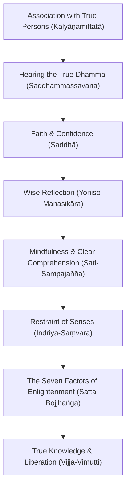

# The Seven Factors of Enlightenment 5: Sampajañña and the Nutriments of Awakening
*Winter Retreat 2013 Monastic Study & Practice Series by Ajahn Jotipalo*

---

## 1. Source & Technical Media Metadata

| Metadata Field | Technical Specification / Attribute Details |
| :--- | :--- |
| **Source Audio File** | `Ajahn Jotipalo - The Seven Factors of Enlightenment 5 - 50 - Abhayagiri Winter Retreat 2013.mp3` |
| **File Size** | 4.95 MB (5,193,678 bytes) |
| **Media Duration** | 27:03 (1623 seconds) |
| **Audio Format & Codec** | MP3 (mp3) |
| **Bitrate** | 25 kbps (CBR/VBR) |
| **Sample Rate** | 16000 Hz |
| **Channels** | 1 (Mono) |
| **Album / Series** | Abhayagiri Winter Retreat 2013 (Track 50) |
| **Artist / Speaker** | Ajahn Jotipalo |
| **Publisher / Archive** | Abhayagiri Buddhist Monastery (abhayagiri.org) |
| **Recording Date** | February 2013 |

---

## 2. Structured Contextual Metadata

### Location
Abhayagiri Buddhist Monastery, Redwood Valley, California; delivered during the silent three-month Winter Retreat in the Dhamma Hall.

### Canonical Setting (Only if Referenced)
Canonical foundation in the auxiliary formula of the Satipaṭṭhāna refrain (*ātāpī sampajāno satimā*) and the *Āhāra Sutta* (AN 10.61) on how wholesome conditions are fed through spiritual friendship (*kalyāṇamittatā*) and hearing the True Dhamma (*saddhammassavana*).

### Circumstances
Morning monastic retreat session exploring the operational partnership between mindfulness (*sati*) and clear comprehension (*sampajañña*), and detailing how the Awakening Factors are nourished on a daily basis.

### People Involved
- **Speaker**: Ajahn Jotipalo.
- **Assembly**: Abhayagiri resident monastics, anāgārikas, and retreatants.

### Theme of the Dharma Talk
The essential role of clear comprehension (*sampajañña*) in grounding mindfulness, alongside the canonical chain of nutriments (*āhāra*)—from spiritual companionship to uninterrupted day-and-night practice.

### Condensed Version of the Teachings
Mindfulness (*sati*) brings awareness to the present, but clear comprehension (*sampajañña*) provides the wisdom and situational intelligence to know what is appropriate. Ajahn Jotipalo examines the four classical divisions of *sampajañña* and links them to the nutriment formula in AN 10.61: wholesome associations (*kalyāṇamitta*) nourish hearing the Dhamma; hearing the Dhamma nourishes faith; faith nourishes wise attention; wise attention nourishes mindfulness and clear comprehension; and these nourish the Seven Factors of Enlightenment. He also addresses the contemplative art of carrying awareness continuously across day and night (*divā ca ratto ca*), transforming even sleep into an intentional, clear state.

### Expanded Version of the Teachings
- **The Triad of Practice (*Ātāpī Sampajāno Satimā*)**:
  - *Ātāpī* (Ardent / Sustained Energy): The heat of spiritual application that melts defilements.
  - *Satimā* (Mindful): Anchored presence that remembers to stay awake.
  - *Sampajāno* (Clearly Comprehending): Cognitive discernment of the fourfold context:
    1. *Sātthaka-sampajañña* (Comprehension of Purpose): Knowing whether an intended action leads to spiritual growth.
    2. *Sappāya-sampajañña* (Comprehension of Suitability): Knowing if the timing, place, and means are appropriate.
    3. *Gocara-sampajañña* (Comprehension of Domain): Keeping the mind rooted in its proper meditation pasture.
    4. *Asammoha-sampajañña* (Comprehension of Non-delusion): Seeing all activities without the delusion of an enduring self.
- **The Causal Chain of Nutriments (AN 10.61)**: Wholesome mental factors do not arise by mere wishful thinking; they depend upon a continuous diet of supporting conditions. Associating with virtuous, wise companions (*kalyāṇamittatā*) is the indispensable starting point that fuels right view and sustained meditation.
- **Continuous Awareness by Day and Night**: Ajahn Jotipalo touches upon the monastic discipline of meditating into the night and awakening with mindfulness, using the perception of light (*ālokasaññā*) to prevent dullness and lethargy.

---

## 3. The Four Dimensions of Sampajañña & The Nutriment Cascade

### The Four Aspects of Clear Comprehension (*Sampajañña*)

| Aspect of Sampajañña | Contemplative Focus | Practical Application in Daily Life & Retreat |
| :--- | :--- | :--- |
| **1. Purpose (*Sātthaka*)** | Discernment of goal | Asking: *"Is this word, action, or thought genuinely beneficial for the Dhamma path?"* |
| **2. Suitability (*Sappāya*)** | Discernment of context | Inquiring: *"Even if beneficial in theory, is this the right time, person, and place?"* |
| **3. Domain (*Gocara*)** | Discernment of anchor | Maintaining the meditation object (breath, body) while walking, eating, or working. |
| **4. Non-delusion (*Asammoha*)** | Discernment of anattā | Recognizing that walking, sitting, and knowing occur without an independent ego-agent. |

### The Upward Nutriment Cascade (AN 10.61)

---

## 4. Stories & Anecdotes Offered

1. **Sleep and Vigilance in the Forest**: Ajahn Jotipalo shares traditional forest reflections about sleep duration for monastics of different ages, discussing how cultivating mindfulness throughout the day naturally reduces the heavy sleep debt caused by mental agitation and proliferation.
2. **Bhante Gunaratana's Everyday Examples**: Reading from Bhante Gunaratana's commentary on how clear comprehension transforms simple activities—like reaching for a cup of tea or answering a question—into genuine spiritual training.

---

## 5. Notable Quotes with Exact Audio Timestamps

- **[02:10]**: *"Mindfulness without clear comprehension is like an eye that sees an object but doesn't know whether it is poison or medicine. Sampajañña gives mindfulness its wisdom."*
- **[12:51]**: *"The nutriment for hearing the good Dhamma is association with good persons. Thus, association with good persons fills up hearing the good Dhamma, which in turn nourishes wise attention."*
- **[21:15]**: *"When clear comprehension is present in our domain of meditation, whatever we do—walking to the dining hall, chopping firewood, or sitting in the hall—is practice."*
- **[26:05]**: *"If you cultivate the perception of day by night, and night by day, the mind remains bright. Mindfulness doesn't stop when you lie down."*

---

## 6. Doctrinal Concordance & Master Vault Cross-References

- **Clear Comprehension (*Sampajañña*)**: Master Pāli Dictionary entry on *Sampajañña*.
- **Nutriments of Awakening**: [[AN 10.61 - Āhāra Sutta]], [[SN 46.2 - Āhāra Sutta]].
- **Spiritual Friendship (*Kalyāṇamittatā*)**: [[SN 45.2 - Upaḍḍha Sutta (Half of the Holy Life)]].
- **Related Teacher Talks**:
  - [[Ajahn Pasanno - Sati and Sampajanna in Motion]]
  - [[Ajahn Karunadhammo - The Ecology of Awakening Factors]]

---

## 7. Complete Verbatim Instruction Transcript

**Ajahn Jotipalo:**

[00:00] I thought I'd go over one of the factors of sampajana or clear comprehension in the introductory section where the mood is introducing the different sati pitanas. There's a phrase, a tapi sampajana or satima, and that's a tapi. It's usually like a diligence, and then sampajana is this clear comprehension and satima is a mindfulness.

[00:37] So there's three qualities that need to be developed in developing all of the sati pitanas. So I'll do, again, from Janati Loca's dictionary, just the clear comprehension. I like just the very first sentence of it was, or the first definition was clarity of consciousness. One way of thinking about it, and then it said clear comprehension.

[01:09] And then I'm going to read just a one page from Bunty G's book again on four foundations of mindfulness. He starts off the chapter with a suta from the book of 47, number seven called the monkey. Bikus in the Himalaya, the king of mountains, there are rugged and uneven zones where neither monkeys nor human beings can go. There are rugged and uneven zones where monkeys can go but not human beings.

[01:44] There are even and delightful regions where both monkeys and humans can go. There, along the monkey trails, hunters set out traps of pitch for catchy monkeys. Those monkeys who are not foolish and frivolous when they see the pitch avoid it from afar, but a monkey who is foolish and frivolous approaches the pitch and seizes it with a hand. He gets caught there thinking, I will free my hand. He seizes it with the other hand.

[02:15] He gets caught there thinking I will free it, free both hands. He seizes it with his foot. He gets caught there thinking I will free both hands and my foot. He seizes it with the other foot. He gets caught there thinking I will free both the hands and feet. He applies his muzzle to it. He gets caught there. Thus Bikus, that monkey, trapped at five points, lies their screeching. He has met his calamity and disaster, and the hunter can do with him as he wishes. The hunter spears him, fastens him to that same block of wood, and goes off where he wants. So it is Bikus when one strays outside of one's own resort into the domain of others. Before Bikus do not stray outside of your own resort into the domain of others, Mara will gain access to those who stray outside of their own resort into the domain of others. Mara will get hold of them. And what is not the Bikus own resort but the domain of others?

[03:19] It is the five cords of sensual pleasure. This is what is not a Bikus own resort but the domain of others. In your own resort Bikus, in your own ancestral domain, Mara will not gain access to those who move in their own resort, but in their own ancestral domain, Mara will not get a hold of them. In what is the Bikus resort?

[03:42] What is his ancestral domain? It is the four establishments of mindfulness. What here? Bikus dwells contemplating the body and the body, hardened, clearly comprehending, mindful, having removed covetness and displeasure with regard to the world. He dwells contemplating feelings and feelings, mind and mind, phenomena and phenomena, ardent, clearly comprehending, mindful, having removed covetness and displeasure in regard to the world. This is a Bikus resort. This is his ancestral domain.

[04:19] So, Banteji opens up the chapter number three on clear comprehension with that suta. This story illustrates an essential element of the Buddha's message. Every calamity or disaster we experience begins with our own unwise actions. If we want to end our suffering, we must look carefully at the activities of our own body and mind.

[04:50] This is the laboratory where we must work very hard. With the instruction, with the instrument of mindfulness and clear comprehension, we investigate our body, feelings, perceptions, thoughts and consciousness, not as biologist, chemist or pathologist, but more profoundly as a meditator, whose aims are morally, spiritually, morality, spiritual development and deep insight. In every activity, whether we are sitting, standing, walking, lying down, talking, eating, or meditating, mind, peace and clear comprehension work together to help us see that whatever we are experiencing is temporary and thus can never bring us lasting satisfaction. Moreover, though we may think we understand perfectly what is happening, often we are confused and deluded. So, what is clear comprehension?

[05:51] Traditionally it has four aspects, purpose, suitability, domain, and non-delusion. In brief, purpose means that there is a good reason for us to engage in the activity. Sutability means that it has the activity that the activity fulfills the purpose. Domain, as we see from the story of the foolish monkey, means that the activity lies within appropriate boundaries.

[06:21] Finally, non-delusion means that while we are doing the activity, we are investigating whether we understand clearly what is going on. Then, there is a note from one of the sutas that gives a little better, not better, but just gives it a little more slightly different variation of those four domains or reasons for clear comprehension.

[06:52] Clearly the four are clear comprehension of purposefulness, which means discerning a worthy purpose in one's intended actions. Clearly comprehension of suitability means discerning a suitable means for achieving one's aim. Three, clearly comprehension of resort means, this is a different one to like, maintaining awareness of one's meditation subject when engaged in various activities than poor comprehension of non-delusion, discerning one's actions, discerning one's actions as condition process devoid of a substantial self, a substantial self, for further information, seeing in a whole lot of ways. So, I am going to go to the book of the 10s, a sutas, 61, and a lot of people are going to be able to do this. So, I'm going to go to the book of the 10s. Yes, that is commentarial. Yes. You have a bunch of Jesus. Okay, so I'm going to go to on Guteronikaya, Book of the Tens, a Suta-61, which is called Ignorance. Pekus, this is said, a first point of ignorance, Pekus, is not seen such that before this there was no ignorance, and afterwards it came into being. Still, ignorance is seen to have a specific condition. I say, Vekus, that ignorance has a nutriment. It is not without nutriment. And what is the nutriment of ignorance? It is said to be the five hindrances. The five hindrances, too, I say, have a nutriment. They are not without a nutriment. And what is the nutriment for the five hindrances? It should be said that the three kinds of misconduct, I say, to have a nutriment or not without a nutriment. And what is the nutriment with the three kinds of misconduct? Ice, it should be said, non-restraint of the sense faculties. Non-restraint of the sense faculties, too, I say, has a nutriment. It is not without nutriment. And what is the nutriment for non-restraint of the sense faculties? It should be said, lack of mindfulness and clear comprehension. Lack of mindfulness and clear comprehension, too, I say, has a nutriment. It is not without a nutriment. And what is the nutriment for lack of mindfulness and clear comprehension? It should be said, careless attention. Careless attention, too, I say, has a nutriment. It is not without a nutriment. And what is the nutriment for careless attention, it should be said, lack of faith. Lack of faith too, I say, has a neutron, it is not without a neutron. In what is the neutron for lack of faith?

[10:05] It should be said, not hearing the good-dama. Not hearing the good- remotely. It is not without a neutron and in what is articles the neutron for not hearing the the gadama, it should be said, not association with good persons. Thus not association with good persons, becoming full fills up, not hearing gadama. Becoming fills up, fills up lack of faith, becoming fills up careless attention, fills up lack of mindfulness and clear comprehension, fills up non-restraint of the sense faculty fills up three kinds of misconduct, fills up the five hindrances, the five hindrances becoming fill up, fill up ignorance. Thus there is a nutrient for ignorance, and in this way it becomes full. Just as when it is raining and the rain pours down and thick droplets on the mountaintop, the water flows down along the slopes and fills the claps, gullies and creeks, those become full, fill up the pools, those becoming full, fill up the lakes, and those becoming full, fill up the streams, these becoming full, fill up the rivers, these becoming full, fill up the great oceans. Thus there is a nutrient for the great ocean, and it is in this way it becomes full. So too, not association, good person, fills up, not, fills up, not hearing the gadama. The five hindrances become full, full up, fill up ignorance. Thus there is a nutrient for ignorance, it is in this way it becomes full. I say because that true knowledge and liberation has a nutrient, they are not without nutriment. In what is the nutriment for the true knowledge and liberation, it should be said the seven factors of enlightenment. The seven factors of enlightenment too, I say, have a nutriment, they are not without a nutriment. In what is the nutriment for the seven factors of enlightenment, it should be said the four establishments of mindfulness, then goes on the three, the nutriment for that is the three kinds of good conduct, nutriment for that is restraint of the sense faculties, the nutriment for that is mindfulness and clear comprehension, mindfulness, nutriment for that is careful attention, mindfulness of careful attention is faith. Nutriment for that is hearing the gadama, the nutriment for hearing the gadama is association with good persons. Thus association with good person fills up hearing the gadama through all of those, just as when it is raining, when it is raining and the rain drops down and thick droplets, again everything becomes filled up to the ocean. So too association with good persons becoming filled fills up hearing gadama, the seven factors of enlightenment becoming full fill up true knowledge in liberation. Thus there is a nutriment for true knowledge in liberation and in this way they become full. Question your comments?

[13:53] Yeah, with that I'll actually skip the wind, that's a good point. So from the sinew to 46 to 12 and 13, bikus this is the forerunner and precursor of the rising of the sun, it is dawn. So too bikus for a bikus, this is the forerunner and precursor for the rising of the seven factors of enlightenment, that is good friendship. When a biku has a good friend it is to be expected that he will develop and cultivate the seven factors of enlightenment and how does a biku who has good friend develop and cultivate the seven factors? He goes through them, he mentions all of them. And then the next sutta, sutta 13, also is simply the sun. Bikus, this is the forerunner and precursor of the rising of the sun, that is the dawn. So too bikus for a biku, this is the forerunner, the precursor for the rising of the seven factors of enlightenment, that is careful attention. When a biku is accomplished in careful attention, it is expected that he will develop and cultivate the seven factors of enlightenment. And there's a note to this one. Because when I first read that, it's like, you read the first one, then you read the second one, it does sort of, well, maybe what he's saying is a good friendship is the clearly knowing, clear comprehension. There's a note here, sometimes you do here, like the kalyanamita is translated as sort of like, you know, the good friend is like mindfulness or is the eightfold path. I've heard that translation, but the biku bodhi has this note here, it says, so the kalyanamita sutta biku is sometimes translated as a biku who is a friend of righteousness. He has the Woodward has a monk who is a friend of what is lovely, Ireland, a biku who is friends of the good. He writes, these renderings are all rest on a misunderstanding of the grammatical form and expression, expression. And then he says, so his says, he says his, you know, probably a proper translation of it would be as means a biku who has a good friend, who is opposed to sort of, which I think is important to me on the coaster, but it's interesting to see how having friends, friendship in the holy life can can help to foster these, these qualities.

[17:20] Okay, so I'll go back to the Angutrinikaya book book four. This is in a sub chapter called Robitasa and has the story of them traveling, trying to reach the end of the universe, but that's not the sutta borit here. This one's called concentration. Bikus, there are these four developments of concentration, what for? There is a development of concentration that leads to dwelling happily in this very life.

[17:53] There is development of concentration that leads to obtaining knowledge and vision. There is development of concentration that leads to mindfulness and clear comprehension. There is development of concentration that leads to the destruction of the taints and what bikus is the development of concentration that leads to dwelling happily in this life. Here, secluded from sensual pleasures, secluded from unwholesome states, a biku enters and abides in the first jana, which consists of rapture and pleasure born of seclusion, accompanied by thought and examination. With the subsiding of thought and examination, he enters and dwells in the second jana, which has internal plasticity in unification of mind and consists of rapture and pleasure born of concentration without thought and examination. With the fading away as well of rapture, he dwells equanimously and mindful, clearly comprehending. He experiences pleasure.

[19:00] With the body. He enters and dwells in the third jana, which the noble ones declare he is equanimous, mindful, one who dwells happily. With the abandoning of pleasure and pain and with the previous passing away of joy and dejection, he enters and dwells in the fourth jana, either painful nor pleasant, which has purification of mindfulness by equanimity. This is called the development of concentration that leads to dwelling happily in this very life.

[19:34] And what is the development of concentration that leads to obtaining knowledge and vision? Here a biku attends to the perception of light. He focuses on the perception of day thus, as by day, so by night, as by night, so by day. Thus, with this with a mind that is open and uncovered, he develops a mind imbued of luminosity. This is the development of concentration that leads to obtaining knowledge and vision. And what is the development of concentration that leads to mindfulness and clear comprehension? Here, a biku knows feelings as they arise, as they remain present, as they disappear. He knows perceptions as they arise, as they remain present, and as they disappear. He knows thoughts as they arise, as they remain present, and as they disappear. This is the development of concentration that leads to mindfulness and clear comprehension. And what is the development of concentration that leads to the destruction of the taints? Here, a biku dwells contemplating a rising and vanishing of the five aggregates, subject to clinging, such as form, such as origin, such as passing away, such as feeling, such as perceptions, such are meant are volitional activities, such as consciousness, such as its origin, such as passing away. This is the development of concentration that leads to the destruction of taints. These are the four developments of concentration, and it was with reference to this that I said in the Ariana, in the questions, having comprehended the world's highs and lows, he is not perturbed by anything in the world. Peaceful, fumeless, untroubled, wishless, he has, I said, crossed over perth in old age. There's that in the development of concentration that leads to taining knowledge and vision, as by day, as by night. I remember I was reading that earlier, I couldn't find the reference to it, but with the footnote I had seen on it earlier, it was, it's like whatever sort of meditation object you're working with during the day, it's working for you, then at nighttime, you just continue with that same, same meditation object, and then if something's working for you at night, then when you go to the daytime, you use that, which is basically applying effort, it's the same as daytime, and you do it really to them. Yeah, I'd be curious if anyone felt that they could sound the significance between numbers, what differences are between the third and the fourth, and whether there's anything they may have to say in here, but not part of the thing, was present in, in the third dimension.

[22:51] In the quality of happiness, and the quality of pleasure, and what is predominantly in the fourth dimension, and that question, I'm not quite sure that my question about the difference between mindfulness and comprehension. One of the times that there is in the least mindfulness and third competition, had a concentration at least in the destruction of the pain, so this is where I'm going to see that. Well, well, one of the mindfulness and third comprehension is here, is the following and also, for clarity, where the fourth one is a, holding an office in the intention of rejection. Because sometimes it doesn't necessarily, just because it's mindful of something, doesn't necessarily mean you're going to have to look open, so that in connection to a relationship, and very close, is important. So that's the pay attention to the writing that's happening, because there's a, there's a condition in fact, or, just in fact, a good conclusion.

[24:28] And is it second and fifth? The bottom is one of the mentions, one of the fourth, and the fourth one is the third one, is it seeing feelings, perceptions, and thoughts. So the third one is basically, it seems to be focused on security on mind, and where it's the fourth one. That's the one, because that focus is for mindfulness and critical comprehension, whereas the fourth one is the overcoming of the opposite.

[24:59] Which is, is a penetration of mindfulness. So that both, both of them are, are important to be taken in as perspectives, but ultimately, and as well as the penetration of all the things you look at. Just kind of a sudden memory, anything that, the third one of the feelings and perceptions, arising in agencies is also looking at the describes as one of the wonderful and marvelous qualities, one of the other photographers. Thank you. You just ruined many three things. I just said, comment on it, seeing a day as a night, and as you practice this by night, so the idea is to be able to overnight it. Here's the night chat box, probably I was kouti, asking questions, and if somebody, who else comes in, I can play asks, how much should you sleep in the seventh, but you know, usually if you're like, you know, 20 to 30, you're going to be six hours, or 30 to 45 hours, you're going to be able to sleep four hours, and you say, but if you, if you cultivate a perception of that's by day, so by night.

[26:36] And by night somebody doesn't matter how long you sleep. Yeah. Okay, I think it's good today. Can you get enough?

