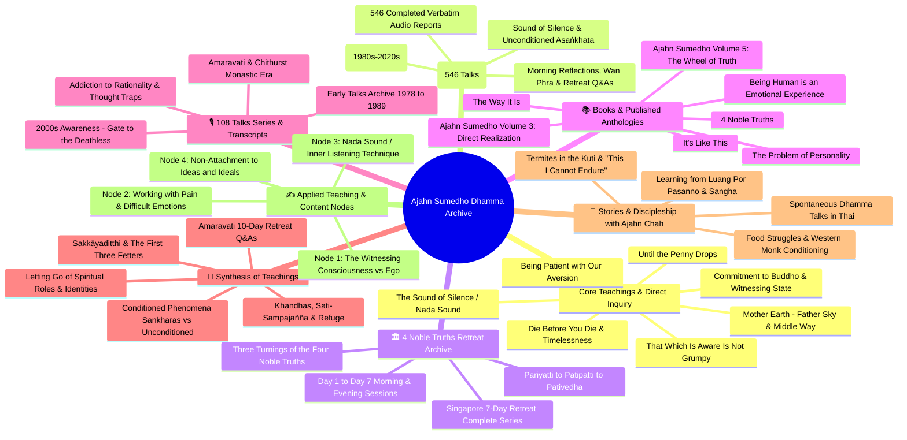

# Master Mind Map - Ajahn Sumedho Archive & Content Nodes

This master mind map organizes and indexes the complete **Ajahn Sumedho (Luang Por Sumedho)** teaching repository in your vault—spanning **822 completed audio Dhamma talk reports** (including the entire 546-track Amaravati Podcast Archives), 7-day retreat archives, published books, and 620+ thematic synthesis notes (1,500+ files in total).

---

## 🗺️ Interactive Master Mind Map

---

## 📂 Subfolder Architecture & Content Mapping

Below is the complete structural breakdown of the subfolders located within `_A_My Research\_My Teachers\Ajahn Sumedho`:

| Major Archive / Subfolder | Status | File Count | Core Purpose & Master Archival Index | Primary Thematic Focus |
| :--- | :---: | :---: | :--- | :--- |
| **[[00 - Master Index - 108 Talks by Luang Por Sumedho\|108 Talks by Luang Por Sumedho/]]** | ✅ Complete | 108 talks | Comprehensive 4-decade chronological retrospective (1978–2010). | Sakkāya-diṭṭhi, Sound of Silence, Deathless, Awareness, Nirodha. |
| **[[Ajahn Sumedho - 4 Noble Truths Retreat Singapore Index\|4 Noble Truths Retreat/]]** | ✅ Complete | 7 talks | Intensive 7-day retreat at Kong Meng San Phor Kark See Monastery (2006). | The 12 Modes (*Tiparivaṭṭaṁ Dvādasākāraṁ*), Three Turnings, Transcending Suffering. |
| **[[00 - Master Index - Talks From Thailand (2010-2014)\|Talks From Thailand (2010-2014)/]]** | ✅ Complete | 37 talks | Archival discourses at Wat Pah Nanachat, Wat Pah Pong, & Dtao Dam. | Ascetic discipline (*ot-thon, toraman*), The Knower (*Phū Rū*), Paccuppanna-dhamma. |
| **[[00 - Master Index - Spirit Rock Monastic Retreats\|Spirit Rock Monastic Retreats/]]** | ✅ Complete | 30 talks | Monastic retreats and historical California visits (1995, 1999, 2001, 2005, 2008). | The Way It Is (*Tathatā*), Sound of Silence (*Nāda*), Space & Consciousness, The Unconditioned (*Asaṅkhata*). |
| **[[00 - Master Index - Amaravati Retreats\|Amaravati Retreats/]]** | ✅ Complete | 26 talks | Landmark 10-day retreat (May 2006), annual Vassa retreats, & Winter retreats (1989–2007). | Relaxed Attention (*Paccuppanna-Dhamma*), Asaṅkhata, Sakkāya-diṭṭhi, Nāda, Biological Conditionality (*Idappaccayatā*). |
| **[[00 - Master Index - Recent Dhamma Talks (2020-2024)\|Recent Dhamma Talks (2020-2024)/]]** | ✅ Complete | 21 talks | Culminating discourses and Q&As delivered between ages 86–90 (2020–2024). | Non-Thinking (*Buddho*), I Think Therefore I Doubt, Ideals Don’t Feel, Effortless Right Effort, In This Life. |
| **[[00 - Master Index - Amaravati Archival & Sunday Talks\|Amaravati Archival & Sunday Talks/]]** | ✅ Complete | 47 talks | Historical discourses, Sunday reflections, and monastic gatherings (1988–2019). | Witnessing Position (*Buddho*), Stress & Two Arrows, Parable of the Key, Inner Listening, Gratitude (*Kataññū*). |
| **[[00 - Master Index - Amaravati Podcast Archives|Amaravati Podcast Archives/]]** | ✅ 100% Complete (546 Talks Live) | 546 tracks (546 live) | Definitive comprehensive audio podcast archive spanning 4 decades (1980s–2020s). | Asaṅkhata, Amata, Sound of Silence, Buddho, Idappaccayatā, Sīladharā, Kathina. |
| **`Books/`** | 📚 Curated | 8 volumes | Primary PDF book transcriptions and published volumes by Luang Por Sumedho. | *Direct Realization*, *The Wheel of Truth*, *The Way It Is*, *Personality*. |
| **`Synthesis of Teachings/`** | 🔬 Compendium | 627 notes | Topical research compendium across various monastic themes and retreat reflections. | Granular cross-references on technical Buddhist psychological doctrines. |

---

## 📜 Curated Index of Primary Root Notes

The root directory contains 50+ curated high-priority study notes and direct teaching summaries:

### 1. Awareness, Presence & The Witnessing State
* 📄 `[[Commitment to Buddho -The Witnessing Position -Ajahn Sumedho.md]]`
* 📄 `[[Mindfulness - 2005 - Ajahn Sumedho - Summary and Transcript.md]]`
* 📄 `[[Silence Is to Be Realized - Ajahn Sumedho.md]]`
* 📄 `[[Not Bering A Witness but Witnessing Experience.md]]`
* 📄 `[[Witnessing Who You Really Are Ajahn Sumedho 29.03.2023.md]]`
* 📄 `[[_Common Base Instructions by Ajahn Sumedho.md]]`

### 2. Emotional Agility & Disarming Defenses
* 📄 `[[That Which Is Aware Is Not Grumpy - Ajahn Sumedho - Sum and Trans.md]]`
* 📄 `[[Ajahn Sumedho - Being Patient with Our Aversion.md]]`
* 📄 `[[Ajahn Sumedho - Attachment to Thought is Insecure - Summary Only.md]]`
* 📄 `[[Ajahn Sumedho - Addiction to Rationality - 2010.md]]`
* 📄 `[[I think therefore I doubt - Ajahn Sumedho.md]]`
* 📄 `[[NOTES - Ajahn Sumedho - I_m Right - You_re Wrong (part...).md]]`

### 3. Ultimate Truth & Non-Duality
* 📄 `[[Ajahn Sumedho - Die Before You Die - 1993.md]]`
* 📄 `[[Ajahn Sumedho - Inclining to nibbana - 1984.md]]`
* 📄 `[[Ajahn-Sumedho - Awakening-from-the-dream-of-life-1989.md]]`
* 📄 `[[Ajahn Sumedho - Mother Earth - Father Sky and the Middle Way.md]]`
* 📄 `[[Ajahn Sumedho - Timelessness - Talks From Thailand - Sum and Trans.md]]`
* 📄 `[[Until the penny drops - Ajahn Sumedho.md]]`

### 4. Monastic Stories & Teacher Relations
* 📄 `[[_Ajahn Sumedho stories_.md]]`
* 📄 `[[Learning from Luang Por Sumedho - Ajahn Pasanno.md]]`
* 📄 `[[_Reflections of a Monk_ Ajahn Sumedho's Teachings.md]]`

---

## 🔑 Key Teaching Signatures of Luang Por Sumedho

1. **The Sound of Silence (*Nāda* Inner Vibration)**:
   Using the subtle, high-pitched background sound in consciousness as an object of meditation to cut through conceptual thinking and anchor in pure awareness.
2. **"That Which Knows" (*Buddho*)**:
   Stepping back into the witnessing space rather than being identified with the thoughts, emotions, or bodily sensations that arise and pass away.
3. **"That Which Is Aware Is Not Grumpy"**:
   Recognizing that awareness itself is never angry, impatient, depressed, or sick—suffering only arises when we identify with the changing emotional weather.
4. **Three Turnings of the Four Noble Truths**:
   * *Statement*: There is suffering.
   * *Prescription*: Suffering is to be understood.
   * *Realization*: Suffering has been understood and let go of.
5. **The Problem of Personality (*Sakkāyaditthi*)**:
   Seeing through the conditioned belief in a permanent self, allowing compassion and presence to function without ego defense.
