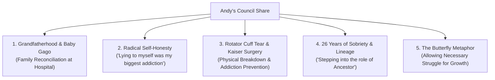

# 🕊️ Quest and Council Potluck Gathering
📅 **Date**: Saturday, November 07, 2026  
⏰ **Time**: 5:30 PM – 9:45 PM PST  
🏡 **Location**: Denise & Mark's Residence, Petaluma, California  
🎙️ **Recording Sources**: Elasound NZ007 (`18:03:04`, `20:12:39`), Plaud NotePin (Sessions 6 & 7), Linearity High-Fidelity Recorder (`20261107_001.mp3`)  
🎯 **Focus**: Annual Autumn Quest & Council Potluck, Honoring Denise's 20-Year Sobriety Milestone, Ceremonial Council Circle with Talking Stone, and Deep Communal Sharing  

---

## 📋 Executive Summary & Meeting Context

> [!NOTE] Meeting Context
> This gathering is a **Quest and Council circle** within the *Kalyāṇa-mittatā* (spiritual friendship) tradition, rooted in wilderness vision quests, council practice, and deep community kinship. It is **not** a 12-step or recovery meeting, though participants freely bring their full lives—including personal sobriety milestones and health journeys—into the sacred council space.

On Saturday evening, November 7, 2026, members of the long-standing **7 AM Marin Recovery Fellowship** gathered at the home of Denise and Mark in Petaluma for an evening of potluck fellowship, ceremonial council circle, and celebration of sobriety milestones. 

The gathering served as a reunion for practitioners who trace their roots over two and a half decades back to early morning quest and council gatherings in San Rafael, annual Spirit Walk retreats in the redwoods over New Year's, and wilderness vision fasts in the Eastern Sierra desert near Mono Lake.

The evening was highlighted by:
1. **Denise's 20th Sobriety Anniversary Celebration**: Honoring Denise's two continuous decades of sobriety with warm community tributes and a homemade pumpkin apple curry cake.
2. **Ceremonial Council Circle**: Facilitated by Andrea McGuire and opened by Mark Shalloe (Roaming Elk) using a sacred smooth river stone as the talking piece, framed by reflections on the four-day wilderness threshold, and grounded in ancient indigenous ceremonial etiquette.
3. **Sacred Readings & Invocations**: Lighting the ceremonial candle to represent Grandfather Fire, reciting the traditional **Ute Earth Prayer** (*"Earth teach me stillness as the grasses are stilled with light..."*), and sharing Marianne Williamson's reflection on embracing inner light (*"Our deepest fear is not that we are inadequate..."*).
4. **Communal Basket of Dedications**: Participants placed loved ones into the center of the circle, including newborn grandchildren, family members navigating addiction and shelters, aging siblings facing dementia and surgeries, and departed mentors who founded the circle (Pat, Tony Robischod, and Jack).
5. **Andy McGuire's Comprehensive Share**: A candid, multi-faceted reflection detailing the joy of welcoming his sixth grandchild (baby Gago, born October 23), navigating complex in-law dynamics with radical self-honesty, managing severe rotator cuff injury and upcoming surgery within Kaiser, maintaining 26 years of continuous sobriety, honoring his transition from student to elder (*"becoming an ancestor"*), and the essential recovery teaching of the butterfly cocoon.

---

## 🏛️ Agenda & Meeting Flow

| Time Window | Phase / Segment | Description & Facilitator |
| :--- | :--- | :--- |
| **5:30 PM – 6:45 PM** | **Arrival & Potluck Fellowship** | Members arrived with shared dishes (fresh garden tomato salads, roasted dishes, desserts); informal reconnection, enjoying "dog medicine" in Mark and Denise's home, and reminiscing about 7 AM Marin history. |
| **6:45 PM – 7:15 PM** | **Anniversary Tribute & Cake** | Surprising Denise in honor of her **20-year sobriety milestone**; presenting cake, sharing gratitude, and acknowledging her service as a anchor for the fellowship. |
| **7:15 PM – 7:45 PM** | **Council Circle Opening & Invocations** | Passing the sacred talking stone; Mark Shalloe (Roaming Elk) opening the circle with teachings on desert vision fasts; invoking Grandfather Fire and setting intentional container boundaries. |
| **7:45 PM – 8:12 PM** | **Readings & Dedications** | Group recitation of the Ute Earth Prayer; reading Marianne Williamson's *Our Deepest Fear*; placing intentions, sick friends, and family into the circle center. |
| **8:12 PM – 9:20 PM** | **Granular Circle Sharing** | Passing the stone from heart to heart. Participants delivered vulnerable check-ins on medical trials, grief, relational growth, and spiritual surrender, including Andy McGuire's full share. |
| **9:20 PM – 9:45 PM** | **Closing Dedication & Departure** | Grounding the energy, expressing gratitude to hosts Denise and Mark, exchanging hugs, packing leftover dishes, and heading home. |

---

## 🪶 Ceremonial Openings, Invocations & Sacred Readings

### 1. Mark Shalloe (Roaming Elk)'s Opening Reflection: The 3-Day Desert Wilderness Threshold
Mark opened the formal council circle by passing the smooth talking stone into the circle, describing council as an intentional practice of vulnerability where *"we are not allowed to hide, and we discover that when nothing is on the menu, stillness becomes natural."* 
- He recalled their annual vision quest in the desert east of Mono Lake—packing out personal water, climbing the ridge into complete solitude, and fasting for three days and three nights without food.
- He described how the mind quiets when external distraction is stripped away: *"You look around, you listen, you watch desert animals roll up and say hello... You realize you are good for two or three days with nothing. When electricity goes out or storms hit in civilization, you remember: 'I know I am good.' It resets your baseline of what you actually need."*
- He emphasized the difficult transition back down the mountain into modern society, reminding the circle that returning requires patience and that council provides the essential grounded vessel to integrate wilderness wisdom into everyday life.

### 2. Calling in Grandfather Fire
The circle called in the clear fire of the sun and grandfather fire, dedicating the center of the room as a sacred hearth of non-judgmental listening.

### 3. The Traditional Ute Earth Prayer
Recited in unison to center the circle on natural conditionality (*Idappaccayatā*) and humility:
> *"Earth teach me stillness as the grasses are stilled with light.*  
> *Earth teach me suffering as old stories suffer with memory.*  
> *Earth teach me humility as blossoms are humble at beginning.*  
> *Earth teach me caring as the mother who secures her young.*  
> *Earth teach me courage as the tree which stands all alone.*  
> *Earth teach me limitation as the ant which crawls on the ground.*  
> *Earth teach me freedom as the eagle which soars in the sky.*  
> *Earth teach me resignation as the leaves which die in the fall.*  
> *Earth teach me regeneration as the seed which rises in the spring.*  
> *Earth teach me to forget myself as melted snow forgets its life.*  
> *Earth teach me to remember kindness as dry fields weep with rain."*

### 4. Marianne Williamson's Reading (*A Return to Love*)
Shared to challenge the subconscious fear of spiritual adequacy:
> *"Our deepest fear is not that we are inadequate. Our deepest fear is that we are powerful beyond measure. It is our light, not our darkness that most frightens us. We ask ourselves, 'Who am I to be brilliant, gorgeous, talented, fabulous?' Actually, who are you not to be? You are a child of God. Your playing small does not serve the world..."*

### 5. Circle Dedications & Intentions Placed in the Center
Participants placed specific loved ones and intentions into the center of the circle:
- **Baby Gago & Kiera**: Welcoming Andy's newest grandson, born early on October 23, and blessing mother and child.
- **Family in Vulnerable Transitions**: Andy placed his daughter currently in recovery and residing in a community shelter into the circle; his two sisters in Florida (one experiencing progressive dementia, and the other serving as sole caregiver while recovering from major cervical spine surgery); and his son and in-law family who tragically lost their young nephew earlier in the week.
- **Absent Community Members & Sufferers**: Friend Frankie (sending regrets due to acute health challenges), Ken, Will Meecham, Deborah, Kevin, and Tina.
- **Founding Ancestors & Lineage Teachers**: Honoring the deceased pioneers of the 7 AM Marin fellowship who built the circle's foundations: **Pat**, **Tony Robischod**, and **Jack**.

---

## 🎂 Denise's 20-Year Sobriety Milestone

The circle took dedicated time to honor co-host **Denise** on celebrating **20 years of continuous sobriety**.
- Members recalled when Denise first joined the 7 AM San Rafael group roughly a decade after the original founding wave, quickly becoming a central pillar and welcoming presence for newcomers.
- Denise was celebrated with warm tributes, laughter, and a homemade pumpkin apple curry cake.
- Andy reflected on the intergenerational continuity of the group: *"Denise recruited so many of us... She's got 20 years now. It proves that this circle is bigger than any single person—it's a living lineage of recovery that carries forward across decades."*

---

## 🗣️ Granular Breakdown of Andy McGuire's Share

When the talking stone reached Andy, he delivered a transparent, comprehensive share bridging his personal recovery, health challenges, family growth, and contemplative practice:

### 1. Welcoming Sixth Grandchild (Baby Gago) & Relational Healing
- **The Milestone**: Andy shared the joyful news that he is now a **grandfather six times over**. His daughter Kiera gave birth to a healthy baby boy named **Gago** on **October 23, 2026, at 1:00 PM** at Queen of the Valley Hospital in Napa, arriving roughly a month ahead of schedule.
- **Overcoming Pre-Visit Anxiety**: Andy candidly admitted experiencing considerable angst prior to visiting the hospital. Past interactions with Kiera's partner Hayk had felt awkward, strained, and emotionally distant (including an incident where Hayk seemed preoccupied with his house cleaner, and another awkward instance involving alcohol gifting despite knowing Andy was long-term sober).
- **The Melting of Barriers**: Describing the moment they reached the hospital maternity wing, Andy recounted how Hayk opened the door and warmly hugged Andrea. Andy immediately stepped forward, saying, *"Hey, I want one too!"* In that single spontaneous physical embrace, two years of built-up tension, mutual wariness, and storytelling instantly dissolved: *"It just completely melted the whole thing away."*
- **Holding the Baby**: Both Andy and Andrea held baby Gago, feeling profound gratitude that mother and child were thriving despite the early arrival.

### 2. Radical Self-Honesty as the Bedrock of Recovery
- Andy linked the hospital breakthrough to the fundamental discipline of honesty in recovery.
- He noted that he has always spoken directly and factually with his daughter Kiera without hostility, refusing to sugarcoat reality:
  > *"That was one thing about recovery that was the biggest story for me. I realized how much I was lying to myself as much as I was lying to others. It was never just about misleading other people—it was about me lying to myself. So honesty is a very big deal for me. I don't want to harm anybody, but if we meet life with simple, factual honesty and make even a small genuine effort, the friction melts away."*

### 3. Rotator Cuff Injury, Kaiser Navigation & Pain Management
- **The Diagnostic Struggle**: Andy shared the frustrating journey of navigating medical bureaucracy regarding severe left arm and shoulder pain. His initial Kaiser primary care physician dismissively told him: *"If you didn't have a traumatic event, there's no way you have a rotator cuff tear."*
- **Advocacy & Orthopedic Diagnosis**: His Kaiser physical therapist believed Andy's symptoms and actively advocated on his behalf, securing an orthopedic referral to Dr. George Pichy. Dr. Pichy conducted ten seconds of manual physical testing and immediately diagnosed a rotator cuff tear.
- **MRI Confirmation & Impending Surgery**: An MRI conducted two days prior confirmed extensive tearing (*"The report is Greek, but the word 'tear' appears far too many times"*). Andy faces surgical repair followed by a grueling rehabilitation period requiring him to wear an abduction brace 24/7.
- **Addiction Vigilance & Mindful Rehab**: Reflecting on the painful road ahead, Andy recalled advice from an early recovery mentor regarding surgical operations: *"There is no straight line back from surgery."* Having maintained 26 years of clean sobriety, Andy emphasized the absolute necessity of entering surgery with an explicit, vigilant pain-management plan to prevent any risk of prescription opioid cross-addiction:
  > *"I was never an opioid abuser on the street, but when they're prescribed, you can eat them like M&Ms. It's going to be a real challenge. I have to approach this surgery with eyes wide open and a strict protocol so I don't fall into old traps."*
- **Gratitude for Addiction Therapist**: Despite his frustration with primary care, Andy decided to remain with Kaiser because his therapist in the Addiction Medicine Recovery Services (AMRS) department is an essential anchor for his continuous sobriety.
- **Aging & Physical Conditionality**: Quoting The Who's Pete Townshend (*"I hope I die before I get old... Well, I'm old, and Pete is 80 on his fifth farewell tour!"*), Andy accepted that bodily wear and tear—likely compounded by genetics and his past years as a whitewater rafting guide—is a natural biological reality (*Idappaccayatā*) to be met with patience rather than self-pity.

### 4. Retirement, Contemplative Practice & Vision Quest Base Camp
- Andy discussed his transition since retiring in April 2026. He recognized that work stress had been leaving him feeling like a *"nervous wreck"* and that he refused to carry that reactive energy into his elder years.
- He has dedicated his retirement to daily Buddhist meditation, writing his contemplative blog, and teaching *Living Mindfully*.
- He reflected on serving at **Base Camp** during the recent Mono Lake desert vision quest, emphasizing the deep fulfillment of supporting fellow practitioners out on the mountain threshold:
  > *"My upbringing was rough, and I've been in plenty of traumatic, hairy situations in my life. The gift of that is that when something goes wrong, I don't panic. Panic only freezes people in fear and multiplies the misery of everyone around them. Being able to hold steady at base camp and support the circle in a grounded way was an honor."*

### 5. 26 Years of Continuous Sobriety & Stepping into the "Ancestor" Role
- Andy acknowledged reaching **26 years of continuous sobriety**, tracing his journey from the earliest days of the 7 AM Marin recovery circle in San Rafael.
- He shared his Tribal / Earth names given in ceremony: formerly **"Wind on the Mountain"**, and currently **"Cloud Watcher"**.
- He reflected on the passage of time and stepping into elderhood: *"It's definitely about community. We've been doing this together for 26, 27 years, and the old-timers were doing it before me. It's a strange and humbling feeling to realize that we are now becoming the ancestors of this fellowship."*

### 6. The Metaphor of the Butterfly Cocoon
- Andy shared a foundational teaching from his earliest days in recovery:
  > *"They taught us about the caterpillar going through its metamorphosis inside the cocoon. As it struggles to break out, that struggle is what forces the fluid from its body into its wings so it can fly. If someone walks by with misguided pity and takes a pair of scissors to snip the cocoon open to 'save' it from suffering, the butterfly emerges with shriveled wings and immediately dies. The struggle is necessary. In recovery and in family life, we have to let people have their own struggle so their wings can develop."*

### 7. Contrasting Grandfather Archetypes
- Reflecting on his own role as a grandfather to six children, Andy contrasted the two grandfathers of his childhood:
  - One grandfather was a reclusive hermit who spent his days isolated in the garage, smoking cigarettes, drinking dandelion wine, and hanging out solely with his dog.
  - The other grandfather was an engaged mentor who took the kids out to the zoo, taught them how to fish, and answered their questions about life.
- Andy reaffirmed his deep commitment to being the loving, present, and engaged grandfather for baby Gago and his other five grandchildren.

---

## 👥 Other Participant Contributions & Communal Themes

- **Mark Shalloe (Roaming Elk)**: Spoke on the deep medicine of indigenous ceremony, non-argumentative council listening, and how time spent fasting on the land strips away the false urgency of modern culture.
- **Denise**: Expressed emotional gratitude to the group for twenty years of unwavering fellowship, recounting early fears when entering recovery and celebrating the peace of long-term sobriety.
- **Andrea McGuire (Facilitator)**:
  - Facilitated the ceremonial council circle, holding the sacred talking container, guiding transitions, and supporting participants through vulnerable shares.
  - Shared appreciation for the warm community container, the shared dog medicine, and the relief of seeing family barriers dissolve at the hospital with Kiera and Hayk.
- **Fellow Group Members (Larry, Glenn, Sarah Jane, Kristina)**: Shared reflections on grief, holding family members through severe illnesses, practicing 12-step principles in political seasons, and expressing gratitude for the safe container provided by Denise and Mark's home.

---

## 📌 Key Decisions, Action Steps & Spiritual Commitments

| Category | Action / Commitment | Owner | Timeline / Status |
| :--- | :--- | :--- | :--- |
| **Medical / Surgical** | Finalize orthopedic surgical consultation with Dr. George Pichy; review MRI findings and schedule rotator cuff repair. | Andy | Next week (Nov 9–13) |
| **Addiction Vigilance** | Establish explicit non-opioid / tightly monitored post-operative pain protocol with Kaiser AMRS therapist to avoid cross-addiction. | Andy & AMRS Therapist | Prior to surgery date |
| **Family Connection** | Maintain open, warm, and non-defensive communication with Kiera and Hayk; plan follow-up visits to support newborn baby Gago. | Andy & Andrea | Ongoing throughout November |
| **Fellowship Support** | Continue regular attendance and elder support at 7 AM Marin gatherings; support Denise in celebrating her 20th year. | Andy & Community | Active weekly |
| **Digital App Support** | Continue fine-tuning custom flood-watch tracking tools for neighborhood low-elevation points and storm resilience. | Andy | Ongoing |

---
*Report recorded via high-fidelity audio streams and synthesized according to Living Mindfully & Antigravity Master Council Standards.*
