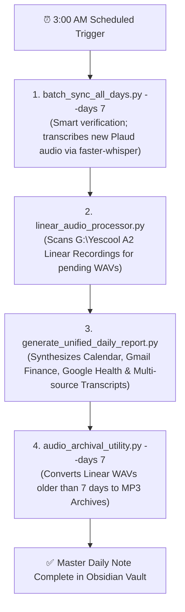

# Master Audio Pipeline & Daily Note Architecture (October 2026)

## 📌 Executive Overview
This document represents the current, authoritative technical reference for the automated personal archiving, voice transcription, and Master Daily Note synthesis workflow in Andy's **FlashRebob Obsidian Vault**.

As of **October 2026**, the system has evolved from early single-device experiments (Bee, Tasker mobile export, and legacy CPU Whisper) into a high-fidelity, multi-source, privacy-first audio intelligence system running locally on the PC with automated daily synthesis.

---

## 🎙️ Hardware Audio Recorders & Data Ingestion Matrix

| Device / Source | Role & Characteristics | Local Storage / Watch Directory | Ingestion Mechanism |
| :--- | :--- | :--- | :--- |
| **Yescool A2 Linear** *(Primary Continuous)* | Continuous high-fidelity ambient recorder capturing full days (up to 15h per session in 24kHz stereo WAV). | `G:\Yescool A2 Linear Recordings` *(with subfolder `MP3 Archives`)* | Automated scan via [`linear_audio_processor.py`](file:///G:/Documents/_Antigravity%20Sandbox/Workflow%20Automations/linear_audio_processor.py). |
| **Elasound NZ007** *(Retreats & Extended Travel)* | Voice-activated long-duration recorder (70–100 hours capacity) designed for multi-day retreats (e.g., Hidden Villa). Filenames encode second-precision start timestamps: `VYYYY-MM-DD-HH-MM-SS.WAV`. | `G:\Elasound NZ007 Recordings` | Batch ingest and date-matched transcription via `faster-whisper`. |
| **Plaud NotePin** *(Lapel & Targeted Sessions)* | Wearable lapel recorder used for meetings, walks, driving, and specific events. | `G:\Google Drive (260611)\Plaud Watch folder` | Direct unencrypted cloud sync via `@plaud-ai/cli` and [`batch_sync_all_days.py`](file:///G:/Documents/_Antigravity%20Sandbox/Workflow%20Automations/batch_sync_all_days.py). |
| **Wispr Flow** *(Personal Voice Dictation)* | Real-time speech-to-text dictation across PC applications. Functions as the **ground truth** for personal voice journals and reflections. | `scratch_audio/` & SQLite history | Extracted via [`wispr_integrator.py`](file:///G:/Documents/_Antigravity%20Sandbox/Workflow%20Automations/wispr_integrator.py) into Master Daily Notes. |
| **Bee Wearable** *(Deprecated)* | Former ambient recording pendant. | N/A | **Deprecated & disabled** as of October 13, 2026. |

---

## ⚙️ Transcription Engine: Migration to `faster-whisper`

### Legacy System (Deprecated)
* Previously utilized `C:\Users\SparkyDesktop\AppData\Local\Programs\Python\Python310\Scripts\whisper.exe` (unquantized PyTorch float32 on CPU).
* **The Problem**: 5 hours of continuous audio required ~5 hours of CPU compute, frequently locking up a CPU core at 100% and causing nightly pipelines to hang.

### Current System (`faster-whisper`)
* Powered by CTranslate2 with `int8` quantization, 8 CPU threads, and **Silero Voice Activity Detection (VAD)**.
* **Performance**: A 14-hour continuous WAV file processes in **8.5 minutes** (~100x realtime speedup).
* Long ambient silences are automatically bypassed without CPU thrashing.
* **Legacy Whisper Purge**: All active scripts (`batch_sync_all_days.py`, `linear_audio_processor.py`, `plaud_audio_processor.py`) have completely removed `whisper.exe`.

---

## 🛡️ Smart Caching & Regressive Redundancy Prevention

To prevent the pipeline from regressively re-downloading or re-transcribing past audio, [`batch_sync_all_days.py`](file:///G:/Documents/_Antigravity%20Sandbox/Workflow%20Automations/batch_sync_all_days.py) enforces a **two-tier verification gate**:

1. **Master Daily Note Completion Check**:
   * If a recording's date is in the past (`rec['date'] < today`) and that date's `Daily Note {yymmdd}.md` is already finalized in Obsidian, the script **immediately skips** both downloading and transcribing.
2. **Transcript Cache Check**:
   * If not already finalized, it checks `scratch_audio/{session}.json` and `scratch_audio/{session}.txt`, or the Obsidian `Plaud Daily Transcript {yymmdd}.md`. If present, it loads the cached transcript directly.
3. **Local Audio Existence Check**:
   * Before requesting an S3 URL from Plaud, it checks `Plaud Watch folder` for existing audio matching the timestamp, title, or ID.
4. **Result**:
   * Running a 7-day lookback over 22 recordings completes in **under 3 seconds** when days are already finalized.

---

## 🔄 Daily 3:00 AM Automated Schedule (`run_daily_3am_pipeline.bat`)

The automated pipeline executes daily via Windows Task Scheduler (`PlaudMasterDailyReport_3AM`) at **3:00 AM**:

---

## 🏛️ Master Daily Note Report Structure

The generated `Daily Note {yymmdd}.md` is written to `G:\Google Drive (260611)\Obsidian Master Vault\Flashrebob Obsidian\_A_My Journal and Notes\Daily Reports\{YYYY MM MonthName}\`:

1. **Header & Metadata**: Tags, date, attendees, processed sessions, and pipeline health log.
2. **📌 Executive & Core Topics Overview**: High-level semantic themes and tag index.
3. **📅 Google Calendar Events**: Verified end-of-day scheduled occurrences.
4. **📧 Gmail & Financial Account Balances**:
   * Bank of America (checking & savings balances).
   * Fidelity Investments (taxable, IRA settled cash, total value).
   * New York Life Annuity (fixed APY & guaranteed death benefit).
   * Combined Liquid & Annuity Portfolio total.
5. **🏃 Physical Activity & Health**: Google Health / Health Connect daily steps, distance, calories, and weight.
6. **💻 Antigravity AI Sessions & Creative Work Log**: Chronological summary of interactive AI sessions.
7. **🎙️ Wispr Voice Dictation & Input Activity**: Verbatim dictation log grouped by application and purpose.
8. **💡 Key Points, Subjects & Themes**: Chronological narrative (Morning, Afternoon, Evening).
9. **👥 Group Gatherings & Multi-Participant Key Points**: Detailed meeting and retreat records.
10. **📖 Detailed Subject Matter**: Step-by-step chronological log.
11. **🗣️ Personal Monologues & Direct Thoughts**: Authenticated solo reflections (grounded via Wispr Flow or verified solo journals).
12. **🧘 Spiritual & Societal Insights**: Dhamma framing (Head & Heart, Conditionality, Sallatha Sutta / Two Arrows, unpressured compassion).
13. **💬 Quoted Expressions & Memorable Phrasings**: Verified speaker quotes and notable names.
14. **📚 Stories & Case Examples Shared**: Narrative anecdotes and takeaways.
15. **🧠 Physical & Mental Challenges**: Clean Markdown tables detailing somatic ailments and emotional reactions.
16. **🛠️ Spoken Directives & System Improvement Ideas**: Action items, feature thoughts, and workflow ideas spoken aloud on analog ambient mics (**Linearity / Yescool A2**, **Plaud NotePin**, and **Elasound NZ007**) when away from the computer, distinguishing them from direct Wispr Flow typed/prompted actions and queuing them into `System Directives & Improvement Queue.md`.
17. **📻 Miscellaneous Media & References Encountered**: Segregated catalog of external YouTube videos, podcasts, TV shows, and books heard in ambient audio.

---

## 📋 Editorial & Dhamma Guardrails
* **Inclusive Human "We"**: Non-prescriptive, gentle observational tone (no imperative commands like "Do this" or "Stop doing that").
* **Physical Sensation Phrasing**: Use natural phrasing ("our stomach is tight or knotted up", not "clenched like a fist").
* **Sensory Framing**: Difficulties are framed as entering our senses (eye, ear, nose, tongue, body, mind) rather than landing on physical resources.
* **Media Misattribution Separation**: High-polish third-person essays or YouTube audio captured by ambient room mics must be categorized under `## 📻 Miscellaneous Media`, never attributed as Andy's personal monologue.
* **Event Verification & Calendar Transparency (Free vs. Busy)**: Routine or group events (e.g. Insight Berkeley, Tai Chi, Saturday Night Puja) marked as **Free** (transparency: `transparent`) are informational FYI placeholders where attendance is optional. They must NEVER be recorded as attended unless Andy explicitly switches the event status to **Busy** (transparency: `opaque`) on his Google Calendar AND there is corroborating audio evidence.
* **Graceful Missing-Audio Fallback**: If a day has no audio recordings due to technical issues, dead batteries, offload delays, or retreats, the pipeline proceeds to generate the Daily Note using Google Calendar, Gmail Financial balances, Google Health, and Wispr Flow records, prepending a high-visibility warning callout flagging that no audio streams were detected.
* **Forecast vs. Actual Reality**: Morning briefing emails ("Your Day Ahead") reflect early automated forecasts. When actual experienced conditions differ (e.g. unexpected rain, schedule shifts), the Daily Note must prioritize observed reality over early forecasts.
